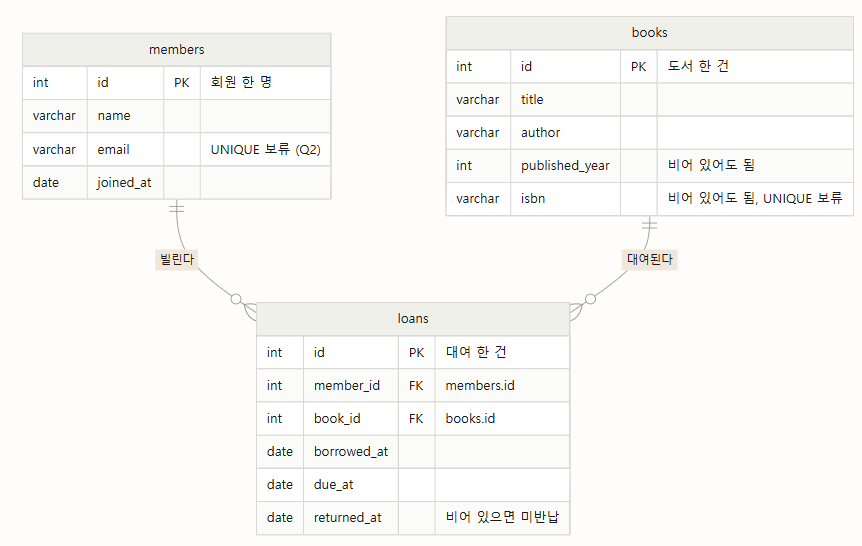
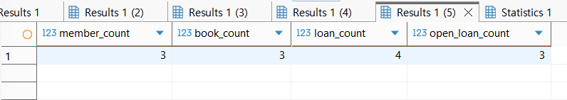
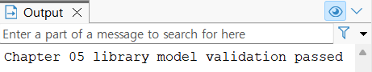
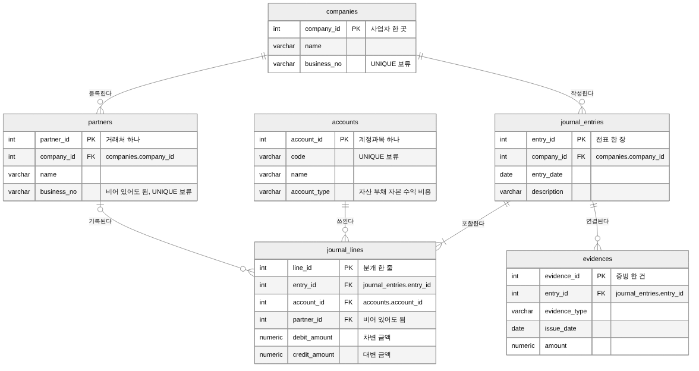

# Chapter 05 확장 실습 답안

> **과제:** 요구사항에서 데이터 모델과 ERD 만들기  
> **사용 방법:** 이 파일을 내려받아 본인의 GitHub 저장소에 `chapter05_answer.md`라는 이름으로 저장한 뒤 실습하면서 바로 작성합니다.  
> **제출 방법:** LMS에는 파일을 직접 업로드하지 않고, **본인 GitHub 저장소의 `chapter05_answer.md` 파일 URL**을 제출합니다.

---

## 제출 전 주의

이 파일과 캡처 화면에는 실제 비밀번호, 전체 DB 접속 URL, API Key, 개인정보를 기록하지 않습니다.

```text
GitHub 계정 또는 별칭: 유진
과제 작성일: 2026.10.13
사용한 AI 도구: Claude (실습 진행 안내, 답안 초안 작성 보조, 설계 리뷰)
```

---

# 1. Chapter 05 핵심 개념 복습

본문을 보지 않고 먼저 작성합니다.

```text
요구사항에서 바로 테이블부터 만들면 위험한 이유:
요구사항에 나온 명사를 그대로 테이블로 만들게 되어, 무엇이 따로 관리할 대상이고 무엇이 반복되는 사건인지 정하지 않은 채 구조가 굳어지기 쉽다. 예를 들어 members에 빌린 책 번호 칸을 하나 두면, 회원이 두 번째 책을 빌릴 때 저장할 곳이 없다. 이메일 중복 금지와 같은 요구사항에 없는 규칙을 설계자가 임의로 넣게 될 수 있다.

한 행의 의미를 먼저 정해야 하는 이유:
한 행이 무엇 하나를 뜻하는지 정해야 어떤 열이 그 테이블에 들어갈지, PK가 무엇을 구분하는지 판단할 수 있다. loans 한 행을 '대여 한 건'으로 정하면 대여일, 반납예정일, 실제반납일이 loans에 들어가야 한다는 것이 분명해진다. 같은 회원 번호가 loans 여러 행에 나와도 오류가 아니라 대여가 여러 번 일어난 것으로 읽을 수 있다.

확정 요구사항과 미확정 정책을 구분해야 하는 이유:
요구사항에 적힌 것만 확정이고, 적히지 않은 것은 아직 정하지 못한 것이다. 미확정인 것을 UNIQUE나 NOT NULL로 먼저 정해 버리면, 실제 정책이 다를 때 필요한 데이터를 저장하지 못하거나 구조를 다시 고쳐야 하는 문제가 생긴다. 예를 들어 ISBN 없는 책도 등록하기로 먼저 정해지면, isbn을 NOT NULL로 만든 테이블에는 그 책을 넣을 수 없다.

PK와 업무상 고유값 후보의 차이:
PK는 테이블 안에서 행 하나를 구분하려고 붙이는 번호(id)로, 한 번 정해지면 바뀌지 않아야 한다. 업무상 고유값 후보는 이메일·ISBN처럼 업무에서 쓰는 값 중 겹치지 않을 것 같은 값이다. 이메일은 바뀔 수 있고 ISBN은 없는 책도 있을 수 있어 PK로 쓰기 어렵다. 정말 겹치면 안 되는지는 정책이 정해져야만 알 수 있다.

N:M 관계를 그대로 두지 않고 연결 테이블을 검토하는 이유:
테이블 두 개만으로는 N:M을 저장할 자리가 없다. 회원 쪽에 책 번호를 여러 개, 또는 도서 쪽에 회원 번호를 여러 개 넣어야 하는데 한 칸에는 값 하나만 넣어야 하기 때문이다. 그래서 '회원 한 명이 도서 한 권을 빌린 일'을 한 행으로 두는 loans를 만들어 1:N 두 개로 나눈다. 이렇게 하면 대여일과 반납일처럼 연결한 것에 붙는 정보도 저장할 수 있다.
```

---

# 2. 도서 대여 요구사항 R-01~R-07 다시 분해

| 요구사항 | 관리 대상 / 사건 | 속성 후보 | 관계 / 규칙 후보 | 미확정 질문 |
| --- | --- | --- | --- | --- |
| R-01 | 회원 (관리 대상) | - | 회원은 따로 등록하고 관리하는 대상이다. | 탈퇴하거나 삭제된 회원의 대여 기록은 남기는가? |
| R-02 | 회원 (관리 대상) | 이름, 이메일, 가입일 | 회원이면 이름·이메일·가입일을 모두 가진다. | 이메일은 회원마다 달라야 하는가? 대소문자만 다른 이메일은 같은 것으로 보는가? |
| R-03 | 도서 (관리 대상) | 제목, 저자, 출판연도, ISBN | 제목과 저자는 반드시 저장한다. 출판연도와 ISBN은 "저장할 수 있다"이므로 비어 있어도 된다. | ISBN 없는 도서도 등록하는가? 저자가 여러 명이면 어떻게 하는가? 같은 ISBN의 실물 책이 여러 권이면 어떻게 구분하는가? |
| R-04 | 회원과 도서 사이의 대여 (사건) | - | 회원 한 명은 대여를 여러 번 할 수 있다. (회원 1 : N 대여) | 회원 한 명이 한 번에 빌릴 수 있는 최대 권수는? |
| R-05 | 회원과 도서 사이의 대여 (사건) | - | 도서 한 건은 시간에 따라 여러 번 대여된다. (도서 1 : N 대여) 회원과 도서는 N:M이다. | 같은 책을 두 사람이 동시에 빌릴 수 있는가? |
| R-06 | 대여 기록 (사건) | 대여일, 반납예정일, 실제반납일 | 세 날짜는 회원이나 도서가 아니라 대여 한 건에 붙는 값이다. | 반납예정일은 대여일로부터 며칠인가? |
| R-07 | 대여 기록 (사건) | 실제반납일 | 아직 반납하지 않았으면 실제반납일은 비어 있다. (NULL 허용) | 반납예정일이 지났는데 실제반납일이 비어 있는 경우(연체)를 따로 표시하는가? |

### 본문과 비교한 뒤 수정한 내용

```text
처음에 놓친 부분:
R-04와 R-05를 따로 읽으면 각각 1:N이지만, 두 문장을 합치면 회원과 도서가 N:M이 되어 둘을 잇는 대여 기록이 필요하다는 점을 놓쳤다.
R-03의 "저장할 수 있다"가 출판연도와 ISBN은 비어 있어도 된다는 뜻이라는 점을 잘 몰랐다.

처음에 잘못 분류한 부분:
이메일은 당연히 회원마다 다를 것이라고 보고 확정 규칙으로 분류했다.

수정한 이유:
이메일은 요구사항에 "가진다"만 있고 달라야 한다는 말은 없으므로 미확정 질문으로 바꾸었다.
```

---

# 3. 확정 규칙과 미확정 정책 구분

## 3-1. 확정된 규칙

```text
1. 도서관은 회원과 도서를 관리한다. (R-01, R-03)
2. 대여 기록 한 건은 회원 한 명과 도서 한 권을 연결한다. (R-04, R-05)
3. 대여 기록에는 대여일과 반납예정일을 반드시 저장한다. (R-06)
4. 아직 반납하지 않은 대여는 실제반납일이 비어 있을 수 있다. (R-07)
5. 한 회원과 한 도서는 시간에 따라 여러 대여 기록을 가질 수 있다. (R-04, R-05)
```

## 3-2. 미확정 질문

최소 5개를 작성합니다.

```text
Q1. 탈퇴하거나 삭제된 회원의 대여 기록은 남기는가? (R-01)
Q2. 이메일은 회원마다 달라야 하는가? 대소문자만 다른 이메일은 같은 것으로 보는가? (R-02)
Q3. ISBN이 없는 도서도 등록하는가? (R-03)
Q4. 한 도서에 저자가 여러 명이면 어떻게 저장하는가? (R-03)
Q5. 같은 ISBN의 실물 책이 여러 권이면 어떻게 구분하는가? (R-03)
Q6. 회원 한 명이 한 번에 빌릴 수 있는 최대 권수는? (R-04)
Q7. 같은 책을 두 사람이 동시에 빌릴 수 있는가? (R-05)
Q8. 반납예정일은 대여일로부터 며칠인가? (R-06)
Q9. 반납예정일이 지났는데 실제반납일이 비어 있는 경우(연체)를 따로 표시하는가? (R-07)
```

### 미확정 정책을 바로 `UNIQUE`, `CHECK`, 삭제 규칙으로 구현하면 위험한 이유

```text
제약조건은 규칙에 맞지 않는 데이터를 DB가 저장하지 못하게 막는 장치다. 그래서 정해지지 않은 정책을 먼저 걸어 두면, 나중에 실제 정책이 다를 때 정상인 데이터까지 막히거나 남겨야 할 데이터가 지워진다.

예를 들어,
이메일에 UNIQUE를 걸었는데 가족이 이메일 하나를 같이 쓰는 것을 허용하기로 정해지면, 두 번째 가족은 가입할 수 없다.
반납예정일을 대여일로부터 14일 이내로 막아 두었는데 방학 중 장기 대여를 허용하기로 하면, 그 대여를 저장할 수 없다.
회원을 지우면 대여 기록도 함께 지워지도록 정했는데 대여 이력을 남기기로 정해지면, 이미 지워진 기록은 되돌릴 수 없다.

그래서 정책이 정해질 때까지는 제약조건을 걸지 않고 질문으로 남겨 둔다.
```

---

# 4. 엔터티·속성·사건 후보 구분

| 후보 | 대상 엔터티 / 사건 엔터티 / 속성 | 판단 근거 | 독립 식별 필요? |
| --- | --- | --- | --- |
| 회원 | 대상 엔터티 | 회원마다 따로 구분해야 하고, 이름·이메일·가입일 같은 속성을 여러 개 가지고, 한 번 등록하면 계속 관리한다. | 필요. 회원을 하나씩 구분할 번호가 있어야 대여 기록이 어느 회원인지 가리킬 수 있다. |
| 도서 | 대상 엔터티 | 도서마다 따로 구분해야 하고, 제목·저자·출판연도·ISBN을 가지고 여러 번의 대여와 연결된다. | 필요. 도서를 하나씩 구분할 번호가 있어야 대여 기록이 어느 도서인지 가리킬 수 있다. |
| 대여 기록 | 사건 엔터티 | 빌릴 때마다 새로 한 건씩 쌓이는 일이다. 대여일·반납예정일·실제반납일을 자기 속성으로 가지고, 회원과 도서를 연결한다.  | 필요. 같은 회원이 같은 책을 반납 후 다시 빌릴 수 있어서, 회원과 도서만으로는 대여 한 건을 구분할 수 없다. |
| 이메일 | 속성 (회원) | 회원 한 명을 설명하는 값 하나다. 이메일 자체가 다른 속성을 가지지 않는다. | 불필요. 회원 행 안의 값 하나다. |
| ISBN | 속성 (도서) | 도서 한 건을 설명하는 값 하나이고, 비어 있을 수도 있다. | 불필요. 도서 행 안의 값 하나다. |
| 반납예정일 | 속성 (대여 기록) | 같은 책도 빌릴 때마다 반납예정일이 다르므로, 도서가 아니라 대여 한 건에 붙는 값이다. | 불필요. 대여 기록 행 안의 값 하나다. |

### “명사가 보이면 무조건 테이블”이 아닌 이유

```text
명사 중에는 다른 것을 설명하는 값일 뿐인 것이 많다. 이메일, ISBN, 반납예정일은 모두 명사지만 따로 구분할 필요가 없고 자기 속성도 없어서, 회원·도서·대여 한 건 안에 들어가는 값 하나다. 반대로 대여는 요구사항에서 "대여할 수 있다"처럼 동사로 나오지만, 빌릴 때마다 쌓이고 자기 속성을 가지므로 테이블이 된다. 관리 대상과 반복되는 사건을 찾아서 테이블을 정한다.
```

---

# 5. 테이블별 한 행의 의미와 키 후보

| 테이블 | 한 행의 의미 | PK 후보 | 업무상 고유값 후보 | FK 후보 |
| --- | --- | --- | --- | --- |
| `members` | 회원 한 명 | `id` | `email` (회원마다 다른지는 미확정) | 없음 |
| `books` | 대여 대상으로 다루는 도서 한 건 | `id` | `isbn` (도서마다 다른지, 없어도 되는지 미확정) | 없음 |
| `loans` | 특정 회원이 특정 도서를 한 번 빌린 일 한 건 | `id` | 없음. 같은 회원이 같은 책을 다시 빌리면 회원과 도서 조합이 반복된다. | `member_id` → `members.id`, `book_id` → `books.id` |

### `members.email`을 지금 바로 UNIQUE라고 확정하지 않는 이유

```text
R-02에는 "회원은 이메일을 가진다"만 있고, 이메일이 회원마다 달라야 한다는 말은 없다. 가족이 이메일 하나를 같이 쓰는 것을 허용할지, 대소문자만 다른 이메일을 같은 것으로 볼지도 정해지지 않았다. 지금 UNIQUE를 걸면 허용될 수도 있는 가입을 DB가 막게 되므로, 정책이 정해질 때까지는 고유값 후보로만 둔다.
```

### `books.isbn`을 지금 바로 NOT NULL + UNIQUE라고 확정하지 않는 이유

```text
R-03은 ISBN을 "저장할 수 있다"고만 해서 ISBN이 없는 도서도 있을 수 있다. NOT NULL을 걸면 ISBN 없는 책은 등록할 수 없다.
처음에는 ISBN 고유성을 질문으로 떠올리지 못했지만, 요구사항에 "ISBN은 도서마다 달라야 한다"는 말이 없으므로 이것도 미확정이라는 것을 알게 되었다. 같은 ISBN의 실물 책이 여러 권일 때 어떻게 구분할지도 정해지지 않았다. 이 상태에서 UNIQUE를 걸면 같은 책 두 번째 권은 등록할 수 없다. 그래서 이번 장 SQL에서 isbn에는 NOT NULL과 UNIQUE를 모두 붙이지 않았다.
```

---

# 6. 관계를 양방향 문장으로 작성

## 6-1. `members ↔ loans`

```text
회원 한 명은 여러 대여 기록을 가질 수 있고, 아직 한 번도 빌리지 않아 대여 기록이 없을 수도 있다.

대여 기록 한 건은 정확히 한 명의 회원을 참조한다.

카디널리티: members 1 : N loans
선택성에서 확인할 점: 가입만 하고 아직 빌리지 않은 회원도 있으므로 회원 쪽에서 대여 기록은 없어도 된다. 반대로 대여 기록은 회원 없이 존재할 수 없으므로 member_id는 반드시 있어야 한다.
```

## 6-2. `books ↔ loans`

```text
도서 한 건은 시간에 따라 여러 대여 기록을 가질 수 있고, 새로 들어와 아직 한 번도 대여되지 않았을 수도 있다.

대여 기록 한 건은 정확히 한 도서를 참조한다.

카디널리티: books 1 : N loans
선택성에서 확인할 점: 아직 대여되지 않은 도서도 있으므로 도서 쪽에서 대여 기록은 없어도 된다. 대여 기록은 도서 없이 존재할 수 없으므로 book_id는 반드시 있어야 한다.
또 1 : N은 시간 전체에 걸쳐 여러 번 빌린다는 뜻이지, 같은 시점에 여러 명이 빌릴 수 있다는 뜻은 아니다. 동시 대여 허용 여부는 미확정이다.
```

## 6-3. `members ↔ books`를 직접 N:M으로 저장하지 않고 `loans`를 두는 이유

```text
회원과 도서는 서로 여러 개와 연결되는 N:M이지만, 테이블 두 개만으로는 이 연결을 저장할 칸이 없다.
members에 도서 번호 칸을 두면 칸 하나에 책 한 권만 들어가고, books에 회원 번호 칸을 두어도 마찬가지다.
그래서 "회원 한 명이 도서 한 권을 빌린 일"을 한 행으로 두는 loans를 만들어 members 1 : N loans N : 1 books로 나눈다.
이렇게 하면 대여일, 반납예정일, 실제반납일처럼 회원이나 도서가 아니라 그 연결에 붙는 값도 loans에 저장할 수 있다.
```

### `loans`가 단순 연결표가 아니라 사건 엔터티라고 볼 수 있는 이유

```text
단순 연결표라면 "어떤 회원과 어떤 도서가 연결되어 있다"만 저장하고, 같은 회원과 같은 도서의 연결은 한 번만 있으면 된다.
하지만 loans는 대여일, 반납예정일, 실제반납일이라는 자기 속성을 가지고, 같은 회원이 같은 책을 반납 후 다시 빌리면 새 행이 하나 더 생긴다.
즉 loans 한 행은 단순한 연결이 아니라 특정 날짜에 일어난 대여 한 건이고, 시간에 따라 계속 쌓이므로 사건 엔터티다.
```

---

# 7. 도서 대여 ERD 초안

아래 항목이 보이도록 ERD를 작성합니다.

```text
members
books
loans
PK
FK
주요 속성
1:N 관계
```

권장 이미지 경로:

```text
assignments/chapter05/images/step07_library_erd.png
```

Markdown 예시:

```markdown

```


### ERD를 그린 뒤 수정한 부분

```text
처음에는 관계선을 members ||--|{ loans 처럼 그렸다. 이 표기는 "회원 한 명은 대여 기록을 1건 이상 가진다"는 뜻이라서, 6번에서 정한 "가입만 하고 아직 빌리지 않은 회원도 있다"와 맞지 않았다. 그래서 0건 이상을 뜻하는 o{ 로 고쳤다. 아직 대여되지 않은 도서도 있으므로 books 쪽도 같은 이유로 고쳤다.

또 email과 isbn에 UNIQUE가 없는 것이 빠뜨린 것이 아니라 일부러 보류한 것임을 알 수 있도록 설명을 달았고, published_year·isbn·returned_at에는 비어 있어도 된다는 설명을 달았다.

점검 결과: 세 테이블 모두 한 행의 의미를 설명할 수 있고, 각 테이블의 id가 행을 하나씩 구분하며, loans의 member_id와 book_id가 실제로 members와 books를 가리킨다. 요구사항에 없는 UNIQUE는 추가하지 않았다.
```

---

# 8. PostgreSQL로 도서 대여 모델 구현 확인

## 8-1. 현재 환경 확인

```sql
SELECT current_database();
SELECT current_user;
SELECT current_schema();
SHOW search_path;
SHOW transaction_read_only;
```

```text
현재 DB: ai_database_book
현재 사용자: postgres
현재 스키마: public
search_path: public, "$user"
읽기 전용 여부: off
```

- [x] 현재 DB가 `ai_database_book`이다.
- [x] 실행 범위를 확인했다.
- [x] Auto-commit 상태를 확인했다.

## 8-2. 스키마 생성 SQL 실행

사용 파일:

```text
code/chapter05/01_library_schema.sql
```

실행 전 예상:

```text
생성될 테이블 수: 3개
생성 순서: members, books, loans 순서
각 테이블 예상 행 수: members 0행, books 0행, loans 0행
```

실행 후 실제:

```text
members 존재: 존재함
books 존재: 존재함
loans 존재: 존재함
각 테이블 행 수: members 0행, books 0행, loans 0행
```

### `loans`를 마지막에 만드는 이유

```text
loans는 member_id로 members를, book_id로 books를 참조한다. 참조하는 테이블은 참조할 테이블이 먼저 있어야 만들 수 있으므로 members와 books를 먼저 만들고 loans를 마지막에 만든다. loans를 먼저 만들면 참조할 테이블이 없어서 오류가 난다.
```

---

# 9. 샘플 데이터 입력과 관계 관찰

사용 파일:

```text
code/chapter05/02_library_seed.sql
```

## 9-1. 실행 전 예상

```text
members 예상 행 수: 3
books 예상 행 수: 3
loans 예상 행 수: 4
미반납 예상 건수: 3
회원 101 대여 예상 건수: 2
도서 201 대여 예상 건수: 2
```

## 9-2. 실제 결과

```text
members 실제 행 수: 3
books 실제 행 수: 3
loans 실제 행 수: 4
미반납 실제 건수: 3
회원 101 대여 실제 건수: 2
도서 201 대여 실제 건수: 2
```

### 샘플 데이터에서 확인한 1:N 관계

```text
회원 101 김민지는 loans에 1001과 1002 두 건이 있어, 회원 한 명이 여러 대여 기록을 가진다. 도서 201 데이터베이스 입문도 1001과 1003 두 건이 있어, 도서 한 건이 시간에 따라 여러 번 대여된다. 1001은 4월 2일에 반납되었고 1003은 4월 3일에 시작되어, 같은 책이 반납된 다음 날 다시 대여되었다. 같은 회원 번호와 도서 번호가 loans에 여러 번 나오는 것은 중복이 아니라 대여가 여러 번 일어났기 때문이다.
```

### `returned_at = NULL`이 의미하는 것

```text
아직 반납하지 않은 대여라는 뜻이다. 반납일을 모르는 것이 아니라 반납이 아직 일어나지 않은 상태를 나타낸다. 샘플에서는 1002, 1003, 1004 세 건이 NULL이고, 반납하면 이 칸에 실제 반납일이 들어간다.
```

### 증거 화면

권장 경로:

```text
assignments/chapter05/images/step09_seed_result.png
```



---

# 10. 검증 SQL 실행

사용 파일:

```text
code/chapter05/03_library_validation.sql
```

## 10-1. 결과 기록

```text
members = 3
books = 3
loans = 4
미반납 건수 = 3
회원 101 대여 이력 = 2
도서 201 대여 이력 = 2
회원 참조 고아 행 = 0
도서 참조 고아 행 = 0
loans FK 개수 = 2
검증 최종 메시지 = Chapter 05 library model validation passed
```

### 단순히 테이블 3개가 생성되었다고 설계 검증이 끝난 것이 아닌 이유

```text
테이블이 생성되었다는 것은 구조가 생겼다는 뜻일 뿐이다. FK가 제대로 연결되었는지, 샘플 데이터가 요구사항대로 1:N 관계로 저장되었는지, 존재하지 않는 회원이나 도서를 가리키는 대여가 없는지, 미반납 상태가 NULL로 표현되는지는 데이터를 넣고 조회해 보아야 알 수 있다. 그래서 구조 생성, 샘플 데이터 입력, 검증 SQL을 함께 실행했다.
```

### 증거 화면

권장 경로:

```text
assignments/chapter05/images/step10_validation.png
```



---

# 11. 작은 시나리오로 모델 검증

아래 시나리오를 현재 모델이 표현할 수 있는지 판단합니다.

| 시나리오 | 표현 가능? | 이유 | 추가 확인할 정책 |
| --- | --- | --- | --- |
| 회원 A가 서로 다른 책 2권을 대여 | 가능 | member_id는 같고 book_id가 다른 loans 행 두 개로 저장한다. 샘플의 회원 101이 이 경우다. | 회원 한 명이 한 번에 빌릴 수 있는 최대 권수 |
| 같은 책을 시간 차를 두고 다시 대여 | 가능 | 대여할 때마다 loans에 새 행이 생기므로 이전 기록을 덮어쓰지 않는다. 샘플의 도서 201이 이 경우다. | 없음 |
| 아직 반납하지 않은 대여 | 가능 | returned_at을 NULL로 둔다. | 연체를 따로 표시할지 |
| 회원은 있지만 대여 기록이 없음 | 가능 | members에만 행이 있고 loans에는 그 회원의 행이 없으면 된다. | 없음 |
| ISBN이 없는 도서 | 가능 | isbn은 NULL을 허용한다. | ISBN 없는 도서를 실제로 받을지 |
| 같은 ISBN의 실물 복본 2권 | 부분적으로 가능 | 같은 isbn으로 books 행을 두 개 만들 수는 있지만, 두 행이 같은 책의 서로 다른 실물이라는 것은 구조로 나타낼 수 없다. | 실물 책을 따로 관리할지 |
| 한 도서에 저자 2명 | 어려움 | author 칸이 하나라서 두 저자를 한 칸에 함께 적어야 하고, 저자별로 찾기 어렵다. | 저자를 따로 관리할지 |
| 같은 도서를 두 명이 동시에 대여 | 저장은 되지만 막을 수 없음 | 같은 book_id에 returned_at이 NULL인 행을 두 개 만들 수 있어, 동시에 두 명이 빌린 것처럼 기록된다. | 같은 책의 동시 대여를 허용할지 |

### 현재 Chapter 05 모델의 한계 3가지

```text
1. 같은 ISBN의 실물 책 여러 권을 구분하지 못한다. books 한 행이 책 한 종류인지 실물 한 권인지 나뉘어 있지 않다.
2. 한 도서의 여러 저자를 나누어 저장하지 못한다. author 칸이 하나뿐이다.
3. 같은 책이 동시에 두 명에게 대여되는 것을 막지 못한다. 1:N 관계는 시간 전체의 대여 이력을 나타낼 뿐, 같은 시점의 대여를 한 건으로 제한하지 않는다.
```

---

# 12. Chapter 01~04 개인 서비스 요구사항 작성

지금까지 선택한 개인 서비스 아이디어를 사용합니다.

```text
서비스 이름: BalanceBook
서비스 목적: 소규모 사업자의 거래를 복식부기 전표로 기록하고, 계정과목과 거래처를 한 곳에서 관리하며, 차변과 대변이 맞는 장부를 유지한다.
```

## 12-1. 요구사항

최소 8개를 작성합니다.

```text
P05-R01. 서비스는 여러 사업자의 장부를 관리하며, 사업자는 상호와 사업자등록번호를 가진다.
P05-R02. 계정과목은 계정코드, 계정명, 계정 분류를 가지며, 계정 분류는 자산, 부채, 자본, 수익, 비용 중 하나다.
P05-R03. 사업자는 여러 거래처를 등록하며, 거래처는 거래처명을 가지고 사업자등록번호를 저장할 수 있다.
P05-R04. 사업자는 거래가 생길 때마다 전표를 작성하며, 전표는 전표일자와 적요를 가진다.
P05-R05. 전표 한 장은 분개 여러 줄로 이루어지며, 분개 한 줄은 계정과목 하나와 차변 금액 또는 대변 금액 중 한쪽 금액을 가진다.
P05-R06. 계정과목 하나는 시간에 따라 여러 전표의 분개에 쓰인다.
P05-R07. 분개 한 줄에는 거래처를 기록할 수 있으며, 거래처가 없는 분개도 있다.
P05-R08. 전표에는 세금계산서, 카드영수증 같은 증빙을 여러 개 연결할 수 있으며, 증빙은 증빙 종류, 발행일, 금액을 가진다. 증빙이 없는 전표도 있다.
P05-R09. 전표 한 장의 차변 합계와 대변 합계는 같아야 한다.
```

> 화면 기능보다 **저장해야 할 사실, 반복 사건, 상태와 관계**를 중심으로 작성합니다.

## 12-2. 미확정 질문

최소 3개를 작성합니다.

```text
P05-Q01. 계정과목표를 모든 사업자가 함께 쓰는가, 사업자마다 따로 두는가?
P05-Q02. 사업자등록번호는 사업자끼리, 그리고 한 사업자의 거래처끼리 중복될 수 없는가?
P05-Q03. 잘못 입력한 전표는 삭제할 수 있는가, 역분개 전표로만 정정하는가?
P05-Q04. 증빙 금액이 전표 금액과 다르면 저장을 막는가?
```

---

# 13. 개인 서비스 모델 초안

## 13-1. 엔터티·사건 후보표

| 후보 | 대상 / 사건 | 한 행의 의미 | 주요 속성 | PK 후보 | 업무 식별자 후보 |
| --- | --- | --- | --- | --- | --- |
| 사업자 `companies` | 대상 | 서비스를 쓰는 사업자 한 곳 | 상호, 사업자등록번호 | `company_id` | 사업자등록번호 |
| 계정과목 `accounts` | 대상 | 계정과목 하나 | 계정코드, 계정명, 계정 분류 | `account_id` | 계정코드 |
| 거래처 `partners` | 대상 | 한 사업자가 등록한 거래처 하나 | 거래처명, 사업자등록번호 | `partner_id` | 사업자등록번호. 다만 없는 거래처도 있다. |
| 전표 `journal_entries` | 사건 | 한 사업자에게 일어난 거래 한 건을 기록한 전표 한 장 | 전표일자, 적요 | `entry_id` | 없음 |
| 분개 `journal_lines` | 사건 | 전표 한 장 안에서 계정과목 하나에 차변 또는 대변 중 한쪽 금액을 기록한 한 줄 | 차변 금액, 대변 금액, 거래처 | `line_id` | 없음. 같은 전표에 같은 계정과목이 두 줄 나올 수 있다. |
| 증빙 `evidences` | 사건 | 전표 한 장에 연결한 증빙 서류 한 건 | 증빙 종류, 발행일, 금액 | `evidence_id` | 없음 |

## 13-2. 관계 문장

최소 3쌍을 양방향으로 작성합니다.

```text
관계 1: 사업자와 전표
사업자 한 곳은 여러 전표를 가질 수 있고, 가입 직후에는 전표가 없을 수도 있다.
전표 한 장은 정확히 한 사업자의 것이다.

관계 2: 전표와 분개
전표 한 장은 분개 여러 줄을 가지며, 분개가 없는 전표는 없다.
분개 한 줄은 정확히 한 전표에 속한다.

관계 3: 계정과목과 분개
계정과목 하나는 여러 분개에 쓰일 수 있고, 아직 한 번도 쓰이지 않았을 수도 있다.
분개 한 줄은 정확히 한 계정과목을 참조한다.

관계 4: 거래처와 분개
거래처 하나는 여러 분개에 기록될 수 있고, 아직 거래가 없을 수도 있다.
분개 한 줄은 거래처 하나를 참조하거나, 거래처 없이 기록될 수 있다.

관계 5: 전표와 증빙
전표 한 장은 증빙을 여러 개 가질 수 있고, 증빙이 없을 수도 있다.
증빙 하나는 정확히 한 전표에 연결된다.

관계 6: 사업자와 거래처
사업자 한 곳은 여러 거래처를 등록할 수 있고, 아직 등록한 거래처가 없을 수도 있다.
거래처 하나는 정확히 한 사업자가 등록한 것이다.
```

## 13-3. N:M 관계 검토

```text
N:M 관계 후보: 전표와 계정과목. 전표 한 장에는 계정과목이 여러 개 쓰이고, 계정과목 하나도 여러 전표에 쓰인다.
연결 테이블 후보: journal_lines (분개)
연결 테이블 한 행의 의미: 전표 한 장 안에서 계정과목 하나에 차변 또는 대변 중 한쪽 금액을 기록한 분개 한 줄이다. 같은 전표에 같은 계정과목이 두 줄 나올 수도 있어서 전표 번호와 계정과목 번호만으로는 한 줄을 구분할 수 없으므로 line_id를 따로 둔다.
연결 테이블 자체에 필요한 사건 속성: 차변 금액, 대변 금액, 거래처
```

---

# 14. 개인 서비스 ERD 초안

ERD에 최소 다음을 표시합니다.

```text
테이블 3개 이상
각 테이블 PK
주요 속성
필요한 FK
관계선
카디널리티
```

권장 이미지 경로:

```text
assignments/chapter05/images/step14_my_erd.png
```



### ERD의 각 테이블이 어떤 요구사항에서 나왔는지 설명

| 테이블 | 근거 요구사항 ID | 한 행의 의미 |
| --- | --- | --- |
| `companies` | P05-R01 | 서비스를 쓰는 사업자 한 곳 |
| `accounts` | P05-R02 | 계정과목 하나 |
| `partners` | P05-R03 | 한 사업자가 등록한 거래처 하나 |
| `journal_entries` | P05-R04 | 전표 한 장 |
| `journal_lines` | P05-R05, P05-R06, P05-R07 | 전표 안에서 차변 또는 대변 중 한쪽 금액을 기록한 분개 한 줄 |
| `evidences` | P05-R08 | 전표에 연결한 증빙 한 건 |

---

# 15. 요구사항 추적표

| 요구사항 ID | 데이터 모델 반영 위치 | 검증 방법 | 상태 |
| --- | --- | --- | --- |
| P05-R01 | `companies` (name, business_no) | 사업자 두 곳을 저장할 수 있는지 확인한다. | 반영 |
| P05-R02 | `accounts` (code, name, account_type) | 계정과목 여러 개를 분류와 함께 저장할 수 있는지 확인한다. | 반영 |
| P05-R03 | `partners`, `partners.company_id` | 한 사업자에 거래처 여러 곳과 사업자등록번호가 없는 거래처를 저장할 수 있는지 확인한다. | 반영 |
| P05-R04 | `journal_entries`, `journal_entries.company_id` | 한 사업자에 전표 여러 장을 저장할 수 있는지 확인한다. | 반영 |
| P05-R05 | `journal_lines.entry_id`, `journal_lines.account_id`, debit_amount, credit_amount | 전표 한 장에 분개 세 줄을 저장할 수 있는지 확인한다. | 반영 |
| P05-R06 | `journal_lines.account_id` (전표와 계정과목의 N:M을 분개로 연결) | 같은 계정과목이 서로 다른 전표 두 장의 분개에 쓰이는지 확인한다. | 반영 |
| P05-R07 | `journal_lines.partner_id` (비어 있어도 됨) | 거래처가 있는 분개와 없는 분개를 함께 저장할 수 있는지 확인한다. | 반영 |
| P05-R08 | `evidences`, `evidences.entry_id` | 증빙이 있는 전표와 증빙이 없는 전표를 함께 저장할 수 있는지 확인한다. | 반영 |
| P05-R09 | 테이블 구조로는 나타낼 수 없음 | 전표별로 차변 합계와 대변 합계를 비교하는 조회로 확인한다. 저장 단계에서 막는 방법은 이후 트랜잭션에서 정한다. | 확인필요 |

### ERD 그림만으로 요구사항 누락을 발견하기 어려운 이유

```text
ERD는 테이블과 관계를 보여 줄 뿐, 각 테이블과 열이 어떤 요구사항에서 나왔는지는 보여 주지 않는다. 그래서 요구사항 하나가 빠지거나 근거 없는 열이 추가되어도 그림만으로는 알기 어렵다. 실제로 P05-R09의 차변 합계와 대변 합계가 같아야 한다는 규칙은 여러 행에 걸친 규칙이라 ERD 어디에도 나타나지 않는데, 추적표를 만들면서 이 요구사항이 아직 구조에 반영되지 않았다는 것을 확인했다.
```

---

# 16. 개인 서비스 작은 데이터 시나리오 검증

가상 데이터만 사용합니다.

```text
사용자/대상 A: 사업자 가나카페
사용자/대상 B: 사업자 다라학원. 가입만 하고 아직 전표가 없다.
대상 X: 계정과목 원재료, 부가세대급금, 외상매입금, 보통예금, 임차료
대상 Y: 가나카페가 등록한 거래처 가나로스터리
사건 1: 10월 2일 가나카페가 가나로스터리에서 원두를 외상으로 매입했다. 전표 한 장에 분개 세 줄(원재료 차변 300,000, 부가세대급금 차변 30,000, 외상매입금 대변 330,000)을 기록하고, 외상매입금 줄에 가나로스터리를 기록한다. 세금계산서 증빙 한 개를 연결한다.
사건 2: 10월 9일 가나카페가 가나로스터리에서 원두를 같은 금액으로 한 번 더 외상 매입했다. 사건 1과 같은 계정과목과 거래처로 새 전표 한 장을 기록한다.
사건 3: 10월 20일 가나카페가 가나로스터리에 외상매입금 330,000을 보통예금으로 지급했다. 분개 두 줄 중 외상매입금 줄에만 거래처를 기록하고, 증빙은 없다.
사건 4: 10월 25일 가나카페가 임차료 1,000,000을 보통예금으로 지급했다. 거래처 없이 분개 두 줄을 기록하고, 증빙은 없다.
```

### 이 시나리오를 현재 ERD로 저장할 수 있는가?

```text
저장할 수 있다. 다라학원은 companies에만 행이 있고 journal_entries에는 행이 없으면 된다. 사건 1은 journal_entries 1행, journal_lines 3행, evidences 1행으로 저장된다. 사건 2는 같은 거래처와 같은 계정과목이 다시 쓰이지만 새 전표와 새 분개 행이 생기므로 사건 1을 덮어쓰지 않는다. 사건 3과 사건 4처럼 거래처가 없는 분개는 partner_id를 비워 두고, 증빙이 없는 전표는 evidences에 행을 만들지 않는다. 계정과목과 거래처 이름은 각 테이블에 한 번만 저장되고 분개는 번호로만 가리키므로 같은 정보를 중복 저장하지 않는다.
```

### 저장하기 어려운 상황 또는 모호한 부분

```text
첫째, 사건 1에서 차변 합계와 대변 합계를 다르게 입력해도 현재 구조는 그대로 저장한다. 여러 행에 걸친 규칙이라 ERD로는 막을 수 없다.
둘째, 다라학원이 학원에만 필요한 수강료수익 계정을 새로 만들면, 계정과목표를 모든 사업자가 함께 쓰는 지금 구조에서는 가나카페에도 그 계정이 보이게 된다. 계정과목표를 함께 쓸지 따로 둘지가 정해지지 않았다.
셋째, 사건 1 전표를 잘못 입력했을 때 고치는 방법이 정해지지 않았다. 삭제할지 역분개 전표로 정정할지에 따라 필요한 열이 달라진다.
```

### 시나리오 검증 후 수정한 ERD 내용

```text
ERD 구조는 바꾸지 않았다. 네 사건 모두 현재 테이블과 관계로 저장할 수 있었기 때문이다. 대신 차변 합계와 대변 합계 규칙은 추적표에 확인필요로 남겼고, 계정과목표 공유 여부와 전표 정정 방법은 미확정 질문 P05-Q01과 P05-Q03으로 남겼다.
```

---

# 17. AI를 설계자가 아니라 리뷰어로 활용

## 17-1. AI에게 전달한 핵심 자료

```text
요구사항: 12-1의 P05-R01부터 P05-R09까지

미확정 질문: 12-2의 P05-Q01부터 P05-Q04까지

테이블별 한 행 의미: 13-1 표의 companies, accounts, partners, journal_entries, journal_lines, evidences

관계 문장: 13-2의 관계 1부터 관계 6까지

ERD 설명: 사업자 1 : N 거래처, 사업자 1 : N 전표, 전표 1 : N 분개, 계정과목 1 : N 분개, 거래처 1 : N 분개, 전표 1 : N 증빙이다. 분개 쪽 거래처는 없어도 된다. 전표와 계정과목의 N:M은 분개로 연결했다.
```

## 17-2. AI 검토 요청

실제로 사용한 프롬프트 또는 핵심 내용을 기록합니다.

```text
나는 데이터베이스를 배우는 초보자입니다.
아래 요구사항과 내가 만든 데이터 모델을 검토해 주세요.
중요: 완성된 ERD를 대신 만들어 주지 마세요.
내 설계에서 확인해야 할 질문을 먼저 제시해 주세요.
다음 관점으로 검토해 주세요.
1. 요구사항에 없는 정책을 내가 임의로 확정했는지
2. 테이블 한 행의 의미가 모호한 곳
3. 대상과 사건을 섞은 곳
4. PK와 업무 식별자를 혼동한 곳
5. N:M인데 연결 엔터티가 빠진 곳
6. FK 방향이나 카디널리티가 이상한 곳
7. 미확정 질문으로 남겨야 할 부분
8. 작은 데이터 예제로 검증하면 좋을 상황

[요구사항] 12-1 내용
[미확정 질문] 12-2 내용
[테이블별 한 행 의미] 13-1 내용
[관계 설명] 13-2 내용과 ERD 설명
```

## 17-3. AI 제안 검토

| AI 제안 또는 질문 | 수용 / 수정 / 보류 / 거절 | 실제 근거 요구사항 | 나의 판단 이유 |
| --- | --- | --- | --- |
| 전표는 분개가 최소 두 줄 있어야 하는데, ERD에서는 전표 쪽 분개가 0개여도 되는 것으로 그려져 있다. | 수용 | P05-R05, P05-R09 | 분개가 없는 전표는 의미가 없으므로 전표와 분개 관계를 1개 이상으로 고쳤다. 두 줄 이상과 차대 합계 일치는 ERD로 나타낼 수 없어 추적표에 확인필요로 남겼다. |
| journal_lines에 차변 금액과 대변 금액 칸이 모두 있어 한 행이 차변 한 줄인지 대변 한 줄인지 모호하다. 방향 칸과 금액 칸으로 바꾸는 것이 어떤가? | 수정 | P05-R05 | 한 행 의미가 모호하다는 지적은 맞다. 다만 장부와 같은 모양이 이해하기 쉬워 두 칸은 그대로 두고, 한 행 의미를 차변 또는 대변 중 한쪽 금액을 기록한 한 줄로 고쳐 썼다. |
| accounts에 사업자 칸이 없으면 모든 사업자가 계정과목표를 함께 쓰는 것으로 정책을 확정한 셈이다. 요구사항에 근거가 있는가? | 보류 | P05-R02, P05-Q01 | 요구사항에는 공유 여부가 없다. 1차 기획안의 가정대로 함께 쓰는 구조로 두되, 확정된 정책이 아니므로 미확정 질문 P05-Q01로 남겼다. |
| 거래처 사업자등록번호에 UNIQUE를 걸어 같은 거래처를 두 번 등록하지 못하게 하자. | 보류 | P05-R03, P05-Q02 | 요구사항에는 사업자등록번호를 저장할 수 있다는 말만 있고 중복 금지는 없다. 사업자등록번호가 없는 거래처도 있으므로 지금은 걸지 않고 미확정 질문 P05-Q02로 남겼다. |
| 계정코드가 업무에서 고유하다면 account_id 대신 계정코드를 PK로 써도 되지 않는가? | 거절 | P05-R02, P05-Q01 | 계정코드는 업무상 고유값 후보일 뿐이다. 계정과목표를 사업자마다 따로 두게 되면 같은 코드가 여러 번 나올 수 있고 코드 체계가 바뀔 수도 있어 PK로 쓰지 않는다. |

### AI가 요구사항에 없는 정책을 임의로 확정한 부분이 있었나요?

```text
있었다. 거래처 사업자등록번호에 UNIQUE를 걸자는 제안은 요구사항에 없는 중복 금지 정책을 확정한 것이었다. 요구사항에는 사업자등록번호를 저장할 수 있다는 말만 있으므로 보류했다.
```

### AI 검토를 받고도 채택하지 않은 제안 하나와 그 이유

```text
계정코드를 PK로 쓰자는 제안이다. 계정코드는 업무에서 쓰는 값이라 계정과목표를 사업자마다 따로 두게 되면 같은 코드가 여러 번 나올 수 있고, 코드 체계가 바뀔 수도 있다. PK는 바뀌지 않아야 하므로 account_id를 PK로 두고 계정코드는 업무상 고유값 후보로만 두었다.
```

---

# 18. 선택 — PostgreSQL DDL 초안

> 이 단계는 완성된 구현이 아니라 **현재 데이터 모델을 SQL 구조로 옮겨 보는 연습**입니다. Chapter 06에서 정규화와 제약조건을 더 엄격하게 검토합니다.

```sql
-- 개인 서비스 DDL 초안
CREATE TABLE companies (
    company_id INTEGER GENERATED BY DEFAULT AS IDENTITY PRIMARY KEY,
    name VARCHAR(100) NOT NULL,
    business_no VARCHAR(12) NOT NULL
);

CREATE TABLE accounts (
    account_id INTEGER GENERATED BY DEFAULT AS IDENTITY PRIMARY KEY,
    code VARCHAR(10) NOT NULL,
    name VARCHAR(50) NOT NULL,
    account_type VARCHAR(10) NOT NULL
);

CREATE TABLE partners (
    partner_id INTEGER GENERATED BY DEFAULT AS IDENTITY PRIMARY KEY,
    company_id INTEGER NOT NULL REFERENCES companies(company_id),
    name VARCHAR(100) NOT NULL,
    business_no VARCHAR(12)
);

CREATE TABLE journal_entries (
    entry_id INTEGER GENERATED BY DEFAULT AS IDENTITY PRIMARY KEY,
    company_id INTEGER NOT NULL REFERENCES companies(company_id),
    entry_date DATE NOT NULL,
    description VARCHAR(200) NOT NULL
);

CREATE TABLE journal_lines (
    line_id INTEGER GENERATED BY DEFAULT AS IDENTITY PRIMARY KEY,
    entry_id INTEGER NOT NULL REFERENCES journal_entries(entry_id),
    account_id INTEGER NOT NULL REFERENCES accounts(account_id),
    partner_id INTEGER REFERENCES partners(partner_id),
    debit_amount NUMERIC(15, 0) NOT NULL DEFAULT 0,
    credit_amount NUMERIC(15, 0) NOT NULL DEFAULT 0
);

CREATE TABLE evidences (
    evidence_id INTEGER GENERATED BY DEFAULT AS IDENTITY PRIMARY KEY,
    entry_id INTEGER NOT NULL REFERENCES journal_entries(entry_id),
    evidence_type VARCHAR(20) NOT NULL,
    issue_date DATE NOT NULL,
    amount NUMERIC(15, 0) NOT NULL
);
```

### 아직 구현하지 않은 미확정 정책

```text
1. 계정과목표를 사업자마다 따로 둘지 정해지지 않아 accounts에 company_id를 두지 않았고, 계정코드에도 UNIQUE를 걸지 않았다.
2. 사업자등록번호의 중복 금지가 정해지지 않아 companies와 partners의 business_no에 UNIQUE를 걸지 않았다.
3. 전표를 삭제할 수 있는지 정해지지 않아 FK에 삭제 규칙을 따로 정하지 않았다.
4. 증빙 금액이 전표 금액과 달라도 저장을 막을지 정해지지 않아 CHECK를 걸지 않았다.
```

---

# 19. 최종 성찰

아래 문장은 반드시 본인의 말로 작성합니다.

```text
1. 요구사항에서 바로 테이블을 만들지 않고 중간 설계 과정을 거쳐야 하는 이유는
   무엇이 관리 대상이고 무엇이 반복되는 사건인지, 무엇이 확정이고 무엇이 미확정인지를 먼저 나누어야 테이블과 열의 근거를 설명할 수 있기 때문이다.

2. 테이블의 한 행 의미가 중요한 이유는
   한 행이 무엇 하나를 뜻하는지 정해야 그 테이블에 들어갈 열과 PK가 정해지고, 같은 값이 여러 행에 나올 때 그것이 중복인지 반복된 사건인지 판단할 수 있기 때문이다.

3. 미확정 정책을 그대로 남겨 두는 것이 좋은 설계 활동일 수 있는 이유는
   정해지지 않은 정책을 제약조건으로 먼저 걸면 정상 데이터까지 막거나 구조를 다시 고쳐야 하므로, 아직 정해지지 않았다는 사실을 정확히 기록하는 것 자체가 설계 결과이기 때문이다.

4. N:M 관계에서 연결 엔터티가 필요한 이유는
   두 테이블의 칸 하나에는 여러 상대를 저장할 수 없고, 대여일이나 분개 금액처럼 연결 자체에 붙는 값을 저장할 곳이 필요하기 때문이다.

5. AI가 ERD를 만들어 주더라도 사람이 반드시 확인해야 하는 것은
   각 테이블과 열, 관계가 실제 요구사항에서 나왔는지와 AI가 요구사항에 없는 정책을 확정하지 않았는지이다.
```

---

# 20. 제출 체크리스트

- [x] `chapter05_answer.md`를 본인 저장소에 만들었다.
- [x] R-01~R-07을 직접 재분해했다.
- [x] 확정 규칙과 미확정 질문을 구분했다.
- [x] `members/books/loans`의 한 행 의미를 설명했다.
- [x] 관계를 양방향 문장으로 작성했다.
- [x] 도서 대여 ERD를 작성했다.
- [x] `01_library_schema.sql`을 실행했다.
- [x] `02_library_seed.sql`을 실행했다.
- [x] `03_library_validation.sql` 결과를 확인했다.
- [x] 작은 시나리오로 모델의 한계를 확인했다.
- [x] 개인 서비스 요구사항을 8개 이상 작성했다.
- [x] 개인 서비스 미확정 질문을 3개 이상 작성했다.
- [x] 개인 서비스 ERD를 작성했다.
- [x] 요구사항 추적표를 작성했다.
- [x] 개인 서비스 작은 데이터 시나리오를 검증했다.
- [x] AI 제안을 수용/수정/보류/거절로 판단했다.
- [x] 핵심 캡처 또는 ERD 이미지 3~4장 이내로 정리했다.
- [x] 이미지가 GitHub 웹 화면에서 실제로 보인다.
- [x] 답안 파일을 commit/push했다.

---

# 21. LMS 제출 URL

아래 형식의 **본인 GitHub 파일 URL**을 LMS에 제출합니다.

```text
https://github.com/<본인-GitHub-ID>/<본인-저장소>/blob/main/assignments/chapter05/chapter05_answer.md
```

내 제출 URL:

```text
https://github.com/dhdbwls777/database-course-2026-2/blob/main/assignments/chapter05/chapter05_answer.md
```

> 저장소 메인 URL, 교수자 템플릿 URL, Raw URL이 아니라 **작성 완료된 본인 `chapter05_answer.md` 파일 화면 URL**을 제출합니다.
