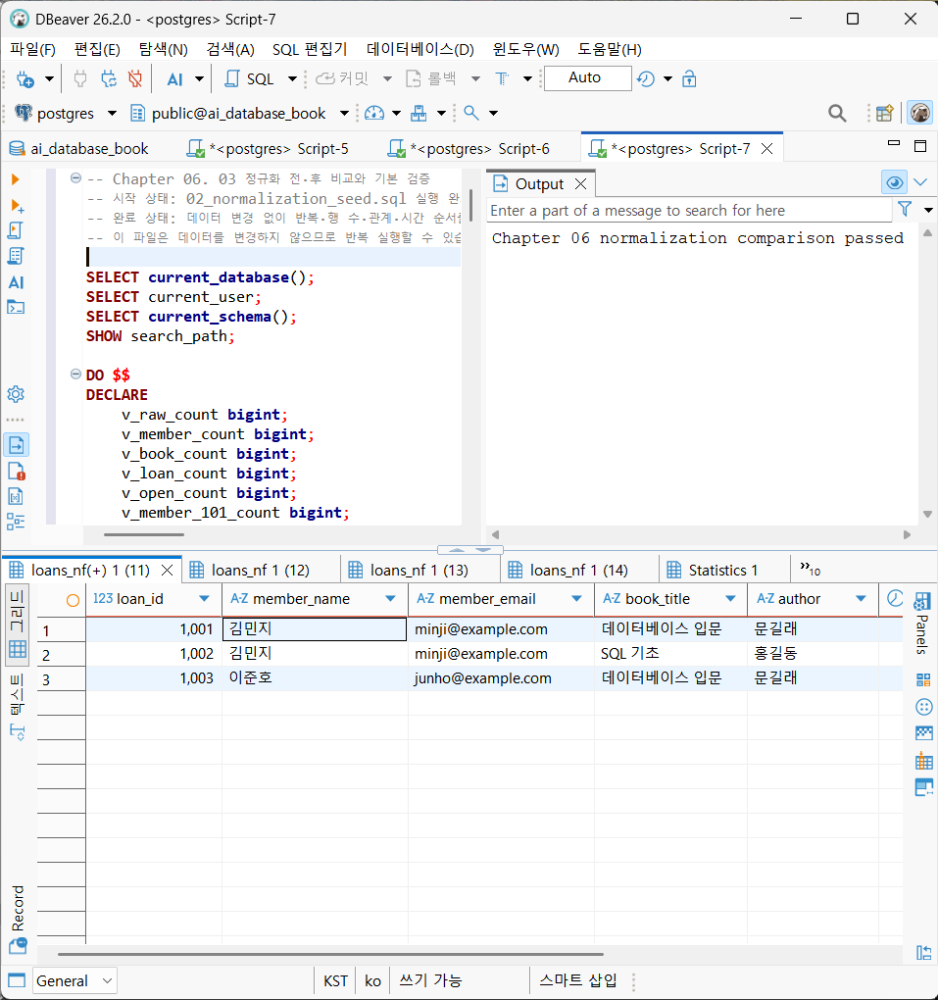
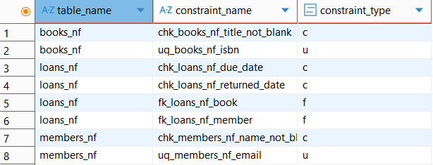
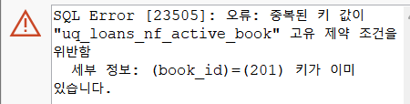
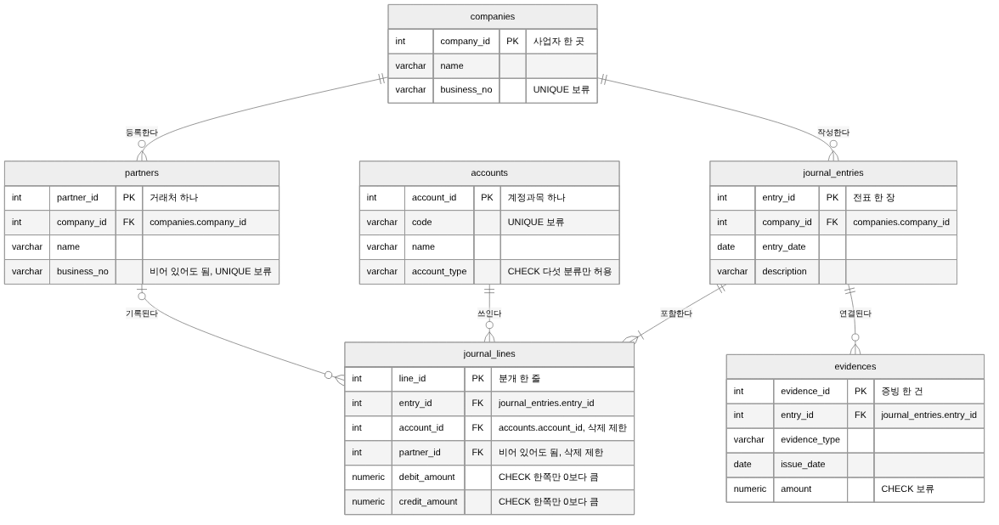

# Chapter 06 확장 실습 답안

> **과제:** 정규화와 데이터 무결성으로 좋은 테이블 만들기  
> **사용 방법:** 이 파일을 내려받아 본인의 GitHub 저장소에 `chapter06_answer.md`라는 이름으로 저장한 뒤 실습하면서 바로 작성합니다.  
> **제출 방법:** LMS에는 파일을 직접 업로드하지 않고, **본인 GitHub 저장소의 `chapter06_answer.md` 파일 URL**을 제출합니다.

---

## 제출 전 주의

이 파일과 캡처 화면에는 실제 비밀번호, 전체 DB 접속 URL, API Key, 개인정보를 기록하지 않습니다.

```text
GitHub 계정 또는 별칭: 유진
과제 작성일: 2026.10.17
사용한 AI 도구: Claude (실습 진행 안내, 답안 초안 작성 보조, 설계 리뷰)
```

---

# 1. 실습 환경과 시작 상태 확인

다음을 실행합니다.

```sql
SELECT current_database();
SELECT current_user;
SELECT current_schema();
SHOW search_path;
SHOW transaction_read_only;
```

| 확인 항목 | 실제 결과 | 의미 |
| --- | --- | --- |
| `current_database()` | ai_database_book | 지금 연결된 데이터베이스 이름이다. |
| `current_user` | postgres | 지금 SQL을 실행하는 계정이다. |
| `current_schema()` | public | 스키마 이름을 생략했을 때 PostgreSQL이 기본으로 쓰는 스키마(schema)의 이름이다. |
| `search_path` | public, "$user" | 스키마를 찾는 순서다. |
| `transaction_read_only` | off | off면 데이터를 바꿀 수 있는 연결이다. |

- [x] 현재 DB가 `ai_database_book`이다.
- [x] 변경 가능한 연결인지 확인했다.
- [x] Auto-commit 상태를 확인했다.
- [x] Chapter 06 번호형 SQL 파일을 사용한다.

---

# 2. 정규화 전 큰 테이블의 문제 찾기

본문의 `library_records_raw` 구조를 기준으로 생각합니다.

```text
library_records_raw 한 행
→ 대여 사건 한 건이지만 회원·도서의 현재 사실까지 함께 저장된 구조
```

## 2-1. 위험한 중복과 의미 있는 반복 구분

| 반복되는 값/상황 | 위험한 중복 / 의미 있는 반복 | 판단 이유 |
| --- | --- | --- |
| 회원 이메일이 여러 대여 행에 반복 | 위험한 중복 | 이메일은 회원 한 명의 현재 정보인데 대여할 때마다 복사된다. 이메일이 바뀌면 그 회원의 대여 행을 전부 고쳐야 하고, 하나라도 놓치면 같은 회원의 이메일이 두 개가 된다. |
| 도서 제목이 여러 대여 행에 반복 | 위험한 중복 | 제목은 도서 한 권의 현재 정보인데 대여될 때마다 복사된다. 제목을 고치면 그 도서의 대여 행을 모두 고쳐야 하고, 하나만 고치면 같은 책이 제목을 두 개 갖게 된다. |
| `loans_nf.member_id = 101` 반복 | 의미 있는 반복 | 1001과 1002는 서로 다른 대여 사건이고, 101은 누가 빌렸는지만 가리킨다. 이름과 이메일은 members_nf에 한 번만 있어서 회원 정보가 바뀌어도 이 행들은 고칠 필요가 없다. |
| 사건 당시 가격 같은 이력값 반복 | 의미 있는 반복 | 거래가 일어난 그때의 값을 남겨 두는 것이다. 나중에 현재 가격이 바뀌어도 지난 기록의 값은 그대로여야 하므로 같은 값이 반복되어도 분리하지 않는다. |

## 2-2. 이상 현상 설명

### 삽입 이상

```text
아직 한 번도 대여되지 않은 새 도서를 등록하려 할 때 생기는 문제: library_records_raw의 한 행은 대여 한 건이라서 대여가 되지 않은 도서만 따로 넣을 자리가 없다. 도서를 넣으려면 회원과 대여일을 비워 둔 가짜 대여 행을 만들어야 하고, 그러면 실제로 없는 대여가 loan_id를 받아 기록되어 대여 건수가 실제와 달라진다.
```

### 수정 이상

```text
회원 이메일이 변경될 때 생기는 문제: 김민지의 이메일은 1001, 1002 두 행에 들어 있어서 두 행을 모두 고쳐야 한다. 한 행만 고치면 같은 회원의 이메일이 두 개가 되고, 어느 쪽이 맞는지 알 수 없다.
```

### 삭제 이상

```text
마지막 대여 기록을 삭제할 때 생길 수 있는 문제: 'SQL 기초'의 정보는 1002 한 행에만 있다. 대여 기록 1002를 지우면 대여만 지우려고 했음에도 불구하고, 'SQL 기초'와 저자 '홍길동' 정보도 함께 지워지는 문제가 생긴다. 또 이준호 회원도 1003 한 행에만 있어서 1003을 지우면 회원 정보도 없어진다.
```

### 왜 이것이 SQL 문법 문제가 아니라 구조 문제인가요?

```text
세 경우 모두 INSERT, UPDATE, DELETE 문은 오류 없이 실행된다. 문제는 문법이 아니라, 한 행에 대여 사건과 회원 정보, 도서 정보가 섞여 있는 테이블 구조다. 그래서 SQL을 고치는 것이 아니라, 회원과 도서와 대여 한 건을 각자의 테이블로 나누어야 해결된다.
```

---

# 3. 1NF·2NF·3NF 핵심 질문 복습

정규형 이름만 외우지 말고 **왜 분리하는지** 설명합니다.

## 3-1. 제1정규형(1NF)

```text
한 셀에 쉼표로 여러 독립 값을 넣거나 book1/book2/book3처럼 반복 열을 만들면 왜 문제가 되는가:
책을 하나씩 따로 찾고, 연결하고, 고칠 수 없다.
'데이터베이스 입문, SQL 기초'처럼 한 칸에 묶으면 'SQL 기초'를 빌린 회원을 찾을 때 하나씩 확인해야 하고, 한 권만 반납 처리하는 경우에도 곤란하다. 또한 FOREIGN KEY로 도서 테이블과 연결할 수도 없다. 반복 열은 네 번째 책이 생기면 열을 새로 만들어야 하고, 찾을 때마다 세 열을 모두 확인해야 한다. 그래서 대여 한 건을 한 행으로 나눠야 한다.
```

내 서비스에서 비슷한 위험이 있는 예:

```text
BalanceBook에서 전표 한 장의 분개를 전표 테이블의 칸으로 늘어놓는 경우다. journal_entries에 계정1/차변1/대변1, 계정2/차변2/대변2처럼 반복 열을 만들면 분개가 세 줄인 원두 외상 매입 같은 전표는 열을 더 만들어야 하고, 외상매입금이 쓰인 전표를 찾거나 계정별 합계(시산표)를 낼 때 계정 열을 하나씩 모두 확인해야 한다. 그래서 분개 한 줄을 한 행으로 두는 journal_lines 테이블로 나눈다. 증빙도 '세금계산서, 카드영수증'처럼 한 칸에 묶지 않고 evidences에 한 행씩 둔다.
```

## 3-2. 제2정규형(2NF)

다음 관계를 설명합니다.

```text
(student_id, course_id) → grade
student_id → student_name
course_id → course_name
```

```text
복합키 전체가 아니라 일부에만 의존하는 열을 분리해야 하는 이유: 이 테이블의 한 행은 (student_id, course_id) 두 열이 함께 있어야 구별되는 수강 한 건이다. grade는 어떤 학생이 어떤 과목에서 받은 점수이므로, 두 값이 모두 있어야 정해지지만, student_name은 student_id만, course_name은 course_id만 알면 정해진다. 이런 열을 이 테이블에 둘 경우, 과목을 하나 들을 때마다 학생 이름이 복사되기 때문에, 이름이 바뀌면 수강 행을 모두 고쳐야 한다. 아직 아무도 듣지 않은 과목은 과목명을 넣을 곳이 없다. 그래서 학생은 students, 과목은 courses로 둔 뒤에, enrollments에는 수강 사실과 grade만 두어야 한다.
```

## 3-3. 제3정규형(3NF)

```text
member_id → zip_code
zip_code → city
```

```text
일반 열이 다른 일반 열을 결정하는 구조를 검토해야 하는 이유:
city는 회원이 아니라 zip_code가 정한다. 회원 테이블에 city를 두면 같은 우편번호를 가진 회원마다 city가 복사되고, 지역 이름이 바뀌면 그 회원들을 모두 고쳐야 하며, 하나라도 놓치면 같은 우편번호에 city가 두 개가 된다. 다만 무조건 나누지 않고 zip_code → city가 실제 업무 규칙인지를 확인하고, 또 이것이 독립적으로 관리해야 하는 사실인지, 변경 이유와 시점이 다른지를 확인한 뒤에 나눌지를 정해야 한다.
```

### 정규화는 값이 반복되기만 하면 무조건 분리하는 것인가요?

```text
아니다. 앞서 살펴 본 loans_nf.member_id 같은 관계 표시나 사건 당시 가격 같은 이력은 반복되어도 행마다 의미있는 반복이었기 때문에 그대로 두어야 한다. 단순히 값이 반복되는지가 아니라, 같은 사실이 복사됐는지, 그 값의 주인이 누구인지, 값이 바뀌는 이유와 시점이 다른지 보고 분리해야 한다.
```

---

# 4. 각 열의 '사실의 주인' 찾기

| 열 | 어떤 사실을 설명하는가 | 주인 테이블 | 이유 |
| --- | --- | --- | --- |
| `member_name` | 회원의 이름 | `members_nf` (name) | 회원 한 명에 대한 현재 정보다. |
| `member_email` | 회원의 연락처 | `members_nf` (email) | 회원 한 명의 현재 연락처다. 바뀌면 회원 테이블 한 곳만 고치면 된다. |
| `book_title` | 도서의 제목 | `books_nf` (title) | 도서에 붙은 정보라 누가 빌리든 같다. |
| `author` | 도서의 저자 | `books_nf` (author) | 도서에 붙은 정보라 대여와 상관없이 정해진다. |
| `borrowed_at` | 대여한 날짜 | `loans_nf` | 대여 한 건마다 다르다. 같은 책도 빌릴 때마다 날짜가 다를 수 있다. |
| `due_at` | 반납 예정일 | `loans_nf` | 그 대여 한 건에 대해 정해지는 날짜다. |
| `returned_at` | 실제 반납일 (반납 전이면 NULL) | `loans_nf` | 그 대여 한 건이 언제 끝났는지다. 반납 전에는 NULL로 비어 있다. |
| `member_id` | 회원을 구별하는 번호 | `members_nf` (id) | members_nf에서는 회원을 구별하는 번호(PK)이고, loans_nf의 member_id는 누가 빌렸는지 가리키기만 하는 번호(FK)다. |
| `book_id` | 도서를 구별하는 번호 | `books_nf` (id) | books_nf에서는 도서를 구별하는 번호(PK)이고, loans_nf의 book_id는 어떤 책을 빌렸는지 가리키기만 하는 번호(FK)다. |


정규화 후 한 행의 의미:

```text
members_nf 한 행 = 회원 한 명
books_nf 한 행 = 대여 대상으로 관리하는 도서 항목 한 건
loans_nf 한 행 = 특정 회원이 특정 도서를 대여한 사건 한 건
```

### 현재 사실과 사건 당시 이력을 구분하는 기준

```text
값이 바뀌었을 때 지난 기록에서도 새 값이 보여야 하면 현재 사실이고, 지난 기록은 그때 값 그대로 남아야 하면 사건 당시 이력이다. 회원 이메일은 바뀌면 지난 대여 기록을 볼 때도 새 이메일로 연락해야 하므로 현재 사실이고 members_nf에 둔다. 대여일, 반납 예정일, 반납일은 그 대여 한 건에 대해서만 정해지는 값이라 사건의 사실로 loans_nf에 둔다.
```

---

# 5. PostgreSQL로 정규화 전·후 구조 재현

Public 저장소의 다음 파일을 순서대로 사용합니다.

```text
code/chapter06/01_normalization_schema.sql
code/chapter06/02_normalization_seed.sql
code/chapter06/03_normalization_compare.sql
```

## 5-1. `01_normalization_schema.sql`

실행 전 예상:

```text
생성될 테이블 수: 4 (library_records_raw, members_nf, books_nf, loans_nf)
각 테이블 예상 행 수: 0 (01은 테이블 구조만 만들고 데이터는 02에서 넣는다)
```

실행 후:

```text
실제로 생성된 테이블: library_records_raw, members_nf, books_nf, loans_nf (4개)
각 테이블 실제 행 수: library_records_raw 0, members_nf 0, books_nf 0, loans_nf 0
```

## 5-2. `02_normalization_seed.sql`

실행 전 예상 기준:

```text
raw = 3
members = 2
books = 2
loans = 3
미반납 = 2
회원 101 대여 = 2
도서 201 대여 = 2
```

실제 결과:

```text
raw: 3
members: 2
books: 2
loans: 3
미반납: 2
회원 101 대여: 2
도서 201 대여: 2
```

예상과 다른 값이 있다면 이유:

```text
없었다. 7개 값이 모두 예상과 같았다.
02 파일은 데이터를 다 넣은 뒤, 저장을 확정하기 전에 이 7개 숫자를 스스로 세어 본다. 하나라도 다르면 오류를 내고 넣은 데이터를 전부 취소하는데, 오류 없이 끝났으니 7개가 모두 맞았다는 뜻이다.

```

## 5-3. `03_normalization_compare.sql`

```text
검증 메시지: Chapter 06 normalization comparison passed
PASS / FAIL: PASS
```

다음 항목을 확인합니다.

```text
회원 고아 참조: 0
도서 고아 참조: 0
날짜 순서 오류: 0
활성 대여 중복: 0
```

### 정규화 후에도 JOIN으로 원래 업무 정보를 다시 볼 수 있는 이유

```text
정규화 후 loans_nf에는 이름이나 제목 대신 member_id, book_id 번호만 남아 있다. 이 번호가 members_nf와 books_nf의 회원·도서를 정확히 가리키고 있어서(고아 참조 0), 번호를 따라 이어 붙이면(JOIN) 누가 어떤 책을 언제 빌렸는지 정규화 전 raw 표와 같은 3건을 다시 만들 수 있다. 그래서 테이블을 나눠도 업무 정보는 잃지 않고, 각 사실은 한 곳에만 저장된다.
```

### 증거 화면

권장 경로:

```text
assignments/chapter06/images/step05_normalization.png
```



---

# 6. Chapter 06에서 확정한 C-01~C-08 정책 해석

| ID | 확정 규칙 | 구현 방법 | 왜 필요한가 | Chapter 05에서는 왜 미확정이었나 |
| --- | --- | --- | --- | --- |
| C-01 | 이메일 문자열 중복 금지 | `UNIQUE` | 같은 이메일로 두 회원이 등록되면 연락이나 로그인 때 어느 회원인지 구분할 수 없다. | 요구사항에는 회원이 이메일을 가진다는 말만 있고 중복 금지는 없어서 Q2로 남겼다. |
| C-02 | ISBN 필수·중복 금지 | `NOT NULL + UNIQUE` | ISBN이 없거나 겹치면 도서를 업무 번호로 찾을 수 없고, 같은 도서가 두 번 등록될 수 있다. | ISBN은 저장할 수 있다고만 되어 있어 ISBN 없는 도서를 받을지와 같은 ISBN의 실물 책 여러 권을 어떻게 할지가 정해지지 않았다. Q3과 Q5로 남겼다. |
| C-03 | 이름·제목 공백 금지 | `CHECK` | 공백만 있는 이름이나 제목은 NOT NULL을 통과하지만 실제로는 값이 없는 것과 같다. | Chapter 05에서는 반드시 있어야 한다는 NOT NULL까지만 정했고, 공백만 넣은 값을 막을지는 정하지 않았다. |
| C-04 | `due_at >= borrowed_at` | `CHECK` | 반납예정일이 대여일보다 빠르면 대여 기간이 거꾸로 된 기록이 남는다. | 요구사항에는 날짜를 저장한다는 말만 있고 날짜 사이의 순서 규칙은 없었다. |
| C-05 | `returned_at`은 NULL 또는 대여일 이상 | `CHECK` | 실제반납일이 대여일보다 빠르면 빌리기 전에 반납한 것이 된다. 미반납은 NULL로 나타내므로 NULL은 허용해야 한다. | C-04와 같이 날짜 순서 규칙이 요구사항에 없었다. |
| C-06 | 존재하는 회원·도서만 참조 | `FOREIGN KEY` | 없는 회원이나 도서를 가리키는 대여가 저장되면 누가 무엇을 빌렸는지 알 수 없다. | 미확정은 아니었다. Chapter 05의 loans에도 FK를 두었고, 이번 실습의 loans_nf는 정규화 전후 비교를 위해 제약 없이 만들었기 때문에 다시 추가했다. |
| C-07 | 대여 이력이 있는 부모 삭제 금지 | `ON DELETE RESTRICT` | 대여 이력이 있는 회원이나 도서를 지우면 그 대여 기록이 가리킬 대상이 사라져 이력을 잃는다. | 탈퇴하거나 삭제된 회원의 대여 기록을 남길지가 정해지지 않아 Q1로 남겼다. |
| C-08 | 도서당 미반납 대여 최대 한 건 | 부분 고유 인덱스 | 같은 책 한 권이 동시에 두 사람에게 대여된 것처럼 기록되는 것을 막는다. | 같은 책을 두 사람이 동시에 빌릴 수 있는지가 정해지지 않아 Q7로 남겼다. 1:N 관계는 시간 전체의 대여 이력을 나타낼 뿐 동시 대여를 제한하지 않는다. |

### 확정되지 않은 정책을 제약조건으로 먼저 만들면 위험한 이유

```text
제약조건은 규칙에 맞지 않는 데이터를 DB가 거부하게 만든다. 정책이 정해지기 전에 먼저 걸면 나중에 허용하기로 한 정상 데이터까지 막히고, 삭제 규칙을 잘못 정하면 남겨야 할 이력이 지워져 되돌릴 수 없다. 그래서 이번 장에서도 C-01부터 C-08까지 확정된 규칙만 구현했고, 이메일 대소문자를 같은 것으로 볼지나 같은 ISBN의 실물 책 여러 권을 어떻게 구분할지처럼 정해지지 않은 정책은 제약조건으로 만들지 않았다.
```

---

# 7. 기존 데이터 검사 후 무결성 규칙 적용

실행 파일:

```text
code/chapter06/04_add_integrity_rules.sql
```

## 7-1. 규칙을 추가하기 전에 기존 데이터를 먼저 검사해야 하는 이유

```text
기존 데이터가 이미 새 규칙을 어기고 있으면 규칙을 추가하는 ALTER TABLE이 실패한다. 예를 들어 이메일이 같은 회원이 이미 두 명 있으면 UNIQUE를 추가할 수 없고, 둘 중 어느 행이 맞는지, 합칠지 고칠지는 DB가 정해 주지 않으므로 사람이 먼저 판단해야 한다. 그래서 04 파일은 NULL, 중복, 공백, 날짜 순서, 고아 참조, 미반납 중복을 먼저 세어 보고 모두 0일 때만 규칙을 추가한다.
```

## 7-2. 실행 결과

```text
명명된 제약조건 개수: 8개
NOT NULL 적용 열 개수: 10개
부분 고유 인덱스 존재 여부: 존재함, uq_loans_nf_active_book
COMMIT 성공 여부: 성공
```

### 메타데이터를 확인하는 이유

```text
ALTER TABLE이 오류 없이 끝났다는 것만으로는 원하는 규칙이 원하는 테이블과 열에 모두 붙었는지 알 수 없다. pg_constraint와 pg_attribute를 조회해 제약조건 8개, NOT NULL 열 10개, 부분 고유 인덱스가 실제로 있는지 확인해야 이후 실패 테스트에서 어떤 규칙이 데이터를 막았는지 믿을 수 있다.
```

### 증거 화면

권장 경로:

```text
assignments/chapter06/images/step07_constraints.png
```



---

# 8. 정상·경계·실패 테스트

실행 파일:

```text
code/chapter06/05_integrity_tests.sql
```

> **중요:** 오류 테스트는 한 번에 하나씩 실행하고, 각 테스트가 끝난 뒤 기준 데이터가 유지되는지 확인합니다.

## 8-1. 허용되어야 하는 경계값

최소 3개를 실행·관찰합니다.

| 테스트 | 예상 | 실제 | 왜 허용되어야 하는가 |
| --- | --- | --- | --- |
| `due_at = borrowed_at` | 성공 | 성공 | 같은 날을 반납예정일로 정해 빌리는 것은 정상이다. C-04는 대여일보다 빠른 날짜만 막아야 한다. |
| `returned_at = borrowed_at` | 성공 | 성공 | 빌린 날 바로 반납하는 것은 정상이다. C-05는 대여일보다 빠른 반납일만 막는다. |
| `returned_at = NULL` | 성공 | 성공 | NULL은 아직 반납하지 않았다는 뜻이라 C-05에서 허용해야 한다. 기준 데이터의 1002, 1003은 returned_at이 NULL인 채로 C-05가 추가되었고, 테스트 후에도 미반납 2건으로 그대로 남아 있다. |
| `published_year = NULL` | 성공 | 성공 | 출판연도는 저장할 수 있는 값일 뿐 필수가 아니어서 NOT NULL을 걸지 않았다. |
| 공백이 아닌 한 글자 이름 | 성공 | 성공 | C-03은 공백만 있는 이름을 막는 규칙이지 짧은 이름을 막는 규칙이 아니다. |

## 8-2. 실패해야 하는 오류값

최소 6개를 실행합니다.

| 오류 테스트 | 기대 규칙 | 실제 결과 | 오류 메시지 핵심 | 실패해야 하는 이유 |
| --- | --- | --- | --- | --- |
| 필수값 NULL | `NOT NULL` | 실패 | 23502, name 칼럼 not null 제약 조건 위반 | 회원 이름은 반드시 있어야 한다. |
| ISBN NULL | `NOT NULL` | 실패 | 23502, isbn 칼럼 not null 제약 조건 위반 | C-02에서 ISBN을 필수로 정했다. |
| 이메일 중복 | `UNIQUE` | 실패 | 23505, uq_members_nf_email 고유 제약 조건 위반 | junho@example.com은 이미 102번 회원이 쓰고 있어 C-01에 어긋난다. |
| ISBN 중복 | `UNIQUE` | 실패 | 23505, uq_books_nf_isbn 고유 제약 조건 위반 | ISBN-001은 이미 201번 도서에 있어 C-02에 어긋난다. |
| 공백 이름/제목 | `CHECK` | 실패 | 23514, chk_members_nf_name_not_blank와 chk_books_nf_title_not_blank 체크 제약 조건 위반 | 공백만 있는 값은 값이 없는 것과 같아 C-03에서 막는다. |
| 존재하지 않는 회원 | `FOREIGN KEY` | 실패 | 23503, fk_loans_nf_member 참조키 제약 조건 위반 | 999번 회원은 없어서 누가 빌렸는지 알 수 없다. |
| 존재하지 않는 도서 | `FOREIGN KEY` | 실패 | 23503, fk_loans_nf_book 참조키 제약 조건 위반 | 999번 도서는 없어서 무엇을 빌렸는지 알 수 없다. |
| 날짜 순서 위반 | `CHECK` | 실패 | 23514, chk_loans_nf_due_date와 chk_loans_nf_returned_date 체크 제약 조건 위반 | 반납예정일이나 실제반납일이 대여일보다 빠르면 C-04와 C-05에 어긋난다. |
| 두 번째 미반납 대여 | 부분 고유 인덱스 | 실패 | 23505, 중복된 키 값이 "uq_loans_nf_active_book" 고유 제약 조건을 위반함 | 201번 도서는 1003번 대여가 아직 미반납이라 C-08에 어긋난다. |
| 참조 중 부모 삭제 | `RESTRICT/FK` | 실패 | 23503, fk_loans_nf_member 참조키 제약 조건 위반 | 101번 회원은 대여 1001, 1002가 가리키고 있어 지우면 대여 이력을 잃는다. |

## 8-3. 테스트 후 기준 상태 재검증

```text
raw: 3
members: 2
books: 2
loans: 3
미반납: 2
회원 고아 참조: 0
도서 고아 참조: 0
활성 대여 중복: 0
검증 메시지: Chapter 06 integrity test baseline preserved
```

### 실패 테스트 후 기준 데이터가 유지되어야 하는 이유

```text
실패한 INSERT나 DELETE가 일부라도 반영되었다면 제약조건이 데이터를 제대로 지킨 것이 아니다. 잘못된 입력은 거부되고 기존 정상 데이터는 그대로 남아야 규칙이 동작했다고 말할 수 있다. 경계값 테스트로 넣었던 임시 행이 남아도 기준 데이터가 바뀌므로, 테스트가 끝난 뒤 raw 3, members 2, books 2, loans 3, 미반납 2가 그대로인지 다시 확인했다.
```

### 증거 화면

권장 경로:

```text
assignments/chapter06/images/step08_integrity_error.png
```



---

# 9. 정규화와 무결성 제약조건 역할 비교

| 질문 | 나의 설명 |
| --- | --- |
| 정규화가 해결하는 문제 | 같은 사실이 여러 행에 복사되어 생기는 삽입, 수정, 삭제 이상을 막는다. 각 사실을 주인 테이블 한 곳에만 둔다. |
| `NOT NULL`이 해결하는 문제 | 반드시 있어야 하는 값이 빠진 행이 저장되는 것을 막는다. |
| `UNIQUE`가 해결하는 문제 | 업무에서 겹치면 안 되는 값이 두 번 저장되는 것을 막는다. |
| `CHECK`가 해결하는 문제 | 공백 이름이나 거꾸로 된 날짜처럼 정한 조건에 맞지 않는 값을 막는다. |
| `FOREIGN KEY`가 해결하는 문제 | 존재하지 않는 회원이나 도서를 가리키는 행을 막고, RESTRICT와 함께 쓰면 참조 중인 부모의 삭제를 막는다. 다만 실제와 다른 회원을 가리키도록 잘못 입력한 것까지는 막지 못한다. |
| 부분 고유 인덱스가 해결하는 문제 | 조건에 맞는 행끼리만 중복을 막는다. 반납이 끝난 과거 대여는 같은 도서로 여러 건 있어도 되지만, 미반납 대여는 도서당 한 건만 허용한다. |

### 정규화만 잘하면 잘못된 데이터가 모두 차단되나요?

```text
아니다. 정규화는 같은 사실이 한 곳에만 있게 할 뿐 그 값이 올바른지는 검사하지 않는다. 04를 실행하기 전의 loans_nf는 정규화된 구조였지만 제약조건이 없어서, 반납예정일이 대여일보다 빠른 행이나 없는 회원을 가리키는 행도 그대로 저장될 수 있었다.
```

### 제약조건만 많이 넣으면 나쁜 구조가 좋은 구조가 되나요?

```text
아니다. 제약조건은 값과 관계를 검사할 뿐 테이블 구조를 바꾸지 않는다. library_records_raw에 NOT NULL이나 CHECK를 아무리 넣어도 회원 이메일이 대여 행마다 복사되는 구조는 그대로라서 수정 이상과 삭제 이상은 남는다. 구조는 정규화로, 값과 관계는 제약조건으로 각각 다뤄야 한다.
```

---

# 10. Chapter 05 개인 ERD 개선

Chapter 05에서 만든 개인 서비스 ERD를 다시 엽니다.

## 10-1. 수정 전 점검

- [x] 같은 현재 사실을 여러 테이블에 복사한 부분이 있는가? 없다. 계정과목과 거래처 이름은 각 테이블에 한 번만 있고, 분개는 번호로만 가리킨다.
- [x] 한 셀에 여러 독립 값을 넣으려 한 부분이 있는가? 없다. 분개와 증빙은 Chapter 05에서 이미 한 줄, 한 건씩 행으로 나누었다.
- [x] 사건과 현재 상태가 한 테이블에 섞였는가? 없다. 전표, 분개, 증빙은 사건이고 사업자, 계정과목, 거래처는 현재 사실로 나뉘어 있다.
- [x] 복합키 일부에만 의존하는 속성이 있는가? 없다. 모든 테이블이 번호 하나를 PK로 써서 해당하지 않는다.
- [x] 일반 열이 다른 일반 열을 결정하는 부분이 있는가? 없다. 지금 accounts에는 계정 분류가 정하는 다른 값을 따로 저장하지 않는다. 나중에 정상 잔액 방향 같은 값을 추가하면 계정 분류를 별도 테이블로 나눌지 다시 검토한다.
- [x] 확정 업무 규칙인데 DB가 막지 못하는 부분이 있는가? 있다. 계정 분류는 다섯 가지 중 하나여야 하고 분개 한 줄은 한쪽에만 금액이 있어야 하는데, 아무 값이나 저장할 수 있었다. 분개의 거래처가 같은 사업자의 거래처인지도 DB가 막지 못한다. 차변 합계와 대변 합계가 같아야 한다는 규칙은 여러 행에 걸쳐 있어 제약조건으로는 막을 수 없으므로, 1차 기획안대로 전표를 저장하는 트랜잭션에서 막는다.
- [x] 아직 미확정인데 제약조건으로 너무 강하게 정한 부분이 있는가? 없다. 사업자등록번호와 계정코드의 UNIQUE, 전표 삭제 규칙은 Chapter 05에서 보류해 두었다.

## 10-2. 수정 전·후 비교

| 항목 | 수정 전 | 수정 후 | 변경 근거 | 관련 요구사항 ID |
| --- | --- | --- | --- | --- |
| 계정 분류 `accounts.account_type` | 글자만 저장하고 허용값 검사가 없었다. | 자산, 부채, 자본, 수익, 비용만 허용하는 CHECK를 추가했다. | 다섯 분류 중 하나라는 규칙이 확정되어 있는데 오타나 다른 값이 저장될 수 있었다. | P05-R02 |
| 분개 금액 `journal_lines.debit_amount`, `credit_amount` | 두 칸에 아무 금액이나 저장할 수 있었다. | 한쪽만 0보다 크고 다른 쪽은 0이어야 하는 CHECK를 추가했다. | 분개 한 줄은 차변 또는 대변 중 한쪽 금액만 가진다는 규칙을 DB가 막지 못했다. 양쪽에 금액이 있는 줄, 둘 다 0인 줄, 음수 금액도 함께 막는다. | P05-R05 |
| 분개가 참조하는 계정과목과 거래처 FK | 삭제 규칙을 정하지 않았다. | ON DELETE RESTRICT로 분개에 쓰인 계정과목과 거래처는 삭제할 수 없게 했다. | 1차 기획안에서 거래에 쓰인 계정과목과 거래처는 삭제할 수 없다고 정했다. 지우면 지난 분개가 가리킬 대상이 사라진다. | P05-R05, P05-R07 |

## 10-3. 개인 프로젝트 무결성 규칙 후보

| 규칙 ID | 업무 규칙 | 제약조건 후보 | 확정 / 미확정 | 근거 |
| --- | --- | --- | --- | --- |
| P06-C01 | 계정 분류는 자산, 부채, 자본, 수익, 비용 중 하나다. | `CHECK (account_type IN ('자산', '부채', '자본', '수익', '비용'))` | 확정 | 요구사항에서 계정 분류는 이 다섯 가지 중 하나라고 정했는데, 지금 구조에서는 오타나 다른 값도 그대로 저장된다. |
| P06-C02 | 분개 한 줄은 차변 또는 대변 중 한쪽에만 0보다 큰 금액이 있다. | `CHECK ((debit_amount > 0 AND credit_amount = 0) OR (debit_amount = 0 AND credit_amount > 0))` | 확정 | 복식부기에서 분개 한 줄은 차변이나 대변 중 한쪽에만 금액을 적는다. 양쪽에 금액이 있거나 둘 다 0인 줄은 장부에서 의미가 없다. |
| P06-C03 | 분개에 쓰인 계정과목과 거래처는 삭제할 수 없다. | `FOREIGN KEY ... ON DELETE RESTRICT` | 확정 | 1차 기획안에서 거래에 쓰인 계정과목과 거래처는 삭제할 수 없다고 정했다. 지우면 지난 분개가 가리킬 대상이 사라져 장부를 다시 볼 수 없다. |
| P06-C04 | 전표 한 장의 차변 합계와 대변 합계는 같다. | 여러 행에 걸친 규칙이라 CHECK로는 막을 수 없다. 전표와 분개를 한 트랜잭션으로 저장하고, 합계가 다르면 ROLLBACK한다. | 확정 | 복식부기의 기본 규칙이고, 1차 기획안에서 전표와 분개를 한 트랜잭션으로 저장해 합계가 다른 전표를 막기로 정했다. |
| P06-C05 | 분개에 기록하는 거래처는 그 전표를 작성한 사업자의 거래처여야 한다. | 지금의 FK로는 다른 사업자의 거래처도 가리킬 수 있다. 저장 전에 확인하는 방법을 정해야 한다. | 확인 필요 | 한 사업자의 장부에 다른 사업자의 거래처가 기록되면 안 되지만, 요구사항에 이 규칙이 적혀 있지 않고 막는 방법도 아직 정하지 않았다. |
| P06-C06 | 사업자등록번호는 중복될 수 없다. | `UNIQUE (business_no)` | 미확정 | 요구사항에는 사업자와 거래처가 사업자등록번호를 가진다는 말만 있고 중복 금지는 없다. 거래처는 사업자등록번호가 없는 경우도 있어 아직 정하지 않았다. |
| P06-C07 | 증빙 금액은 0보다 크다. | `CHECK (amount > 0)` | 미확정 | 금액을 줄이는 수정세금계산서처럼 음수 금액 증빙이 있을 수 있어, 바로 막으면 정상 증빙까지 거부된다. |

> 미확정 규칙은 `확인 필요`로 남겨도 됩니다. 억지로 제약조건을 만들지 않습니다.

## 10-4. 수정한 ERD

권장 이미지 경로:

```text
assignments/chapter06/images/step10_my_erd_after.png
```



---

# 11. AI를 정규화·무결성 리뷰어로 활용

## 11-1. 내가 먼저 작성한 구조와 규칙

```text
내 서비스: BalanceBook, 소규모 사업자용 복식부기 회계 관리 서비스
검토할 테이블: accounts, journal_lines, partners, evidences
한 행의 의미: accounts 한 행은 계정과목 하나, journal_lines 한 행은 전표 한 장 안에서 계정과목 하나에 차변 또는 대변 중 한쪽 금액을 기록한 분개 한 줄, partners 한 행은 한 사업자가 등록한 거래처 하나, evidences 한 행은 전표에 연결한 증빙 한 건이다.
중복으로 의심되는 열: accounts.account_type에 자산, 부채 같은 값이 여러 계정에 반복된다.
확정 업무 규칙: 계정 분류는 다섯 가지 중 하나다. 분개 한 줄은 한쪽에만 금액이 있다. 분개에 쓰인 계정과목과 거래처는 삭제할 수 없다. 전표 한 장의 차변 합계와 대변 합계는 같다.
미확정 정책: 사업자등록번호 중복 금지, 계정과목표 공유 여부, 전표 삭제 허용 여부, 증빙 금액의 범위
```

## 11-2. AI에게 전달한 핵심 프롬프트

```text
나는 데이터베이스 정규화와 무결성을 학습 중입니다.
아래 데이터 모델을 바로 다시 설계하지 말고 리뷰어로 검토해 주세요.
1. 각 열의 '사실의 주인'이 적절한지 확인해 주세요.
2. 반복되는 값이 위험한 중복인지, 관계 표현인지, 사건 당시 이력인지 먼저 구분해 주세요.
3. 1NF/2NF/3NF 위반이라고 판단한다면 이름만 말하지 말고 어떤 결정 관계 때문에 문제인지 설명해 주세요.
4. 내가 확정한 업무 규칙에 대해서만 NOT NULL, UNIQUE, CHECK, FK 후보를 제안해 주세요.
5. 미확정 정책은 제약조건으로 확정하지 말고 확인 질문으로 남겨 주세요.
6. ON DELETE CASCADE를 제안한다면 삭제해도 되는 업무 근거가 무엇인지 먼저 질문해 주세요.
7. 정상값·경계값·실패값 테스트 아이디어를 각각 제안해 주세요.

[내 요구사항 / ERD / 테이블 설명]
Chapter 05의 P05-R01부터 P05-R09까지와 P05-Q01부터 P05-Q04까지, Chapter 05 ERD, 11-1 내용
```

## 11-3. AI 제안 검토

| AI 제안 | 수용 / 수정 / 보류 / 거절 | 요구사항 근거 | 실제 검증 방법 | 나의 판단 |
| --- | --- | --- | --- | --- |
| journal_lines에 한쪽 금액만 허용하는 CHECK를 추가하라. | 수용 | 요구사항에서 분개 한 줄은 차변 금액 또는 대변 금액 중 한쪽 금액만 가진다고 정했다. | PostgreSQL에서 양쪽 금액, 둘 다 0, 음수 금액인 분개가 거부되고 한쪽 금액인 분개는 저장되는지 확인 | 확정 규칙이고 정상 분개는 막지 않아 그대로 적용했다. |
| account_type 값이 여러 계정에 반복되므로 account_types 테이블로 분리하라. | 수정 | 요구사항에서 계정 분류는 자산, 부채, 자본, 수익, 비용 중 하나라고 정했다. | 다섯 분류 외의 값을 넣어 거부되는지 확인 | 분류 값의 반복은 각 계정이 어느 분류인지 나타내는 의미 있는 반복이다. 지금은 분류가 정하는 다른 값을 저장하지 않으므로 테이블은 나누지 않고 허용값만 CHECK로 제한했다. |
| 거래처 사업자등록번호에 UNIQUE를 추가하라. | 보류 | 요구사항에는 거래처가 사업자등록번호를 저장할 수 있다는 말만 있고, 중복 금지는 Chapter 05에서 미확정 질문으로 남겨 두었다. | 정책이 정해진 뒤 같은 번호를 두 번 넣어 거부되는지 확인 | 사업자등록번호가 없는 거래처도 있어, 지금 UNIQUE를 걸면 정해지지 않은 정책을 먼저 확정하는 것이 되므로 보류했다. |
| 전표를 지우면 분개와 증빙이 함께 지워지도록 ON DELETE CASCADE를 걸어라. | 거절 | 잘못 입력한 전표를 삭제할지 역분개 전표로 정정할지는 Chapter 05에서 미확정 질문으로 남겨 두었고, 삭제를 허용한다는 요구사항은 없다. | 해당 없음 | 회계 기록은 지우기보다 역분개로 정정해 이력을 남기는 편이 맞다고 보았다. 근거 없이 같이 삭제되도록 한다면 장부 이력이 한 번에 사라질 수 있다. |
| 증빙 금액에 CHECK (amount > 0)을 추가하라. | 보류 | 요구사항에는 증빙이 금액을 가진다는 말만 있고, 금액의 범위는 정하지 않았다. | 정책이 정해진 뒤 0과 음수 금액으로 경계값과 실패값을 시험 | 금액을 줄이는 수정세금계산서처럼 음수 금액 증빙이 있을 수 있어, 바로 막으면 정상 증빙까지 거부된다. |

특히 AI가 다음을 제안했다면 근거를 다시 확인합니다.

```text
UNIQUE
NOT NULL
CHECK
ON DELETE CASCADE
ON DELETE RESTRICT
새로운 테이블 분리
```

### AI가 단순히 값이 반복된다는 이유만으로 분리를 제안한 부분이 있었나요?

```text
있었다. account_type에 자산, 부채 같은 값이 여러 계정에 반복된다는 이유로 account_types 테이블 분리를 제안했다. 그러나 이 반복은 각 계정의 분류를 나타내는 의미 있는 반복이고, 지금은 분류가 결정하는 다른 값을 저장하지 않으므로 나누지 않았다.
```

### AI가 미확정 정책을 확정 규칙처럼 만든 부분이 있었나요?

```text
있었다. 거래처 사업자등록번호 UNIQUE와 증빙 금액 CHECK는 요구사항에 없는 정책을 확정한 제안이라 보류했다. ON DELETE CASCADE는 전표 삭제 정책이 정해지지 않은 상태에서 삭제를 허용한 제안이라 거절했다.
```

---

# 12. 최종 성찰

아래 문장은 본인의 말로 작성합니다.

```text
1. 정규화에서 가장 중요한 질문은
   이 값은 무엇을 설명하는 값인지, 그리고 그 값의 주인인 테이블에만 저장되어 있는지 확인하는 것이다.

2. 위험한 중복과 의미 있는 반복의 차이는
   같은 사실을 복사한 것이라서 바뀔 때 여러 곳을 고쳐야 하는지, 아니면 행마다 다른 사건이나 관계이기 때문에 고칠 것이 없는지이다.

3. 정규화와 제약조건의 역할이 다른 이유는
   정규화는 사실의 주인에 따라 테이블을 어떻게 나누어 어디에 저장할지 정하는 구조의 문제이고, 제약조건은 업무 규칙에 맞지 않는 값과 관계를 저장하는 것을 DB가 거부하게 하는 값의 문제이기 때문이다.

4. 실패해야 하는 SQL을 일부러 실행해 보는 이유는
   규칙을 만들었다고 해서 실제로 잘못된 데이터를 막는지는 알 수 없으므로 실제로 운영되는지 확인해야 하고, 반려된 뒤에도 기존의 정상 데이터가 그대로 유지되는지까지 확인해야 하기 때문이다.

5. AI가 제안한 UNIQUE/CHECK/FK를 그대로 적용하면 안 되는 이유는
   AI는 업무 정책을 결정하는 주체가 아니어서 요구사항에 없는 규칙을 확정하거나 정상 데이터까지 막는 규칙을 제안할 수 있으므로, 요구사항 근거와 실제 테스트 결과로 점검하는 과정이 필요하기 때문이다.
```

---

# 13. 제출 체크리스트

- [x] `chapter06_answer.md`를 본인 저장소에 만들었다.
- [x] 위험한 중복과 의미 있는 반복을 구분했다.
- [x] 삽입·수정·삭제 이상을 설명했다.
- [x] 1NF·2NF·3NF 핵심 질문을 자신의 말로 설명했다.
- [x] 열의 사실의 주인을 분류했다.
- [x] `01_normalization_schema.sql`을 실행했다.
- [x] `02_normalization_seed.sql` 기준 상태를 확인했다.
- [x] `03_normalization_compare.sql` 검증 결과를 확인했다.
- [x] C-01~C-08의 업무 근거를 설명했다.
- [x] `04_add_integrity_rules.sql`로 규칙을 적용했다.
- [x] 허용 경계값을 최소 3개 확인했다.
- [x] 실패 테스트를 최소 6개 한 번에 하나씩 실행했다.
- [x] 실패 후 기준 데이터가 유지되는지 확인했다.
- [x] Chapter 05 개인 ERD를 수정했다.
- [x] 개인 프로젝트 제약조건 후보를 확정/미확정으로 구분했다.
- [x] AI 제안을 요구사항 근거와 실행 결과로 검토했다.
- [x] 핵심 화면 3~4장만 첨부했다.
- [x] 캡처에 비밀번호나 개인정보가 없다.
- [x] GitHub에서 Markdown 이미지가 정상적으로 보인다.
- [x] 최종 답안을 commit/push했다.

---

# 14. LMS 제출 URL

아래 형식의 **본인 GitHub 파일 URL**을 LMS에 제출합니다.

```text
https://github.com/<본인-GitHub-ID>/<본인-저장소>/blob/main/assignments/chapter06/chapter06_answer.md
```

내 제출 URL:

```text
https://github.com/dhdbwls777/database-course-2026-2/blob/main/assignments/chapter06/chapter06_answer.md
```

> 저장소 메인 URL, 교수자 템플릿 URL, Raw URL이 아니라 **작성 완료된 본인 `chapter06_answer.md` 파일 화면 URL**을 제출합니다.
