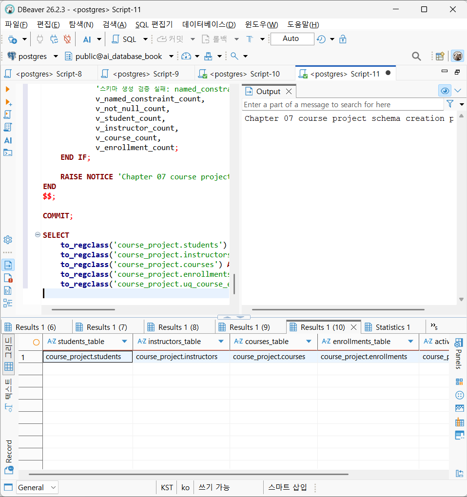
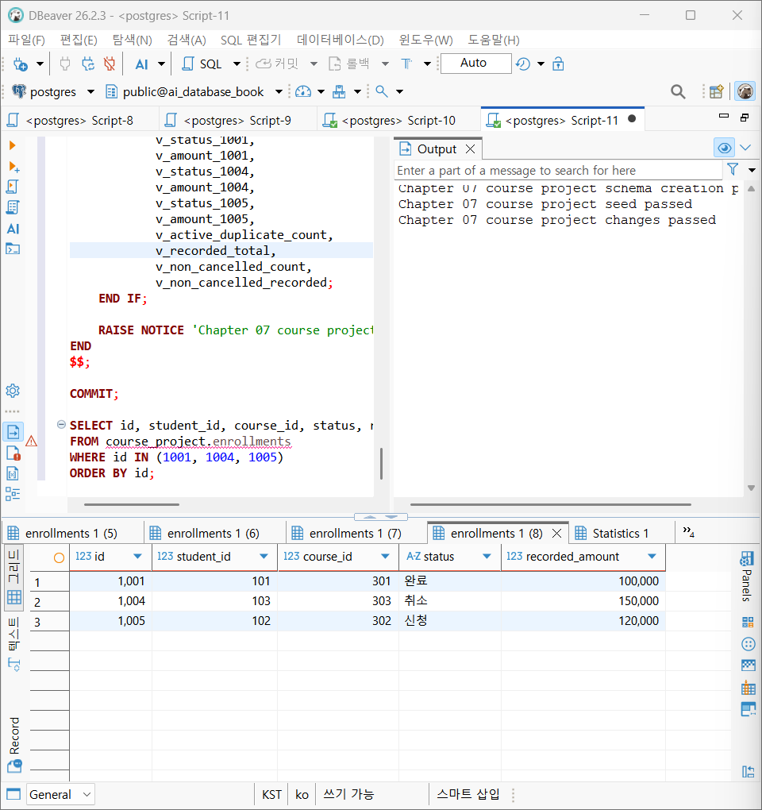
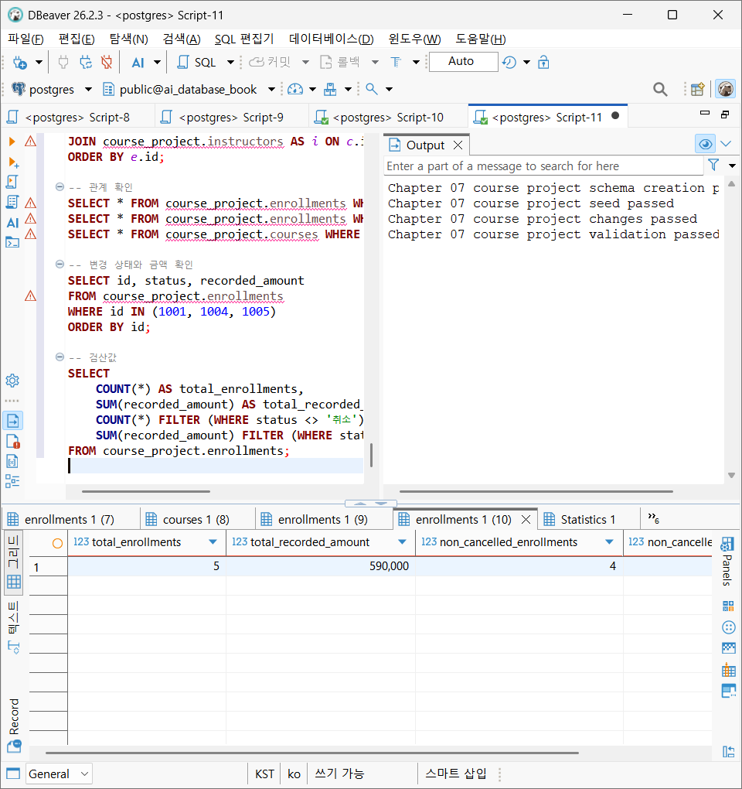
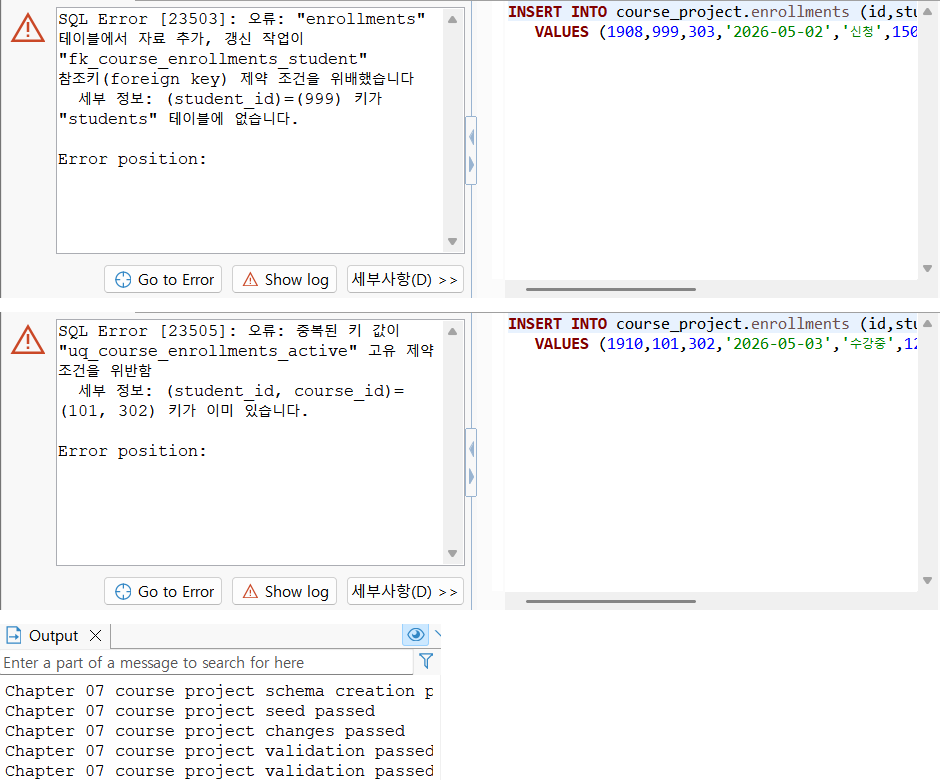
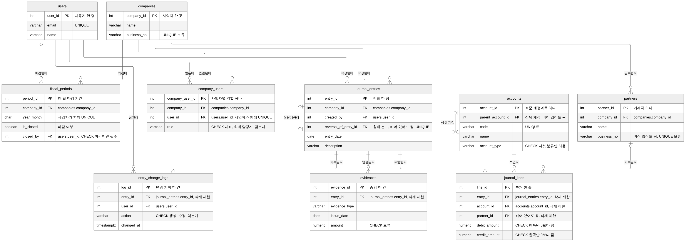

# Chapter 07 확장 실습 답안

> **과제:** 실전 프로젝트 1 — 온라인 강의 수강신청 DB 완성하기  
> **사용 방법:** 이 파일을 내려받아 본인의 GitHub 저장소에 `chapter07_answer.md`라는 이름으로 저장한 뒤 실습하면서 바로 작성합니다.  
> **제출 방법:** LMS에는 파일을 직접 업로드하지 않고, **본인 GitHub 저장소의 `chapter07_answer.md` 파일 URL**을 제출합니다.

---

## 제출 전 주의

이 파일과 캡처 화면에는 실제 비밀번호, 전체 DB 접속 URL, API Key, 개인정보를 기록하지 않습니다.

```text
GitHub 계정 또는 별칭: 유진
과제 작성일: 2026.10.26
사용한 AI 도구: Claude (실습 진행 안내, 답안 초안 작성 보조, 프로젝트 리뷰)
```

---

# 1. 시작 환경 확인

다음을 실행합니다.

```sql
SELECT current_database();
SELECT current_user;
SELECT current_schema();
SHOW search_path;
SHOW transaction_read_only;
```

| 확인 항목 | 실제 결과 | 의미 |
| --- | --- | --- |
| `current_database()` | ai_database_book | 지금 연결된 데이터베이스 이름이다. |
| `current_user` | postgres | 지금 SQL을 실행하는 계정이다. 01에서 스키마를 만든 계정과 02 이후 파일을 실행하는 계정이 같아야 한다. |
| `current_schema()` | public | 스키마 이름을 생략했을 때 쓰는 기본 스키마다. 이번 프로젝트 SQL은 모두 course_project.를 붙여 쓰므로 public이어도 된다. |
| `search_path` | public, "$user" | 스키마 이름을 생략했을 때 테이블을 찾는 순서다. |
| `transaction_read_only` | off | off면 데이터를 바꿀 수 있는 연결이다. |

- [x] 현재 DB가 `ai_database_book`이다.
- [x] 쓰기 가능한 연결인지 확인했다.
- [x] 실행할 SQL 범위를 확인했다.
- [x] Auto-commit 상태를 확인했다.

### 프로젝트 SQL을 실행하기 전에 시작 상태를 확인해야 하는 이유

```text
프로젝트 SQL은 스키마와 테이블을 만들고, 데이터를 넣고 바꾸는 작업이다. 다른 DB에 연결되어 있으면 엉뚱한 곳에 프로젝트가 만들어지고, 읽기 전용 연결이면 중간에 실패한다. 또 01부터 04까지의 파일은 정해진 시작 상태에서만 같은 결과가 나오도록 짜여 있어서, course_project가 이미 있거나 데이터가 남아 있으면 기준 숫자가 달라진다. 그래서 실행 전에 DB 이름, 실행 계정, 쓰기 가능 여부, Auto-commit 상태를 먼저 확인했다.
```

---

# 2. 프로젝트 범위와 요구사항 읽기

## 2-1. 포함 범위

본문을 그대로 복사하지 말고 자신의 말로 정리합니다.

```text
1. 학생과 강사를 각각 따로 등록하고 관리한다.
2. 강사가 개설한 강의와 강의의 난이도, 현재 기준 가격을 관리한다.
3. 학생이 강의에 신청한 기록을 신청일과 함께 남기고, 신청, 수강중, 완료, 취소 상태로 관리한다.
4. 신청할 때의 강의 가격을 그 신청 행에 기록 금액으로 남긴다.
```

## 2-2. 제외 범위

```text
1. 실제 결제의 승인, 실패, 환불은 다루지 않는다.
2. 강의 정원과 대기열은 다루지 않는다.
3. 신청 상태가 언제 어떻게 바뀌었는지의 전체 이력은 남기지 않고 현재 상태만 저장한다.
4. 강의 콘텐츠, 진도, 수료 여부와 수강평, 쿠폰, 할인은 다루지 않는다.
```

### 범위를 명확하게 정해야 하는 이유

```text
범위를 정하지 않으면 결제, 정원, 할인처럼 기능을 계속 늘리게 되어 테이블과 규칙이 많아지고, 지금 배운 내용으로 정확하게 만들고 검증하기 어려워진다. 또 범위가 정해져 있어야 각 열의 의미를 분명히 할 수 있다. 예를 들어 결제가 범위 밖이라는 것을 알아야 recorded_amount를 실제 결제 금액으로 잘못 읽지 않는다. 무엇을 검증해야 완료인지도 범위가 정해져야 정할 수 있다.
```

## 2-3. 요구사항 / 프로젝트 결정 / 미확정 질문 구분

아래 항목 중 대표 항목을 정리합니다.

| ID | 종류 | 내용 요약 | DB 구조/규칙에 미치는 영향 |
| --- | --- | --- | --- |
| P07-R01 | 요구사항 | 학생은 이름, 이메일, 가입일을 가진다. | students 테이블에 name, email, joined_at을 두고 모두 NOT NULL로 한다. |
| P07-R05 | 요구사항 | 신청은 학생, 강의, 신청일, 상태, 신청 시 기록 금액을 가진다. | 신청 한 건을 enrollments 한 행으로 두고, student_id와 course_id를 FK로, enrolled_at, status, recorded_amount를 열로 둔다. |
| P07-R07 | 요구사항 | 학생과 강사의 이메일은 각 테이블 안에서 공백일 수 없고 같은 문자열이 중복될 수 없다. | students와 instructors의 email에 각각 UNIQUE와 공백 금지 CHECK를 둔다. |
| P07-D02 | 프로젝트 결정 | 할인이 없는 지금은 신청을 만들 때 그 시점의 courses.price를 recorded_amount로 복사하고, 이후 가격이 바뀌어도 고치지 않는다. | CHECK로 강제하지 않고, 신청을 만드는 INSERT ... SELECT 문이 가격을 복사한다. 03의 1005 신청이 이 방법으로 만들어졌다. |
| P07-D03 | 프로젝트 결정 | 같은 학생과 같은 강의의 진행 중인 신청은 최대 한 건이다. | 상태가 신청, 수강중인 행에만 적용되는 부분 고유 인덱스 uq_course_enrollments_active를 둔다. 완료, 취소된 행은 막지 않아서 다시 신청할 수 있다. |
| P07-Q01 | 미확정 질문 | 학생과 강사 사이에서도 이메일이 겹치지 않게 막아야 하는가? | 정해지지 않아 테이블별 UNIQUE까지만 두었다. 막기로 정하면 학생과 강사를 하나의 사용자 테이블로 합칠지 다시 검토해야 한다. |

### 미확정 질문을 바로 제약조건으로 만들면 안 되는 이유

```text
제약조건은 한 번 걸면 규칙에 맞지 않는 데이터를 DB가 거부한다. P07-Q01을 정하지 않은 채 학생과 강사 이메일을 전체에서 고유하게 막으면, 강사가 같은 이메일로 학생 가입도 하는 경우처럼 나중에 허용하기로 할 수도 있는 데이터가 저장되지 않는다. 또 이 규칙은 두 테이블을 합치는 것처럼 구조까지 바꿔야 할 수 있으므로, 정책이 정해질 때까지는 질문으로 남기고 지금 구조로 처리한다.
```

---

# 3. 네 테이블의 한 행 의미와 관계

## 3-1. 한 행 의미

```text
course_project.students 한 행 = 학생 한 명

course_project.instructors 한 행 = 강사 한 명

course_project.courses 한 행 = 한 강사가 개설한 강의 하나

course_project.enrollments 한 행 = 특정 학생이 특정 강의에 신청한 일 한 건
```

## 3-2. 키와 중요 규칙

| 테이블 | PK | FK | 중요 규칙 |
| --- | --- | --- | --- |
| students | id | 없음 | 이름, 이메일, 가입일은 필수다. 이메일은 중복될 수 없고, 이름과 이메일은 공백만 넣을 수 없다. |
| instructors | id | 없음 | 이름, 이메일, 전문 분야는 필수다. 이메일은 중복될 수 없고, 세 값 모두 공백만 넣을 수 없다. |
| courses | id | instructor_id (instructors.id 참조) | 설명만 비어 있어도 된다. 난이도는 basic, intermediate, advanced 중 하나이고, 가격은 0 이상이다. 강의가 있는 강사는 삭제할 수 없다. |
| enrollments | id | student_id (students.id 참조), course_id (courses.id 참조) | 상태는 신청, 수강중, 완료, 취소 중 하나이고, 기록 금액은 0 이상이다. 같은 학생과 강의의 신청, 수강중 신청은 한 건만 있을 수 있다. 신청이 있는 학생과 강의는 삭제할 수 없다. |

## 3-3. 관계를 양방향 문장으로 작성

```text
instructors ↔ courses:
강사 한 명은 강의를 0개 이상 담당할 수 있고, 강의 하나는 정확히 한 명의 강사를 참조한다. (instructors 1 : N courses)

students ↔ enrollments:
학생 한 명은 신청을 0건 이상 가질 수 있고, 신청 한 건은 정확히 한 명의 학생을 참조한다. (students 1 : N enrollments)

courses ↔ enrollments:
강의 하나는 신청을 0건 이상 가질 수 있고, 신청 한 건은 정확히 한 강의를 참조한다. (courses 1 : N enrollments)
```

### 학생과 강의의 N:M 관계가 `enrollments`를 통해 어떻게 바뀌는지 설명

```text
학생 한 명은 여러 강의에 신청하고 강의 하나에도 여러 학생이 신청하므로 학생과 강의는 N:M이다. 두 테이블만으로는 이 연결을 저장할 칸이 없어서, 신청 한 건을 한 행으로 두는 enrollments를 만들어 students 1 : N enrollments N : 1 courses의 1:N 두 개로 나눈다. Seed에서 학생 101은 강의 301과 302에 신청했고, 강의 301에는 학생 101과 102가 신청해 있어 두 방향 모두 여러 건이 enrollments 행으로 저장된다.
```

### `enrollments`가 단순 연결 테이블이 아니라 사건 테이블이라고 볼 수 있는 이유

```text
enrollments는 student_id와 course_id만 갖는 것이 아니라 신청일, 상태, 신청 시 기록 금액이라는 자기 속성을 가진다. 또 같은 학생이 같은 강의를 완료하거나 취소한 뒤 다시 신청하면 새 행이 하나 더 생기고, 앞의 행은 완료나 취소 상태로 남는다. 그래서 enrollments 한 행은 단순한 연결이 아니라 특정 날짜에 일어난 신청 한 건이고, 시간에 따라 계속 쌓이는 사건이다.
```

---

# 4. `recorded_amount`의 의미 이해

```text
courses.price = 지금 이 강의에 적용되는 현재 기준 가격

enrollments.recorded_amount = 신청이 만들어질 때 그 신청 행에 기록해 둔 금액
```

### 두 값이 처음에는 같아도 같은 의미가 아닌 이유

```text
지금은 할인이 없어서 신청할 때 courses.price를 그대로 복사하므로 처음에는 두 값이 같다. 하지만 price는 강의의 현재 정보라 나중에 바뀔 수 있고, recorded_amount는 신청 당시의 값이라 가격이 바뀌어도 고치지 않는다. 예를 들어 강의 302의 가격이 120000에서 130000으로 오르더라도 이미 만들어진 1002와 1005의 recorded_amount는 120000으로 남아야 한다. 같은 숫자여도 하나는 현재 사실이고, 하나는 사건 당시의 기록이다.
```

### `recorded_amount`를 실제 결제 성공액이나 회계 매출로 해석하면 안 되는 이유

```text
recorded_amount는 신청할 때 적어 둔 금액일 뿐, 결제가 실제로 승인되었는지, 환불되었는지는 담고 있지 않다. 결제와 환불은 이번 범위에서 제외되어 그 사실을 저장하는 테이블도 없다. 취소된 1004도 recorded_amount 150000을 그대로 갖고 있어서, 이 값을 모두 더해 매출로 보면 받지 않았거나 돌려준 금액까지 매출에 들어간다. 회계에서 매출은 강의를 실제로 제공한 만큼 인식해야 해서, 신청할 때 적어 둔 금액을 그대로 매출로 볼 수 없다.
```

---

# 5. STEP 01 — 스키마와 테이블 생성

실행 파일:

```text
code/chapter07/01_course_project_schema.sql
```

## 5-1. 실행 전 예상

```text
course_project 스키마 존재 여부: 실행 전에는 없다. 01을 실행하면 새로 만들어진다.
예상 테이블 수: 4개 (students, instructors, courses, enrollments)
예상 데이터 행 수: 네 테이블 모두 0행 (01은 구조만 만들고 데이터는 02에서 넣는다)
예상되는 명명 제약조건 수: 15개
예상되는 NOT NULL 열 수: 20개
부분 고유 인덱스 존재 여부: uq_course_enrollments_active 1개가 생성된다.
```

## 5-2. 실행 결과

```text
실제 테이블 수: 4개 (students, instructors, courses, enrollments)
실제 명명 제약조건 수: 15개
실제 NOT NULL 열 수: 20개
부분 고유 인덱스: 존재함, uq_course_enrollments_active
네 테이블의 실제 행 수: students 0, instructors 0, courses 0, enrollments 0
통과 메시지: Chapter 07 course project schema creation passed
```

### 예상과 실제 비교

```text
모두 예상과 같았다.
01 파일은 테이블을 만든 뒤, 저장을 확정하기 전에 네 테이블과 인덱스가 있는지, 명명 제약조건이 15개, NOT NULL 열이 20개인지, 네 테이블이 모두 0행인지 스스로 세어 본다. 하나라도 다르면 오류를 내고 전체를 취소하는데, 통과 메시지가 나왔으므로 모두 맞았다는 뜻이다. 마지막 조회에서도 네 테이블과 uq_course_enrollments_active가 모두 course_project 아래에 있는 것을 확인했다.
```

### 증거 화면

권장 경로:

```text
assignments/chapter07/images/step05_schema.png
```



---

# 6. STEP 02 — Seed 데이터 입력

실행 파일:

```text
code/chapter07/02_course_project_seed.sql
```

## 6-1. 실행 전 예상

```text
students: 3
instructors: 2
courses: 3
enrollments: 4
recorded_amount 합계: 470000
학생 101 신청 건수: 2
강의 301 신청 건수: 2
강사 201 담당 강의 수: 2
활성 중복 신청: 0
```

## 6-2. 실제 결과

```text
students: 3
instructors: 2
courses: 3
enrollments: 4
recorded_amount 합계: 470000
학생 101 신청 건수: 2
강의 301 신청 건수: 2
강사 201 담당 강의 수: 2
활성 중복 신청: 0
1001 상태: 수강중
1004 상태: 신청
1005 존재 여부: 없음
통과 메시지: Chapter 07 course project seed passed
```

### Seed 데이터를 단순 예제가 아니라 검증 데이터라고 볼 수 있는 이유

```text
Seed는 요구사항과 관계를 확인할 수 있도록 미리 정해 둔 데이터다. 학생 101은 신청이 2건, 강의 301은 신청이 2건, 강사 201은 강의가 2개라서 1:N 관계가 실제로 만들어졌는지 셀 수 있다. 상태도 수강중과 신청이 섞여 있고, 금액 합계 470000처럼 미리 정한 숫자로 검산할 수 있다. 1005가 아직 없다는 것도 확인해 두어야 03에서 새 신청이 제대로 하나만 생겼는지 비교할 수 있다.
```

---

# 7. STEP 03 — 변경 시나리오 실행

실행 파일:

```text
code/chapter07/03_course_project_changes.sql
```

## 7-1. 실행 전에 상태 변화를 예상

| 신청 ID | 변경 전 예상 상태 | 변경 후 예상 상태 | 예상 recorded_amount |
| ---: | --- | --- | ---: |
| 1001 | 수강중 | 완료 | 100000 |
| 1004 | 신청 | 취소 | 150000 |
| 1005 | 없음 | 신청 | 120000 |

```text
변경 후 예상 enrollments 행 수: 5
변경 후 예상 전체 recorded_amount 합계: 590000
변경 후 예상 취소 제외 건수: 4
변경 후 예상 취소 제외 recorded_amount 합계: 440000
```

## 7-2. 실제 결과

```text
1001 상태 / recorded_amount: 완료 / 100000
1004 상태 / recorded_amount: 취소 / 150000
1005 상태 / recorded_amount: 신청 / 120000
최종 enrollments 행 수: 5
전체 recorded_amount 합계: 590000
취소 제외 건수: 4
취소 제외 recorded_amount 합계: 440000
활성 중복 신청: 0
통과 메시지: Chapter 07 course project changes passed
```

### 조건부 UPDATE에서 예상 이전 상태를 확인해야 하는 이유

```text
WHERE id = 1001만 쓰면 1001이 이미 취소되었거나 다른 작업으로 상태가 바뀐 경우에도 완료로 덮어쓰게 된다. AND status = '수강중'을 함께 쓰면 예상한 이전 상태일 때만 바뀌고, 아니면 한 행도 바뀌지 않는다. 03 파일은 실행 전에 시작 상태를 먼저 검사하고, 변경 후 결과를 다시 검사해 하나라도 다르면 전체를 취소하므로 일부만 바뀐 채로 남지 않는다. 취소한 1004도 recorded_amount를 0으로 바꾸지 않고 150000을 그대로 남겼다.
```

### 증거 화면

권장 경로:

```text
assignments/chapter07/images/step07_changes.png
```



---

# 8. STEP 04 — 최종 완료 게이트 실행

실행 파일:

```text
code/chapter07/04_course_project_validation.sql
```

## 8-1. 최종 검증 결과

```text
최종 행 수 students/instructors/courses/enrollments: 3 / 2 / 3 / 5
서비스 JOIN 결과 행 수: 5
학생 101 신청 수: 2
강의 301 신청 수: 2
강사 201 강의 수: 2
고아 관계 수: 0 (학생 참조 0, 강의 참조 0, 강사 참조 0)
활성 중복 신청 수: 0
전체 recorded_amount: 590000
취소 제외 recorded_amount: 440000
통과 메시지: Chapter 07 course project validation passed
```

### SQL 파일 4개가 모두 실행되었다는 사실과 프로젝트 검증 PASS가 다른 이유

```text
파일이 오류 없이 실행되었다는 것은 문장이 문법에 맞게 끝났다는 뜻일 뿐이다. 예를 들어 1001의 상태가 예상과 달라서 조건부 UPDATE가 한 행도 바꾸지 못해도 오류는 나지 않는다. 04는 구조, 행 수, 관계, 상태와 금액을 미리 정한 숫자와 하나씩 비교해서 모두 맞을 때만 통과 메시지를 낸다. 그래서 프로젝트가 요구사항을 만족한다는 것은 04가 통과해야 말할 수 있다.
```

### 증거 화면

권장 경로:

```text
assignments/chapter07/images/step08_validation.png
```



---

# 9. 무결성 테스트

실행 파일:

```text
code/chapter07/05_course_project_integrity_tests.sql
```

> 오류 테스트는 파일 전체를 무작정 실행하지 않고 **한 테스트 구간씩** 실행합니다.

## 9-1. 허용되어야 하는 경계값 1개

```text
테스트 내용: 경계 테스트 A. 가격이 0원이고 설명이 NULL인 무료 강의 1801을 만들고, 학생 103이 기록 금액 0원으로 신청(1802)하게 한 뒤 두 행을 삭제했다.
기대 결과: 성공
실제 결과: 성공. 두 INSERT가 오류 없이 저장되었고, 확인 후 1802와 1801을 삭제해 기준 상태로 되돌렸다.
왜 허용되어야 하는가: 무료 강의는 금액이 0원으로 정해진 것이지 잘못된 값이 아니다(P07-D01). 가격과 기록 금액의 CHECK는 음수만 막아야 하고, 강의 설명은 선택 항목이라 비어 있어도 된다.
```

## 9-2. 실패해야 하는 테스트 1 — 잘못된 참조 또는 값

```text
테스트 내용: 오류 8. 존재하지 않는 학생 999가 강의 303에 신청하는 행을 넣었다.
기대 결과: 실패
실제 오류 핵심: SQL Error [23503], "enrollments" 테이블에서 자료 추가 작업이 "fk_course_enrollments_student" 참조키 제약 조건을 위배함, (student_id)=(999) 키가 "students" 테이블에 없음
동작한 제약조건/규칙: fk_course_enrollments_student (FOREIGN KEY)
왜 실패해야 하는가: 999번 학생은 없어서 누가 신청했는지 알 수 없는 신청이 된다. 신청은 존재하는 학생과 강의만 참조해야 한다(P07-R09).
```

## 9-3. 실패해야 하는 테스트 2 — 활성 중복 신청

```text
테스트 내용: 오류 10. 학생 101이 강의 302에 수강중 상태로 신청을 하나 더 넣었다.
기대 결과: 실패
실제 오류 핵심: SQL Error [23505], 중복된 키 값이 "uq_course_enrollments_active" 고유 제약 조건을 위반함, (student_id, course_id)=(101, 302) 키가 이미 있음
동작한 인덱스/규칙: 부분 고유 인덱스 uq_course_enrollments_active (P07-D03)
왜 실패해야 하는가: 학생 101은 강의 302에 신청 상태인 1002가 이미 있어서, 같은 강의에 진행 중인 신청이 두 건이 된다. 신청과 수강중 상태는 학생과 강의 조합마다 한 건만 허용한다.
```

## 9-4. 실패 후 기준 상태 재검증

```text
04 validation 재실행 결과: Chapter 07 course project validation passed
기준 데이터가 유지되었는가: 유지되었다. 행 수 3 / 2 / 3 / 5, 전체 recorded_amount 590000, 취소 제외 440000, 활성 중복 0이 그대로였다. 실패한 두 INSERT는 저장되지 않았고, 경계 테스트로 넣은 1801과 1802도 삭제되어 남아 있지 않다.
```

### 실패 테스트가 프로젝트 품질 검증에 필요한 이유

```text
정상 데이터가 들어간다는 것만으로는 잘못된 데이터를 막는지 알 수 없다. 없는 학생을 가리키는 신청이나 같은 강의의 두 번째 진행 중 신청을 직접 넣어 보고, 의도한 제약조건이나 인덱스가 막는지 오류 메시지로 확인해야 규칙이 실제로 동작한다고 말할 수 있다. 또 거부된 뒤에도 기존 기준 데이터가 그대로 남아야 하므로, 실패 테스트 후 04를 다시 실행해 통과하는지 확인했다.
```

### 증거 화면

권장 경로:

```text
assignments/chapter07/images/step09_integrity.png
```



---

# 10. 재현성 실험

> 이 단계는 본인의 실습 환경이며 보존할 데이터가 없을 때만 수행합니다.

실행 순서:

```text
reset_course_project.sql
→ 01_course_project_schema.sql
→ 02_course_project_seed.sql
→ 03_course_project_changes.sql
→ 04_course_project_validation.sql
```

```text
처음 실행의 최종 결과: 04에서 Chapter 07 course project validation passed. 행 수 3 / 2 / 3 / 5, 전체 590000, 취소 제외 440000
재실행의 최종 결과: reset에서 Chapter 07 course project reset passed가 나온 뒤 01부터 04까지 다시 실행해 같은 validation passed. 행 수 3 / 2 / 3 / 5, 전체 590000, 취소 제외 440000
두 결과가 일치했는가: 일치했다.
중간에 수동 수정이 필요했는가: 필요하지 않았다. 파일을 순서대로 실행만 했다.
```

### 다른 사람이 같은 순서로 실행해 같은 결과를 얻는 것이 중요한 이유

```text
내 PC에서 한 번 성공한 것만으로는 프로젝트가 완성되었다고 할 수 없다. 중간에 손으로 데이터를 고쳤다면 그 과정은 파일에 남지 않아서 다른 사람은 같은 결과를 만들 수 없다. 같은 순서로 실행해 같은 구조와 기준 숫자가 나와야 팀원이나 채점자가 결과를 확인할 수 있고, 다음 Chapter에서도 같은 기준 상태에서 이어서 작업할 수 있다.
```

---

# 11. Chapter 01~06 개인 프로젝트를 중간 프로젝트 초안으로 확장

온라인 강의 예제를 이름만 바꾸지 않고 본인의 아이디어를 사용합니다.

## 11-1. 프로젝트 기본 정보

```text
프로젝트 이름: BalanceBook (소규모 사업자용 복식부기 회계 관리 서비스)

해결하려는 문제: 이 프로젝트는 소규모 사업자가 엑셀로 장부를 쓸 때 차변과 대변이 맞지 않는 전표나 잘못 적은 계정과목이 그대로 저장되고, 마감한 달의 숫자가 기록 없이 바뀌는 문제를 해결하기 위한 데이터베이스이다.

주요 사용자: 사업자의 대표와 회계 담당자, 여러 사업자의 장부를 검토하고 마감하는 세무대리인, 표준 계정과목을 관리하는 서비스 운영자
```

## 11-2. 포함 범위 / 제외 범위

```text
[포함]
1. 사업자와 사용자를 등록하고, 사용자가 사업자마다 대표, 회계 담당자, 검토자 중 어떤 역할을 맡는지 관리한다.
2. 모든 사업자가 함께 쓰는 표준 계정과목과 그 상위, 하위 계층, 사업자별 거래처를 관리한다.
3. 거래 한 건을 전표 한 장으로 기록하고, 전표 안에 계정과목별 차변 또는 대변 금액을 분개 줄로 기록한다. 잘못된 전표는 역분개 전표로 정정한다.
4. 전표에 세금계산서, 카드영수증 같은 증빙을 연결한다.
5. 사업자의 월별 마감 여부를 기록하고, 전표를 누가 언제 생성, 수정, 역분개했는지 변경 기록을 남긴다.

[제외]
1. 로그인 화면과 비밀번호 인증은 다루지 않는다. 사용자 정보와 역할만 저장한다.
2. 역할에 따라 할 수 있는 작업을 제한하는 권한 처리는 다루지 않는다.
3. 은행, 카드사 거래 내역을 자동으로 불러오는 기능은 다루지 않는다.
```

## 11-3. 요구사항

최소 8개를 작성합니다.

| ID | 요구사항 | 관련 테이블/관계 | 검증 방법 후보 |
| --- | --- | --- | --- |
| P07-MR01 | 사업자는 상호와 사업자등록번호를 가진다. | companies | 상호나 사업자등록번호가 NULL인 사업자 INSERT가 실패하는지 확인 |
| P07-MR02 | 계정과목은 계정코드, 계정명, 계정 분류를 가지며, 계정 분류는 자산, 부채, 자본, 수익, 비용 중 하나다. | accounts | 다섯 분류 외의 값을 넣은 INSERT가 실패하는지 확인 |
| P07-MR03 | 거래처는 한 사업자에 속하며 거래처명을 가지고, 사업자등록번호는 비어 있어도 된다. | partners, companies 1 : N partners | 사업자등록번호가 NULL인 거래처는 저장되고, 없는 사업자를 가리키는 거래처는 실패하는지 확인 |
| P07-MR04 | 전표는 한 사업자에 속하며 전표일자, 적요, 작성한 사용자를 가진다. | journal_entries, companies 1 : N journal_entries, users 1 : N journal_entries | 없는 사업자나 없는 사용자를 가리키는 전표 INSERT가 실패하는지 확인 |
| P07-MR05 | 분개 한 줄은 전표 하나와 계정과목 하나를 참조하고, 차변 또는 대변 중 한쪽에만 0보다 큰 금액을 가진다. | journal_lines, journal_entries 1 : N journal_lines, accounts 1 : N journal_lines | 양쪽에 금액이 있거나 둘 다 0인 분개 INSERT가 실패하는지 확인 |
| P07-MR06 | 분개에는 거래처를 기록할 수 있으며, 거래처가 없는 분개도 있다. | journal_lines.partner_id, partners 1 : N journal_lines | 거래처가 있는 분개와 partner_id가 NULL인 분개가 함께 저장되는지 확인 |
| P07-MR07 | 전표에는 증빙을 0개 이상 연결할 수 있고, 증빙은 증빙 종류, 발행일, 금액을 가진다. | evidences, journal_entries 1 : N evidences | Seed에서 증빙이 있는 전표와 없는 전표가 함께 저장되는지 행 수로 확인 |
| P07-MR08 | 전표 한 장의 차변 합계와 대변 합계는 같아야 한다. | journal_entries와 journal_lines (여러 행에 걸친 규칙) | 전표별 차변 합계와 대변 합계를 비교해 다른 전표가 0건인지 확인 |
| P07-MR09 | 사용자는 이메일과 이름을 가지며, 이메일은 사용자마다 달라야 한다. | users | 이미 있는 이메일로 사용자 INSERT가 실패하는지 확인 |
| P07-MR10 | 사용자 한 명은 여러 사업자를 맡을 수 있고 사업자 한 곳에도 여러 사용자가 있으며, 사용자는 사업자마다 대표, 회계 담당자, 검토자 중 하나의 역할을 맡는다. | company_users (users와 companies의 N:M 연결) | 같은 사용자를 같은 사업자에 두 번 연결하거나 정해지지 않은 역할을 넣으면 실패하는지 확인 |
| P07-MR11 | 계정과목은 상위 계정을 하나 가질 수 있고, 상위 계정이 없는 계정도 있다. (예: 유동자산 아래 보통예금) | accounts.parent_account_id, 상위 계정 1 : N 하위 계정 | 없는 계정을 상위 계정으로 지정하면 실패하는지 확인 |
| P07-MR12 | 사업자는 월별 마감 기간을 가지며, 같은 사업자의 같은 달 마감 기간은 하나뿐이다. 마감된 기간에는 마감한 사용자가 기록된다. | fiscal_periods, companies 1 : N fiscal_periods, users 1 : N fiscal_periods | 같은 달을 두 번 넣거나, 마감되었는데 마감한 사용자가 없는 행을 넣으면 실패하는지 확인 |
| P07-MR13 | 마감된 달의 전표는 수정, 삭제할 수 없고, 오류는 열려 있는 달에 원래 전표를 가리키는 역분개 전표로 정정한다. | journal_entries.reversal_of_entry_id, fiscal_periods | 역분개 전표가 존재하는 원래 전표를 가리키는지 확인. 마감된 달의 수정 차단은 Chapter 09 이후 확인 |
| P07-MR14 | 전표를 생성, 수정, 역분개할 때마다 누가 언제 무엇을 했는지 변경 기록을 남긴다. | entry_change_logs, journal_entries 1 : N entry_change_logs, users 1 : N entry_change_logs | 모든 전표에 생성 기록이 있는지 확인 |

## 11-4. 프로젝트 결정

최소 3개를 작성합니다.

| ID | 이번 프로젝트에서 내린 결정 | 이유 | 구현 후보 |
| --- | --- | --- | --- |
| P07-MD01 | 이번 버전에서는 모든 사업자가 하나의 표준 계정과목표를 함께 쓴다. | 소규모 사업자는 표준 계정과목으로 충분하고, 사업자마다 따로 두면 같은 계정이 사업자 수만큼 반복된다. Chapter 05에서 미확정으로 남긴 P05-Q01을 이번 버전에서 정했다. | accounts에 company_id를 두지 않고, 계정코드에 UNIQUE를 둔다. |
| P07-MD02 | 잘못 입력한 전표는 삭제하지 않고 역분개 전표로 정정하며, 분개에 쓰인 계정과목과 거래처도 삭제하지 않는다. 원래 전표 하나는 한 번만 역분개할 수 있다. | 회계 기록은 지우면 무엇이 왜 바뀌었는지 알 수 없어 남겨 두어야 한다. 수강신청에서 취소한 신청을 지우지 않고 상태로 남긴 것과 같은 이유다. | 전표, 계정과목, 거래처를 참조하는 FK에 ON DELETE RESTRICT를 두고, reversal_of_entry_id에 UNIQUE를 둔다. |
| P07-MD03 | 전표를 저장할 때 차변과 대변 합계 검사, 그 달의 마감 여부 확인, 변경 기록 추가를 한 트랜잭션으로 묶는다. | 여러 행과 여러 테이블에 걸친 규칙이라 한 행만 검사하는 CHECK나 FK로는 막을 수 없다. | BEGIN 후 전표, 분개, 변경 기록을 넣고 규칙에 맞지 않으면 ROLLBACK, 맞으면 COMMIT (Chapter 09에서 구현) |
| P07-MD04 | 계정 분류는 1차 기획안의 계정 분류 테이블로 나누지 않고 accounts의 CHECK로 제한한다. | Chapter 06에서 정한 대로, 분류가 정하는 다른 값을 아직 저장하지 않아 테이블로 나눌 이유가 없다. | CHECK (account_type IN ('자산', '부채', '자본', '수익', '비용')) |

## 11-5. 미확정 질문

최소 3개를 작성합니다.

```text
P07-MQ01. 사업자등록번호는 사업자끼리, 그리고 같은 사업자의 거래처끼리 중복될 수 없는가?
P07-MQ02. 전표가 어느 마감 기간에 속하는지 전표에 마감 기간 번호를 적어 둘 것인가, 전표일자로 찾을 것인가?
P07-MQ03. 증빙 금액이 그 전표의 분개 금액과 다르면 저장을 막는가, 확인만 하는가?
P07-MQ04. 표준 계정과목을 관리하는 서비스 운영자를 사용자 테이블에서 어떻게 구분하는가?
```

---

# 12. 개인 프로젝트 ERD와 한 행 의미

## 12-1. 테이블 후보

최소 4개를 권장합니다.

| 테이블 | 한 행의 의미 | PK 후보 | FK 후보 | 주요 규칙 |
| --- | --- | --- | --- | --- |
| companies | 서비스를 쓰는 사업자 한 곳 | company_id | 없음 | 상호와 사업자등록번호는 필수다. |
| users | 서비스를 쓰는 사용자 한 명 | user_id | 없음 | 이메일과 이름은 필수이고, 이메일은 중복될 수 없다. |
| company_users | 사용자 한 명이 사업자 한 곳에서 맡은 역할 하나 | company_user_id | company_id (companies 참조), user_id (users 참조) | 역할은 대표, 회계 담당자, 검토자 중 하나다. 같은 사용자를 같은 사업자에 두 번 연결할 수 없다. |
| accounts | 모든 사업자가 함께 쓰는 표준 계정과목 하나 | account_id | parent_account_id (같은 accounts의 상위 계정 참조, 비어 있어도 됨) | 계정코드는 중복될 수 없다. 계정 분류는 다섯 가지 중 하나다. 분개에 쓰였으면 삭제할 수 없다. |
| partners | 한 사업자가 등록한 거래처 하나 | partner_id | company_id (companies 참조) | 거래처명은 필수이고 사업자등록번호는 비어 있어도 된다. 분개에 쓰였으면 삭제할 수 없다. |
| fiscal_periods | 한 사업자의 한 달 마감 기간 | period_id | company_id (companies 참조), closed_by (users 참조, 마감 전에는 비어 있음) | 같은 사업자의 같은 달은 하나뿐이다. 마감되었으면 마감한 사용자가 반드시 있고, 마감 전이면 비어 있다. |
| journal_entries | 한 사업자의 거래 한 건을 기록한 전표 한 장 | entry_id | company_id (companies 참조), created_by (users 참조), reversal_of_entry_id (같은 journal_entries의 원래 전표 참조, 비어 있어도 됨) | 전표일자와 적요는 필수다. 원래 전표 하나는 한 번만 역분개할 수 있다. 분개, 증빙, 변경 기록이 있으면 삭제할 수 없다. |
| journal_lines | 전표 한 장 안에서 계정과목 하나에 차변 또는 대변 중 한쪽 금액을 기록한 분개 한 줄 | line_id | entry_id (journal_entries 참조), account_id (accounts 참조), partner_id (partners 참조, 비어 있어도 됨) | 차변과 대변 중 한쪽에만 0보다 큰 금액이 있다. |
| evidences | 전표 한 장에 연결한 증빙 한 건 | evidence_id | entry_id (journal_entries 참조) | 증빙 종류, 발행일, 금액은 필수다. |
| entry_change_logs | 전표 한 장에 대해 누가 언제 무엇을 했는지 남긴 기록 한 건 | log_id | entry_id (journal_entries 참조), user_id (users 참조) | 변경 종류는 생성, 수정, 역분개 중 하나다. 변경 시각은 필수다. |

## 12-2. 관계 문장

```text
1. 사업자 한 곳은 거래처를 0개 이상 등록할 수 있고, 거래처 하나는 정확히 한 사업자의 것이다.
2. 사업자 한 곳은 전표를 0장 이상 가질 수 있고, 전표 한 장은 정확히 한 사업자의 것이다.
3. 전표 한 장은 분개를 1줄 이상 가지고, 분개 한 줄은 정확히 한 전표에 속한다.
4. 계정과목 하나는 분개에 0번 이상 쓰일 수 있고, 분개 한 줄은 정확히 한 계정과목을 참조한다.
5. 거래처 하나는 분개에 0번 이상 기록될 수 있고, 분개 한 줄은 거래처를 하나 참조하거나 거래처 없이 기록된다.
6. 전표 한 장은 증빙을 0개 이상 가질 수 있고, 증빙 한 건은 정확히 한 전표에 연결된다.
7. 사용자 한 명은 여러 사업자를 맡고 사업자 한 곳에도 여러 사용자가 있어 사용자와 사업자는 N:M이다. 그래서 company_users로 나누어, 사용자와 사업자는 각각 연결을 0건 이상 가지고 연결 한 건은 정확히 한 사용자와 한 사업자를 가리킨다.
8. 사업자 한 곳은 마감 기간을 0개 이상 가질 수 있고, 마감 기간 하나는 정확히 한 사업자의 것이다.
9. 사용자 한 명은 전표를 0장 이상 작성할 수 있고, 전표 한 장은 정확히 한 명이 작성한다.
10. 사용자 한 명은 마감 기간을 0개 이상 마감할 수 있고, 마감 기간 하나는 마감한 사용자를 한 명 가리키거나 마감 전이면 비어 있다.
11. 전표 한 장은 생성 기록을 포함해 변경 기록을 1건 이상 가지고, 변경 기록 한 건은 정확히 한 전표에 대한 것이다. 사용자 한 명은 변경 기록을 0건 이상 남길 수 있고, 변경 기록 한 건은 정확히 한 사용자가 남긴다.
12. 상위 계정 하나는 하위 계정을 0개 이상 가질 수 있고, 계정 하나는 상위 계정을 하나 가리키거나 상위 계정 없이 있을 수 있다.
13. 원래 전표 한 장은 역분개 전표를 최대 하나 가질 수 있고, 역분개 전표 한 장은 정확히 한 원래 전표를 가리킨다.
```

## 12-3. ERD

권장 이미지 경로:

```text
assignments/chapter07/images/personal_project_erd.png
```



### Chapter 05~06 ERD에서 이번에 바꾼 점

```text
1차 기획안의 범위대로 넓히면서 다음을 바꾸었다.
첫째, 사용자(users), 사용자가 사업자마다 맡은 역할(company_users), 월 마감 기간(fiscal_periods), 전표 변경 기록(entry_change_logs) 테이블을 추가했다. 사용자와 사업자는 N:M이라 company_users로 나누었다.
둘째, accounts에 상위 계정 칸을, journal_entries에 작성자 칸과 역분개로 취소하는 원래 전표 칸을 추가했다. 상위 계정 칸과 원래 전표 칸은 같은 테이블의 다른 행을 가리킨다.
셋째, P07-MD01에서 표준 계정과목표를 함께 쓰기로 정해서 accounts.code를 UNIQUE 보류에서 UNIQUE로 바꾸었다.
넷째, P07-MD02에서 전표를 삭제하지 않기로 정해서 전표를 가리키는 FK에 삭제 제한을 표시했다.
1차 기획안에 있던 계정 분류 테이블은 Chapter 06에서 정한 대로 나누지 않고 CHECK로 두었다(P07-MD04). 마감된 달의 전표 수정 차단과 변경 기록 자동 저장은 CHECK나 FK로 막을 수 없어 P07-MD03의 트랜잭션으로 미루었고, 사업자등록번호 UNIQUE와 증빙 금액 CHECK는 그대로 보류로 남겼다.
```

---

# 13. 개인 프로젝트 완료 기준 만들기

“잘 동작한다”처럼 모호하게 쓰지 말고 검증 가능한 기준을 최소 6개 작성합니다.

| 번호 | 완료 기준 | 자동 SQL 검증 가능? | 검증 방법 |
| ---: | --- | --- | --- |
| 1 | 스키마 생성 후 10개 테이블이 모두 존재하고 모두 0행이다. | 가능 | to_regclass로 테이블이 있는지 확인하고 COUNT(*)로 행 수를 센다. |
| 2 | Seed 실행 후 행 수가 companies 2, users 2, company_users 3, accounts 6, partners 1, fiscal_periods 2, journal_entries 4, journal_lines 10, evidences 1, entry_change_logs 4다. | 가능 | Chapter 05의 가나카페 사건 1~4에 사용자 2명(가나카페 대표, 세무대리인), 연결 3건, 상위 계정 유동자산, 9월(마감)과 10월 마감 기간, 전표별 생성 기록을 더한 기준이다. 테이블별 COUNT(*)를 기준 숫자와 비교한다. |
| 3 | 존재하지 않는 사업자, 사용자, 전표, 계정과목, 상위 계정, 거래처, 원래 전표를 가리키는 행은 0건이다. | 가능 | 참조 칸에 값이 있는데 LEFT JOIN한 참조 대상이 없는 행의 개수를 센다. |
| 4 | 모든 전표는 분개가 2줄 이상이고, 차변 합계와 대변 합계가 다른 전표는 0건이다. | 가능 | journal_entries를 기준으로 분개를 LEFT JOIN해 전표별 줄 수와 차변, 대변 합계를 GROUP BY로 비교한다. |
| 5 | 모든 전표에 생성 기록이 1건 이상 있다. | 가능 | journal_entries를 기준으로 entry_change_logs를 LEFT JOIN해 생성 기록이 없는 전표의 개수를 센다. |
| 6 | 허용되지 않은 계정 분류, 양쪽에 금액이 있는 분개, 이미 있는 계정코드를 넣으면 DB가 거부한다. | 가능 | 실패해야 하는 INSERT를 한 건씩 실행해 CHECK와 UNIQUE 오류를 확인한다. |
| 7 | 이미 있는 이메일, 같은 사용자와 사업자의 두 번째 연결, 같은 사업자의 같은 달 마감 기간, 마감한 사용자가 없는 마감 기간, 정해지지 않은 역할과 변경 종류를 넣으면 DB가 거부한다. | 가능 | 실패해야 하는 INSERT를 한 건씩 실행해 UNIQUE와 CHECK 오류를 확인한다. |
| 8 | 분개에 쓰인 계정과목과 거래처, 분개가 있는 전표를 삭제하면 DB가 거부하고 행 수는 그대로다. | 가능 | 실패해야 하는 DELETE를 한 건씩 실행해 FK 오류를 확인하고 행 수를 다시 센다. |
| 9 | 각 테이블과 규칙이 어느 요구사항이나 결정에서 나왔는지 설명할 수 있다. | 불가, 사람이 확인 | 요구사항 추적표로 MR, MD와 테이블, 제약조건을 하나씩 대조한다. |

예시 형식:

```text
Seed 실행 후 A/B/C/D 테이블의 행 수가 각각 5/3/8/12다.
존재하지 않는 부모를 참조하는 행은 0건이다.
허용되지 않은 상태 입력은 DB가 거부한다.
검증 SQL이 예상 결과를 반환한다.
```

---

# 14. AI를 프로젝트 리뷰어로 사용

AI에게 프로젝트를 대신 완성시키지 않고 누락과 위험을 찾게 합니다.

## 14-1. AI에게 전달한 핵심 자료

```text
요구사항: 11-3의 P07-MR01부터 P07-MR14까지

테이블/ERD 설명: 12-1의 테이블 10개와 한 행 의미, 12-2의 관계 문장, 12-3의 ERD

프로젝트 결정: 11-4의 P07-MD01부터 P07-MD04까지

미확정 질문: 11-5의 P07-MQ01부터 P07-MQ04까지

완료 기준: 13의 완료 기준 초안
```

## 14-2. 내가 사용한 프롬프트

```text
나는 데이터베이스 입문 수업의 중간 프로젝트 초안을 작성하고 있습니다.
아래 프로젝트를 대신 완성하지 말고 리뷰어로 검토해 주세요.
특히 다음을 찾아 주세요.
1. 요구사항과 ERD가 연결되지 않는 부분
2. 한 행의 의미가 섞인 테이블
3. 빠진 PK/FK 관계 후보
4. 근거 없이 추가한 UNIQUE / NOT NULL / CHECK / CASCADE
5. 미확정 정책을 내가 임의로 확정한 부분
6. Seed 데이터로 검증하기 어려운 요구사항
7. 모호해서 자동 검증할 수 없는 완료 기준
8. 아직 배우지 않은 기능을 꼭 넣지 않아도 되는 부분
정답 ERD나 전체 SQL을 먼저 작성하지 말고,
문제점과 확인 질문을 우선순위 순으로 알려 주세요.

[내 프로젝트 내용]
11-1부터 11-5까지, 12-1부터 12-3까지, 13의 완료 기준 초안
```

## 14-3. AI 제안 검토

| AI 제안 | 수용 / 수정 / 보류 / 거절 | 실제 근거 | 반영 내용 |
| --- | --- | --- | --- |
| 분개가 하나도 없는 전표는 차변과 대변 합계가 둘 다 0이라 차대 비교를 통과한다. 분개 줄 수를 확인하는 완료 기준이 필요하다. | 수용 | 복식부기 전표는 차변과 대변이 모두 있어야 하므로 분개가 최소 2줄이다(P07-MR05, P07-MR08). 12-2의 관계 3에서도 전표는 분개를 1줄 이상 가진다고 정했다. | 완료 기준 4에 분개가 2줄 이상이어야 한다는 조건을 추가했다. |
| fiscal_periods에서 마감 여부는 참인데 마감한 사용자가 비어 있는 행이 저장될 수 있다. 두 칸을 함께 검사하는 CHECK가 필요하다. | 수용 | 마감된 기간에는 마감한 사용자가 기록되어야 한다(P07-MR12). 같은 행 안의 두 칸만 보는 규칙이라 CHECK로 막을 수 있다. | 12-1과 ERD에 CHECK를 추가하고, 완료 기준 7에 실패 테스트를 넣었다. |
| 변경 기록 테이블은 이번 초안에 꼭 필요하지 않은 이력 테이블이니 빼는 것이 어떤가? | 수정 | 1차 기획안에서 해결할 문제로 정한 수정 이력 없음에서 나온 요구사항(P07-MR14)이라 뺄 수 없다. 다만 범위가 커지지 않게 해야 한다는 지적은 맞다. | 테이블은 유지하고, 칸은 전표, 사용자, 변경 종류, 변경 시각만 두었다. 바뀌기 전과 후의 값 전체를 저장하는 칸은 넣지 않았다. |
| 같은 사업자 안에서 거래처 사업자등록번호가 겹치지 않도록 UNIQUE를 추가하라. | 보류 | 요구사항에는 사업자등록번호를 저장할 수 있다는 말만 있고, 중복 금지는 P07-MQ01로 남겨 둔 정책이다. 사업자등록번호가 없는 거래처도 있다. | 반영하지 않고 ERD에 UNIQUE 보류로 표시했다. |
| 전표를 지우면 분개, 증빙, 변경 기록도 함께 지워지도록 ON DELETE CASCADE를 걸어라. | 거절 | P07-MD02에서 전표는 삭제하지 않고 역분개 전표로 정정하기로 정했다. 변경 기록까지 지워지면 P07-MR14도 지킬 수 없다. | ON DELETE RESTRICT를 유지했다. |
| 차변 합계와 대변 합계가 다르거나 마감된 달의 전표를 고치려 하면 트리거로 막아라. | 보류 | 트리거는 아직 배우지 않았다. 같은 규칙은 P07-MD03대로 전표를 저장하는 트랜잭션에서 지킬 수 있다. | 반영하지 않고, 트랜잭션은 Chapter 09에서 구현한다. |

### AI가 미확정 정책을 임의로 확정하려 한 부분이 있었나요?

```text
있었다. 같은 사업자 안에서 거래처 사업자등록번호가 겹치지 않도록 UNIQUE를 추가하자는 제안은 P07-MQ01로 남겨 둔 정책을 확정하는 것이었다. 사업자등록번호가 없는 거래처도 있고 중복 금지 여부도 아직 정하지 않았으므로 보류했다.
```

### AI가 제안한 규칙 중 아직 배우지 않은 기능이라 보류한 것이 있나요?

```text
있었다. 차변 합계와 대변 합계가 다르거나 마감된 달의 전표를 고치려 할 때 트리거로 막자는 제안이다. 트리거는 아직 배우지 않았고, 두 규칙 모두 전표를 저장하는 트랜잭션(P07-MD03)으로 지킬 수 있어서 Chapter 09에서 트랜잭션을 배운 뒤 구현하기로 했다.
```

### AI 활용 후 실제로 좋아진 부분

```text
분개가 하나도 없는 전표도 차대 합계 비교는 통과한다는 점과, 마감 여부만 참이고 마감한 사용자가 비어 있는 기간이 저장될 수 있다는 점을 놓치고 있었는데, 완료 기준 4와 fiscal_periods의 CHECK로 찾아내고 막을 수 있게 되었다. 또 변경 기록 테이블은 유지하되 칸을 최소로 두어 범위가 너무 커지지 않게 정리했다.
```

---

# 15. 최종 성찰

아래 문장은 반드시 본인의 말로 작성합니다.

```text
1. 데이터베이스 프로젝트가 완료되었다고 판단하려면
   SQL 파일의 존재보다 같은 순서로 다시 실행해도 같은 구조와 데이터가 만들어지고, 최종 검증 SQL이 요구사항대로 통과한다는 증거가 중요하다.

2. Seed 데이터의 목적은 단순히 화면을 채우는 것이 아니라
   관계, 상태, 금액이 요구사항대로 저장되는지 미리 정한 숫자로 세고 검산할 수 있는 기준을 만드는 것이다.

3. 실패 테스트가 필요한 이유는
   규칙을 만들었다는 것만으로는 잘못된 데이터를 실제로 막는지 알 수 없고, 거부된 뒤에도 기존 기준 데이터가 그대로 남는지까지 확인해야 하기 때문이다.

4. 요구사항과 프로젝트 결정을 구분해야 하는 이유는
   요구사항은 반드시 지켜야 하는 것이고 결정은 이번 버전에서 고른 방법이라, 범위가 바뀌면 결정은 바꿀 수 있지만 요구사항은 계속 지켜야 하기 때문이다.

5. 내가 만든 개인 프로젝트에서 가장 먼저 추가 확인해야 할 정책은
   전표가 어느 마감 기간에 속하는지를 전표에 마감 기간 번호로 적어 둘지, 전표일자로 찾을지이다(P07-MQ02). 이것이 정해져야 마감된 달의 전표 수정을 막는 방법을 정할 수 있다.
```

---

# 16. 제출 체크리스트

- [x] `chapter07_answer.md`를 본인 저장소에 만들었다.
- [x] 시작 환경과 현재 DB를 확인했다.
- [x] 프로젝트 포함/제외 범위를 설명했다.
- [x] 요구사항/결정/미확정 질문을 구분했다.
- [x] 네 테이블의 한 행 의미와 관계를 설명했다.
- [x] `01_course_project_schema.sql`을 실행하고 결과를 확인했다.
- [x] `02_course_project_seed.sql`의 기준 상태를 확인했다.
- [x] `03_course_project_changes.sql` 전후 상태를 비교했다.
- [x] `04_course_project_validation.sql` PASS를 확인했다.
- [x] 허용 경계값 1개 이상을 확인했다.
- [x] 실패 테스트 2개 이상을 한 구간씩 실행했다.
- [x] 실패 후 validation을 다시 실행했다.
- [x] 개인 프로젝트 요구사항 8개 이상을 작성했다.
- [x] 프로젝트 결정 3개 이상과 미확정 질문 3개 이상을 작성했다.
- [x] 개인 프로젝트 ERD를 작성했다.
- [x] 검증 가능한 완료 기준 6개 이상을 작성했다.
- [x] AI 제안을 수용/수정/보류/거절로 구분했다.
- [x] 핵심 캡처는 3~4장 정도로 정리했다.
- [x] 캡처에 비밀번호나 개인정보가 없다.
- [x] GitHub 웹에서 Markdown과 이미지가 정상적으로 보인다.
- [x] 최종 파일을 commit/push했다.

---

# 17. LMS 제출 URL

아래 형식의 **본인 GitHub 파일 URL**을 LMS에 제출합니다.

```text
https://github.com/<본인-GitHub-ID>/<본인-저장소>/blob/main/assignments/chapter07/chapter07_answer.md
```

내 제출 URL:

```text
https://github.com/dhdbwls777/database-course-2026-2/blob/main/assignments/chapter07/chapter07_answer.md
```

> 저장소 메인 URL, 교수자 템플릿 URL, Raw URL이 아니라 **작성 완료된 본인 `chapter07_answer.md` 파일 화면 URL**을 제출합니다.
