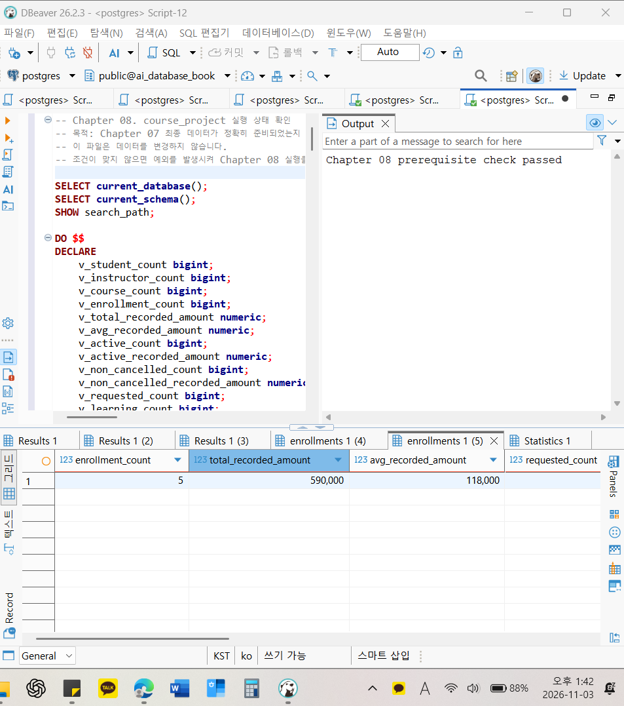
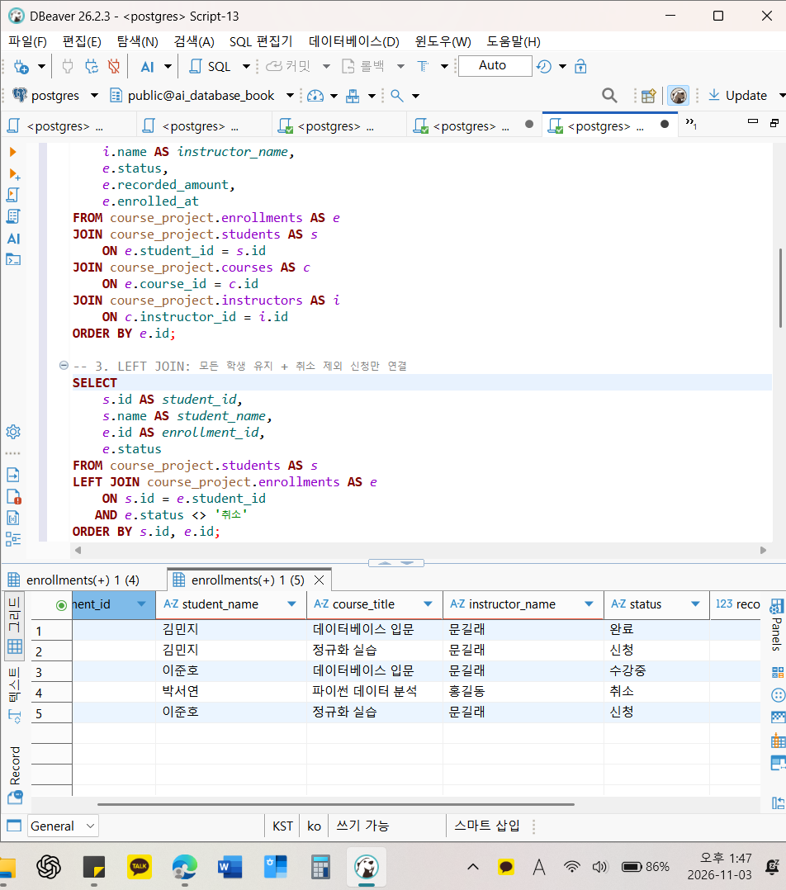
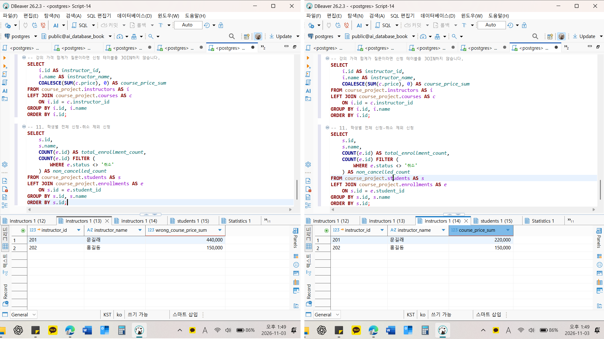
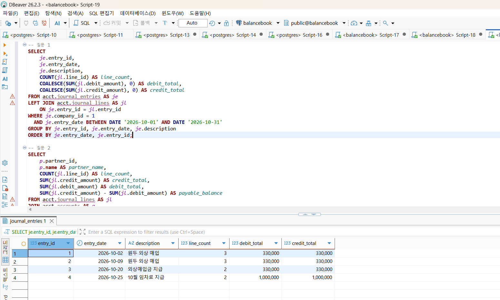

# Chapter 08 확장 실습 답안

> **과제:** JOIN과 집계로 서비스 질문에 답하기  
> **사용 방법:** 이 파일을 내려받아 본인의 GitHub 저장소에 `chapter08_answer.md`라는 이름으로 저장한 뒤 실습하면서 바로 작성합니다.  
> **제출 방법:** LMS에는 파일을 직접 업로드하지 않고, **본인 GitHub 저장소의 `chapter08_answer.md` 파일 URL**을 제출합니다.

---

## 제출 전 주의

이 파일과 캡처 화면에는 실제 비밀번호, 전체 DB 접속 URL, API Key, 개인정보를 기록하지 않습니다.

```text
GitHub 계정 또는 별칭: 유진
과제 작성일: 2026.11.03
사용한 AI 도구: Claude
```

---

# 1. Chapter 07 기준 상태 확인

다음을 실행합니다.

```text
code/chapter08/00_check_course_project.sql
```

## 1-1. 사전 검사 결과

```text
검증 메시지: Chapter 08 prerequisite check passed

students 행 수: 3
instructors 행 수: 2
courses 행 수: 3
enrollments 행 수: 5

전체 신청 건수: 5
전체 recorded_amount: 590000
활성 신청 건수: 3
활성 recorded_amount: 340000
취소 제외 신청 건수: 4
취소 제외 recorded_amount: 440000
```

기준값:

```text
students = 3
instructors = 2
courses = 3
enrollments = 5

전체 = 5 / 590000
활성 = 3 / 340000
취소 제외 = 4 / 440000
```

### 기준값이 다르면 그대로 진행하면 안 되는 이유

```text
Chapter 08의 SQL은 Chapter 07의 최종 데이터를 기준으로 결과가 미리 정해져 있다. 예를 들어 Chapter 07 무결성 테스트에서 넣은 임시 신청이 남아 있으면 신청 건수와 금액 합계가 달라지는데, 이 상태로 진행하면 결과가 다른 이유가 SQL을 잘못 써서인지 데이터가 달라서인지 구분할 수 없다. 그래서 00 파일로 행 수, 상태별 건수, 금액, 없는 학생이나 강의를 가리키는 신청이 없는지를 먼저 확인하고, 다르면 Chapter 07을 다시 실행해 기준 상태를 맞춘 뒤 진행해야 한다.
```

### 증거 화면

권장 경로:

```text
assignments/chapter08/images/step01_prerequisite.png
```



---

# 2. 업무 질문을 SQL보다 먼저 정의하기

다음 세 질문을 각각 SQL 작성 전에 먼저 정의합니다.

## 질문 A

```text
업무 질문: 신청 한 건마다 어떤 학생이 어떤 강의를 신청했고, 그 강의의 강사는 누구인지 조회한다.
결과 한 행의 의미: 신청 한 건
포함 상태: 신청, 수강중, 완료, 취소 모두
제외 상태: 없음
JOIN할 테이블: enrollments, students, courses, instructors
JOIN 경로: enrollments.student_id = students.id, enrollments.course_id = courses.id, courses.instructor_id = instructors.id
INNER JOIN / LEFT JOIN 선택: INNER JOIN
그 이유: 신청 한 건은 반드시 학생 한 명과 강의 하나를 가리키고, 강의는 반드시 강사 한 명을 가리킨다. 세 칸 모두 NOT NULL이고 FK가 걸려 있어 짝이 없는 행이 생기지 않는다. 또 신청이 없는 학생이나 강의는 이 질문에서 볼 필요가 없다.
예상 행 수: 5 (enrollments 행 수와 같다)
```

## 질문 B

```text
업무 질문: 강의마다 취소되지 않은 신청이 몇 건이고, 그 신청의 기록 금액 합계는 얼마인지 조회한다.
결과 한 행의 의미: 강의 하나
포함 상태: 신청, 수강중, 완료
제외 상태: 취소
JOIN할 테이블: courses, enrollments
JOIN 경로: enrollments.course_id = courses.id (courses를 기준으로 LEFT JOIN하고, 취소 제외 조건은 ON에 둔다)
집계 대상: 신청 건수 COUNT(e.id), 고유 학생 수 COUNT(DISTINCT e.student_id), 기록 금액 합계 SUM(e.recorded_amount)
예상 결과: 301은 2건 2명 200000, 302는 2건 2명 240000, 303은 0건 0명 0. 세 강의를 더하면 4건 440000
```

## 질문 C

```text
업무 질문: 학생마다 취소되지 않은 신청이 몇 건인지 조회하고, 취소 제외 신청이 없는 학생도 0건으로 보여 준다.
결과 한 행의 의미: 학생 한 명
포함 상태: 신청, 수강중, 완료
제외 상태: 취소
0건인 부모도 보여야 하는가: 보여야 한다. 신청이 취소된 것뿐인 박서연도 학생 목록에서 빠지면 안 되므로, students를 기준으로 LEFT JOIN하고 취소 제외 조건은 ON에 둔다.
NULL을 어떻게 해석할 것인가: 박서연 행의 enrollments 칸이 NULL인 것은 값이 비어 있다는 뜻이 아니라 연결할 취소 제외 신청이 없다는 뜻이다. 그래서 COUNT(e.id)로 세어 0건으로 표시한다.
예상 결과: 3행. 김민지 2건, 이준호 2건, 박서연 0건
```

---

# 3. INNER JOIN과 다중 JOIN

## 3-1. 신청 한 건마다 학생 이름과 강의 제목 조회

실행 전 예상:

```text
결과 한 행 = 신청 한 건
예상 행 수 = 5
JOIN 경로 = enrollments.student_id = students.id, enrollments.course_id = courses.id
```

내가 실행한 SQL:

```sql
SELECT
    e.id AS enrollment_id,
    s.name AS student_name,
    c.title AS course_title,
    e.status
FROM course_project.enrollments AS e
INNER JOIN course_project.students AS s
    ON e.student_id = s.id
INNER JOIN course_project.courses AS c
    ON e.course_id = c.id
ORDER BY e.id;
```

실제 결과:

```text
실제 행 수: 5
예상과 일치 여부: 일치
```

### 학생 이름이 여러 번 보이는 것이 중복 오류가 아닐 수 있는 이유

```text
결과 한 행은 학생이 아니라 신청 한 건이다. 김민지는 1001, 1002, 이준호는 1003, 1005로 신청이 두 건씩 있어서 이름이 두 번씩 나온다. 신청 ID와 강의가 서로 다르므로 같은 행이 복사된 것이 아니라 서로 다른 신청이다. 여기에 DISTINCT를 붙이면 실제 신청 건수가 줄어든 것처럼 보이게 된다.
```

## 3-2. 학생·강의·강사까지 연결

```text
결과 한 행 = 신청 한 건
강사까지 가는 JOIN 경로 = enrollments.course_id = courses.id 다음에 courses.instructor_id = instructors.id. 신청에는 강사 칸이 없으므로 강의를 거쳐서 강사로 간다.
```

```sql
SELECT
    e.id AS enrollment_id,
    s.name AS student_name,
    c.title AS course_title,
    i.name AS instructor_name,
    e.status,
    e.recorded_amount,
    e.enrolled_at
FROM course_project.enrollments AS e
JOIN course_project.students AS s
    ON e.student_id = s.id
JOIN course_project.courses AS c
    ON e.course_id = c.id
JOIN course_project.instructors AS i
    ON c.instructor_id = i.id
ORDER BY e.id;
```

실제 행 수:

```text
5. 강사를 붙여도 신청 한 건은 강의 하나, 강사 한 명만 가리키므로 행 수가 늘지 않았다.
```

### 증거 화면

권장 경로:

```text
assignments/chapter08/images/step03_inner_join.png
```



---

# 4. LEFT JOIN과 0건 표현

## 4-1. 강의별 취소 제외 신청 수

신청이 없는 강의도 결과에 남도록 작성합니다.

실행 전:

```text
결과 한 행 = 강의 한 개
강의 303의 예상 실제 신청 수 = 0 (303의 신청은 취소된 1004뿐이다)
강의 303의 예상 고유 학생 수 = 0
강의 303의 예상 recorded_amount = 0 (더할 신청이 없어 SUM은 NULL이 되므로 COALESCE로 0을 표시한다)
```

내 SQL:

```sql
SELECT
    c.id AS course_id,
    c.title AS course_title,
    COUNT(e.id) AS non_cancelled_count,
    COUNT(DISTINCT e.student_id) AS student_count,
    COALESCE(SUM(e.recorded_amount), 0) AS non_cancelled_recorded_amount
FROM course_project.courses AS c
LEFT JOIN course_project.enrollments AS e
    ON c.id = e.course_id
   AND e.status <> '취소'
GROUP BY c.id, c.title
ORDER BY c.id;
```

실제 결과:

```text
강의 301: 취소 제외 신청 2건, 고유 학생 2명, recorded_amount 200000
강의 302: 취소 제외 신청 2건, 고유 학생 2명, recorded_amount 240000
강의 303: 취소 제외 신청 0건, 고유 학생 0명, recorded_amount 0
```

## 4-2. `COUNT(*)`와 `COUNT(e.id)` 비교

강의 303을 기준으로 작성합니다.

```text
COUNT(*) 결과: 1
COUNT(e.id) 결과: 0
COUNT(DISTINCT e.student_id) 결과: 0
```

### 왜 `COUNT(*) = 1`인데 실제 신청 수는 0일 수 있나요?

```text
LEFT JOIN은 연결할 신청이 없어도 강의 303 행을 남기고, 신청 쪽 칸을 모두 NULL로 채운 한 행을 만든다. COUNT(*)는 칸의 값과 상관없이 결과 행 수를 세므로 이 한 행을 1로 센다. COUNT(e.id)는 NULL이 아닌 신청 ID만 세므로 0이 된다.
```

### 자식 사건 수를 셀 때 `COUNT(child.id)`가 더 적절한 이유

```text
궁금한 것은 강의에 붙은 신청 건수이고, 신청이 실제로 있으면 그 신청의 id는 PK라서 NULL일 수 없다. 그래서 신청 id가 있는 행만 세는 COUNT(e.id)가 실제 신청 수와 정확히 같다. COUNT(*)는 신청이 없는 강의도 1로 세어 0건과 1건을 구분하지 못한다.
```

---

# 5. `LEFT JOIN`에서 `ON`과 `WHERE` 조건 비교

취소 제외 신청만 연결한다고 가정합니다.

## 5-1. 조건을 `ON`에 둔 경우

```sql
SELECT
    s.id,
    s.name,
    COUNT(e.id) AS non_cancelled_count
FROM course_project.students AS s
LEFT JOIN course_project.enrollments AS e
    ON s.id = e.student_id
   AND e.status <> '취소'
GROUP BY s.id, s.name
ORDER BY s.id;
```

```text
결과 학생 수: 3명 (김민지 2건, 이준호 2건, 박서연 0건)
박서연 포함 여부: 포함, 취소 제외 신청 0건으로 나온다.
```

## 5-2. 조건을 `WHERE`에 둔 경우

```sql
SELECT
    s.id,
    s.name,
    COUNT(e.id) AS non_cancelled_count
FROM course_project.students AS s
LEFT JOIN course_project.enrollments AS e
    ON s.id = e.student_id
WHERE e.status <> '취소'
GROUP BY s.id, s.name
ORDER BY s.id;
```

```text
결과 학생 수: 2명 (김민지 2건, 이준호 2건)
박서연 포함 여부: 포함되지 않는다.
```

## 5-3. 차이 설명

```text
ON 조건이 LEFT JOIN의 오른쪽 연결 대상을 제한하는 방식:
LEFT JOIN은 왼쪽 students 행을 모두 남긴다. ON에 e.status <> '취소'를 두면 각 학생에게 붙일 신청을 고르는 조건이 되어, 취소된 신청만 붙지 않고 학생 행은 그대로 남는다. 붙일 신청이 하나도 없는 학생은 신청 칸이 NULL인 한 행으로 남는다.

WHERE 조건이 JOIN 이후 결과 행을 제거하는 방식:
WHERE는 JOIN이 끝난 결과 행에서 조건에 맞지 않는 행을 지운다. 이때 학생 행을 남겨야 하는지는 따지지 않으므로, 조건에 맞는 신청이 없는 학생은 결과에서 통째로 빠진다. 신청 칸이 NULL인 행도 NULL로는 조건이 참이 되지 않아 함께 지워진다.

이번 사례에서 ON = 3명, WHERE = 2명이 되는 이유:
박서연의 신청은 취소된 1004 한 건뿐이다. ON에 조건을 두면 1004만 붙지 않고 박서연은 신청 칸이 NULL인 행으로 남아 3명이 된다. WHERE에 두면 JOIN 단계에서 1004가 박서연에게 붙었다가 취소라서 지워지고, 박서연에게 남는 행이 없어 2명이 된다.
```

---

# 6. 신청이 없는 학생 찾기 — 두 방법 비교

## 방법 1. `LEFT JOIN ... IS NULL`

```sql
SELECT
    s.id,
    s.name,
    s.email
FROM course_project.students AS s
LEFT JOIN course_project.enrollments AS e
    ON s.id = e.student_id
   AND e.status <> '취소'
WHERE e.id IS NULL;
```

## 방법 2. `NOT EXISTS`

```sql
SELECT
    s.id,
    s.name,
    s.email
FROM course_project.students AS s
WHERE NOT EXISTS (
    SELECT 1
    FROM course_project.enrollments AS e
    WHERE e.student_id = s.id
      AND e.status <> '취소'
);
```

```text
방법 1 결과: 1명
방법 2 결과: 1명
두 결과가 같은가: 같다.
찾아진 학생: 103 박서연
```

### 두 방식의 공통 의미를 자신의 말로 설명

```text
두 방법 모두 학생마다 취소되지 않은 신청이 하나라도 있는지 보고, 하나도 없는 학생만 남긴다. 방법 1은 취소 제외 신청을 ON 조건으로 붙여 본 뒤 붙은 신청이 없어 e.id가 NULL인 학생을 고르고, 방법 2는 그런 신청이 존재하지 않는 학생을 바로 고른다. 박서연은 신청이 있기는 하지만 모두 취소라서 취소 제외 기준으로는 신청이 없는 학생이다.
```

---

# 7. 기본 집계 검산

다음 결과를 직접 확인합니다.

| 분석 범위 | 예상 건수 | 실제 건수 | 예상 금액 | 실제 금액 | 일치? |
| --- | ---: | ---: | ---: | ---: | --- |
| 전체 신청 | 5 | 5 | 590000 | 590000 | 일치 |
| 활성 신청 | 3 | 3 | 340000 | 340000 | 일치 |
| 취소 제외 | 4 | 4 | 440000 | 440000 | 일치 |
| 취소 | 1 | 1 | 150000 | 150000 | 일치 |

## 7-1. 전체 평균 `recorded_amount`

```text
예상 평균: 118000.00 (590000을 5건으로 나눈 값)
실제 평균: 118000.00
```

## 7-2. 취소 제외 평균

```text
예상 평균: 110000.00 (440000을 4건으로 나눈 값)
실제 평균: 110000.00
```

### `recorded_amount`를 실제 회계 매출이라고 부르면 안 되는 이유

```text
recorded_amount는 신청할 때 그 신청 행에 적어 둔 금액일 뿐, 결제가 실제로 되었는지, 환불했는지는 담고 있지 않다. 취소된 1004에도 150000이 그대로 남아 있어서 전체 합계 590000에는 받지 않았거나 돌려준 금액이 들어 있다. 또 회계에서 매출은 강의를 제공한 만큼 인식하는데, 아직 수강을 시작하지 않은 신청 상태의 1002, 1005 금액도 들어 있다. 그래서 이 합계는 매출이 아니라 신청 기록 금액이라고 불러야 한다.
```

---

# 8. `GROUP BY`, `HAVING`, `FILTER`

## 8-1. 상태별 신청 건수

```sql
SELECT
    status,
    COUNT(*) AS enrollment_count,
    SUM(recorded_amount) AS total_recorded_amount
FROM course_project.enrollments
GROUP BY status
ORDER BY CASE status
    WHEN '신청' THEN 1
    WHEN '수강중' THEN 2
    WHEN '완료' THEN 3
    WHEN '취소' THEN 4
    ELSE 99
END;
```

결과:

```text
신청: 2건, 240000
수강중: 1건, 100000
완료: 1건, 100000
취소: 1건, 150000
상태별 합계: 5건, 590000
```

### 상태별 건수 합이 전체 신청 5건과 맞는지 검산

```text
2 + 1 + 1 + 1 = 5건으로 전체 신청 5건과 같고, 금액도 240000 + 100000 + 100000 + 150000 = 590000으로 전체 합계와 같다. 신청 한 건은 상태를 하나만 가지므로, 상태별로 나눈 건수를 다시 더하면 빠지거나 겹치는 신청 없이 전체와 같아야 한다.
```

## 8-2. 강의별 취소 제외 신청 수와 금액

```sql
SELECT
    c.id AS course_id,
    c.title AS course_title,
    COUNT(e.id) AS non_cancelled_count,
    COUNT(DISTINCT e.student_id) AS student_count,
    COALESCE(SUM(e.recorded_amount), 0) AS non_cancelled_recorded_amount
FROM course_project.courses AS c
LEFT JOIN course_project.enrollments AS e
    ON c.id = e.course_id
   AND e.status <> '취소'
GROUP BY c.id, c.title
ORDER BY c.id;
```

```text
강의 301: 2건, 200000
강의 302: 2건, 240000
강의 303: 0건, 0
강의별 합계를 다시 더한 값: 4건, 440000
전체 취소 제외 기준 440000과 일치 여부: 일치
```

## 8-3. `HAVING` 사용

취소 제외 신청이 2건 이상인 강의를 조회합니다.

```sql
SELECT
    c.id,
    c.title,
    COUNT(e.id) AS enrollment_count
FROM course_project.courses AS c
JOIN course_project.enrollments AS e
    ON c.id = e.course_id
WHERE e.status <> '취소'
GROUP BY c.id, c.title
HAVING COUNT(e.id) >= 2
ORDER BY c.id;
```

```text
예상 강의 수: 2 (301, 302)
실제 강의 수: 2 (301 데이터베이스 입문 2건, 302 정규화 실습 2건)
```

---

# 9. 과대 집계 오류 직접 관찰

강사 201의 강의 가격 합계를 구한다고 가정합니다.

## 9-1. 신청까지 JOIN해서 잘못 집계한 결과

```sql
SELECT
    i.id AS instructor_id,
    i.name AS instructor_name,
    SUM(c.price) AS wrong_course_price_sum
FROM course_project.instructors AS i
JOIN course_project.courses AS c
    ON i.id = c.instructor_id
JOIN course_project.enrollments AS e
    ON c.id = e.course_id
GROUP BY i.id, i.name
ORDER BY i.id;
```

```text
강사 201 잘못된 가격 합계: 440000
```

본문 기준:

```text
440000
```

## 9-2. 강의 수준에서 올바르게 집계

```sql
SELECT
    i.id AS instructor_id,
    i.name AS instructor_name,
    COALESCE(SUM(c.price), 0) AS course_price_sum
FROM course_project.instructors AS i
LEFT JOIN course_project.courses AS c
    ON i.id = c.instructor_id
GROUP BY i.id, i.name
ORDER BY i.id;
```

```text
강사 201 올바른 가격 합계: 220000
```

본문 기준:

```text
220000
```

## 9-3. 왜 두 결과가 달라졌나요?

```text
JOIN 전 강의 행 수: 강사 201의 강의는 301, 302 두 행이다.
JOIN 후 강의가 반복된 이유: 강의 301에는 신청 1001, 1003이, 강의 302에는 1002, 1005가 있어서, 신청을 JOIN하면 강의 행이 신청 수만큼 두 번씩 나와 4행이 된다.
SUM이 무엇을 반복해서 더했는가: 강의 가격을 신청 행마다 다시 더했다. 100000 + 100000 + 120000 + 120000 = 440000으로, 실제 강의 가격 합계 220000의 두 배가 되었다.
```

### `SUM(DISTINCT c.price)`를 일반적인 해결책으로 사용하면 안 되는 이유

```text
SUM(DISTINCT c.price)는 같은 강의를 한 번만 더하는 것이 아니라 같은 금액을 한 번만 더한다. 강사 201에게 가격이 똑같이 100000인 강의가 두 개 있다면 실제 합계는 200000이지만 100000만 나온다. 값이 반복된 원인은 질문에 필요 없는 신청 테이블을 JOIN한 것이므로, 강의 가격 합계는 신청을 JOIN하지 않고 강의 테이블에서 바로 구해야 한다.
```

### 증거 화면

권장 경로:

```text
assignments/chapter08/images/step09_over_aggregation.png
```



---

# 10. 상세 결과 ↔ 집계 결과 교차 검산

강의 하나를 선택합니다.

```text
선택한 course_id: 301
강의 제목: 데이터베이스 입문
```

## 10-1. 상세 신청 행 조회

```sql
SELECT
    e.id AS enrollment_id,
    s.name AS student_name,
    e.status,
    e.recorded_amount
FROM course_project.enrollments AS e
JOIN course_project.students AS s
    ON e.student_id = s.id
WHERE e.course_id = 301
  AND e.status <> '취소'
ORDER BY e.id;
```

```text
상세 행 수: 2 (1001 김민지 완료 100000, 1003 이준호 수강중 100000)
상세 recorded_amount를 직접 더한 값: 100000 + 100000 = 200000
```

## 10-2. 집계 SQL

```sql
SELECT
    COUNT(e.id) AS enrollment_count,
    SUM(e.recorded_amount) AS recorded_amount_total
FROM course_project.enrollments AS e
WHERE e.course_id = 301
  AND e.status <> '취소';
```

```text
집계 건수: 2
집계 금액: 200000
```

## 10-3. 비교

```text
상세 행 수와 COUNT 결과 일치 여부: 일치 (2건)
상세 금액 합과 SUM 결과 일치 여부: 일치 (200000)
다르다면 원인: 다르지 않았다. 두 SQL 모두 강의 301과 취소 제외라는 같은 범위를 썼고, 8-2의 강의 301 결과 2건, 200000과도 같다.
```

---

# 11. 자동 완료 게이트

다음을 실행합니다.

```text
code/chapter08/03_join_aggregation_validation.sql
```

```text
최종 검증 메시지: Chapter 08 join and aggregation validation passed
```

기대 메시지:

```text
Chapter 08 join and aggregation validation passed
```

### 자동 검증이 통과했어도 사람이 SQL 의미를 설명해야 하는 이유

```text
자동 검증은 SQL 결과가 미리 정한 숫자와 같은지만 본다. 숫자가 맞아도 SQL이 질문에 맞는 방식으로 계산했다는 뜻은 아니다. 9번에서 강사 202는 신청을 잘못 JOIN한 SQL과 올바른 SQL이 모두 150000으로 같았는데, 신청이 한 건뿐이라 우연히 같았을 뿐이고 신청이 늘면 바로 틀린다. 그래서 결과 한 행의 기준, 상태 범위, JOIN 경로, COUNT 대상을 사람이 설명할 수 있어야 데이터가 바뀌어도 결과를 믿을 수 있다.
```

---

# 12. 개인 프로젝트 업무 질문 3개 만들기

Chapter 07에서 작성한 개인 프로젝트를 사용합니다.

```text
BalanceBook의 Chapter 07 설계대로 database-project/database의 01_schema.sql로 balancebook 데이터베이스에 acct 스키마와 테이블 10개를 만들고, 02_seed.sql로 Chapter 05에서 정한 Seed(가나카페 사건 1~4, 전표가 없는 다라학원)를 넣은 뒤 아래 SQL을 실행했다.
```

| 질문 ID | 업무 질문 | 결과 한 행 | 포함/제외 범위 | JOIN 경로 | 집계 대상 | 검산 방법 |
| --- | --- | --- | --- | --- | --- | --- |
| P08-Q01 | 가나카페의 2026년 10월 전표마다 차변 합계와 대변 합계가 같은가? | 가나카페의 10월 전표 한 장 | 가나카페(company_id 1), 전표일자 10월 1일부터 31일까지. 역분개 전표도 차대가 맞아야 하므로 포함한다. | journal_entries 기준으로 journal_lines를 LEFT JOIN (journal_lines.entry_id = journal_entries.entry_id) | 분개 줄 수 COUNT(jl.line_id), 차변 합계 SUM(jl.debit_amount), 대변 합계 SUM(jl.credit_amount) | 전표별 줄 수를 더한 값이 10월 분개 전체 줄 수와 같은지, 전표별 차변 합계를 모두 더한 값과 대변 합계를 모두 더한 값이 같은지 본다. |
| P08-Q02 | 가나카페가 거래처별로 아직 갚지 않은 외상매입금은 얼마인가? | 외상매입금 분개가 있는 가나카페 거래처 하나 | 가나카페의 거래처, 외상매입금 계정 분개만. 잔액이므로 기간은 제한하지 않고 역분개도 포함한다. 외상매입금 분개가 없는 거래처는 갚을 돈이 없으므로 제외한다. | journal_lines.account_id = accounts.account_id, journal_lines.partner_id = partners.partner_id (INNER JOIN) | 대변 합계에서 차변 합계를 뺀 잔액 | 그 거래처의 외상매입금 분개 상세 행을 조회해 대변 금액과 차변 금액을 직접 더해 비교한다. |
| P08-Q03 | 사업자마다 전표는 몇 장이고 분개는 몇 줄인가? 전표가 없는 사업자도 0으로 보여 준다. | 사업자 한 곳 | 모든 사업자, 모든 기간. 역분개 전표도 한 장으로 센다. | companies 기준으로 journal_entries를 LEFT JOIN (company_id), 다시 journal_lines를 LEFT JOIN (entry_id) | 전표 수 COUNT(DISTINCT je.entry_id), 분개 줄 수 COUNT(jl.line_id) | 사업자별 전표 수를 더한 값이 journal_entries 전체 행 수와, 분개 줄 수를 더한 값이 journal_lines 전체 행 수와 같은지 본다. |

## 12-1. 질문 1 SQL

```sql
SELECT
    je.entry_id,
    je.entry_date,
    je.description,
    COUNT(jl.line_id) AS line_count,
    COALESCE(SUM(jl.debit_amount), 0) AS debit_total,
    COALESCE(SUM(jl.credit_amount), 0) AS credit_total
FROM acct.journal_entries AS je
LEFT JOIN acct.journal_lines AS jl
    ON je.entry_id = jl.entry_id
WHERE je.company_id = 1
  AND je.entry_date BETWEEN DATE '2026-10-01' AND DATE '2026-10-31'
GROUP BY je.entry_id, je.entry_date, je.description
ORDER BY je.entry_date, je.entry_id;
```

```text
예상 결과: 4행. 10월 2일 전표 3줄 330,000 / 330,000, 10월 9일 전표 3줄 330,000 / 330,000, 10월 20일 전표 2줄 330,000 / 330,000, 10월 25일 전표 2줄 1,000,000 / 1,000,000. 네 전표 모두 차변 합계와 대변 합계가 같다.
실제 결과: 예상과 같은 4행이 나왔다. 네 전표 모두 차변 합계와 대변 합계가 같고, 분개가 없는 전표는 없었다.
검산 결과: 같은 범위의 분개를 전표로 묶지 않고 직접 세고 더하니 10줄, 차변 1,990,000, 대변 1,990,000이었다. 전표별 줄 수 3 + 3 + 2 + 2 = 10, 차변 330,000 + 330,000 + 330,000 + 1,000,000 = 1,990,000, 대변도 1,990,000으로 모두 일치했다.
```



## 12-2. 질문 2 SQL

```sql
SELECT
    p.partner_id,
    p.name AS partner_name,
    COUNT(jl.line_id) AS line_count,
    SUM(jl.credit_amount) AS credit_total,
    SUM(jl.debit_amount) AS debit_total,
    SUM(jl.credit_amount) - SUM(jl.debit_amount) AS payable_balance
FROM acct.journal_lines AS jl
JOIN acct.accounts AS a
    ON jl.account_id = a.account_id
JOIN acct.partners AS p
    ON jl.partner_id = p.partner_id
WHERE p.company_id = 1
  AND a.name = '외상매입금'
GROUP BY p.partner_id, p.name
ORDER BY p.partner_id;
```

```text
예상 결과: 1행. 가나로스터리 분개 3줄, 대변 합계 660,000, 차변 합계 330,000, 잔액 330,000
실제 결과: 예상과 같은 1행이 나왔다. 가나로스터리 분개 3줄, 대변 합계 660,000, 차변 합계 330,000, 잔액 330,000
검산 결과: 가나로스터리의 외상매입금 분개 상세를 조회하니 3줄(10월 2일 대변 330,000, 10월 9일 대변 330,000, 10월 20일 차변 330,000)이었다. 대변 330,000 + 330,000 = 660,000에서 차변 330,000을 빼면 330,000으로 질문 2의 잔액과 일치했다.
```

## 12-3. 질문 3 SQL

```sql
SELECT
    c.company_id,
    c.name AS company_name,
    COUNT(DISTINCT je.entry_id) AS entry_count,
    COUNT(jl.line_id) AS line_count
FROM acct.companies AS c
LEFT JOIN acct.journal_entries AS je
    ON c.company_id = je.company_id
LEFT JOIN acct.journal_lines AS jl
    ON je.entry_id = jl.entry_id
GROUP BY c.company_id, c.name
ORDER BY c.company_id;
```

```text
예상 결과: 2행. 가나카페 전표 4장 분개 10줄, 다라학원 전표 0장 분개 0줄
실제 결과: 예상과 같은 2행이 나왔다. 가나카페 전표 4장 분개 10줄, 다라학원 전표 0장 분개 0줄
검산 결과: Seed 입력 후 확인한 행 수가 journal_entries 4행, journal_lines 10행이었다. 사업자별 전표 수 합 4 + 0 = 4, 분개 줄 수 합 10 + 0 = 10으로 모두 일치했다. 분개를 JOIN하면 전표가 분개 줄 수만큼 반복되므로 전표 수는 DISTINCT로 세야 하고, DISTINCT 없이 세면 가나카페가 10장으로 잘못 나온다.
```

> 아직 개인 프로젝트 테이블을 PostgreSQL로 완성하지 않았다면 SQL 초안과 예상 검산 방법까지만 작성하고 `미실행`이라고 명시합니다.

---

# 13. AI를 JOIN·집계 리뷰어로 활용

## 13-1. 내가 AI에게 전달한 질문

```text
나는 데이터베이스 입문 수업에서 소규모 사업자용 복식부기 장부 서비스(BalanceBook)를 설계하고 있습니다.
아래 테이블 구조에서 다음 질문에 답하는 PostgreSQL SQL을 작성하고, JOIN과 집계 관점에서 위험한 부분을 함께 알려 주세요.

질문: 사업자별로 전표가 몇 장이고 분개가 몇 줄인지 조회한다. 전표가 하나도 없는 사업자도 결과에 나와야 한다.

테이블 (스키마 acct)
- companies(company_id PK, name, business_no)
- journal_entries(entry_id PK, company_id FK, entry_date, description, created_by, reversal_of_entry_id)
- journal_lines(line_id PK, entry_id FK, account_id FK, partner_id FK 비어 있어도 됨, debit_amount, credit_amount)
- evidences(evidence_id PK, entry_id FK, evidence_type, issue_date, amount)

다음을 함께 설명해 주세요.
1. 결과 한 행이 무엇인지
2. 포함, 제외 범위 (역분개 전표를 셀지)
3. JOIN 경로와 INNER JOIN, LEFT JOIN 선택
4. COUNT 대상
5. 과대 집계 위험
6. 상세 결과로 검산하는 방법
```

## 13-2. 내 SQL과 AI SQL 비교

| 검토 항목 | 내 판단/SQL | AI 제안 | 최종 선택 | 이유 |
| --- | --- | --- | --- | --- |
| 결과 한 행 | 사업자 한 곳 | 사업자 한 곳. 결과 행 수가 companies 행 수와 같아야 한다. | 내 판단 그대로 | 판단이 같았고, 실제 결과도 companies와 같은 2행이었다. |
| 상태 범위 | 모든 기간의 전표를 세고, 역분개 전표도 한 장으로 센다. | 기본은 역분개 전표도 센다. 살아 있는 거래만 보려면 역분개 전표와 취소된 원래 전표를 함께 빼야 하고, 역분개 건수는 FILTER로 옆 칸에 따로 보여 주면 좋다. | 역분개 포함, 역분개 건수 칸은 보류 | 이 질문은 장부에 전표가 몇 장 있는지를 보는 것이라 둘 다 세야 한다. 역분개 전표만 빼면 취소된 원래 전표가 살아 있는 것처럼 남는다는 점은 회계상으로도 맞다. 지금 Seed에는 역분개가 없어 칸을 더해도 0만 나오기 때문에, 역분개 데이터를 넣을 때 다시 보기로 했다. |
| JOIN 경로 | companies에서 company_id로 journal_entries를, 거기서 entry_id로 journal_lines를 붙인다. | 같은 경로. evidences, 계정과목, 거래처는 이 질문에 필요 없으니 붙이지 않는다. | 내 SQL 그대로 | 필요 없는 테이블까지 붙이면 행만 늘어난다. |
| INNER/LEFT 선택 | 두 번 모두 LEFT JOIN | 같음. 두 번째를 INNER JOIN으로 바꾸면 전표가 없는 사업자와 분개가 없는 전표가 빠진다. | 내 SQL 그대로 | 다라학원처럼 전표가 없는 사업자를 남기려면 뒤에 이어지는 JOIN까지 LEFT JOIN이어야 한다. |
| COUNT 대상 | 전표 수는 COUNT(DISTINCT je.entry_id), 분개 줄 수는 COUNT(jl.line_id) | 같음. COUNT(*)와 COUNT(je.entry_id)가 왜 틀리는지도 같은 방식으로 설명했다. | 내 SQL 그대로 | entry_id는 PK라서 DISTINCT를 걸어도 다른 전표끼리 합쳐질 일이 없다. |
| 과대 집계 위험 | 분개를 붙이면 전표가 분개 줄 수만큼 반복되므로 전표 수는 DISTINCT로 센다. | evidences까지 붙이면 분개 줄과 증빙이 곱해진다. 건수는 DISTINCT로 맞출 수 있어도 금액 합계는 맞출 수 없으므로, 테이블마다 먼저 집계하고 붙이는 WITH 방식이 안전하다. | 내 SQL 그대로, WITH는 보류 | 이번 질문은 분개 테이블 하나만 붙이기 때문에 지금 SQL로도 정확하다. WITH는 아직 배우지 않았고, 증빙 수나 금액을 같이 봐야 할 때 다시 생각해 보려고 한다. |
| 상세 검산 방법 | 사업자별 전표 수와 분개 줄 수를 더해서 journal_entries 4행, journal_lines 10행과 비교한다. | 같은 비교에 결과 행 수와 companies 행 수 비교를 더한다. 사업자 하나를 전표별로 펼쳐 보기, 전표가 없는 사업자 수 세기, 분개 없는 전표나 증빙이 2건인 전표 같은 테스트 데이터 넣기도 함께 제안했다. | 행 수 비교는 수용, 테스트 데이터는 보류 | 결과 2행이 companies 2행과 같은 것도 같이 확인했다. 테스트 데이터는 프로젝트 Seed를 보강할 때 실패 테스트와 함께 넣을 생각이다. |

### AI가 만든 SQL에서 발견한 위험 또는 확인한 점

```text
AI의 기본 SQL은 내가 쓴 질문 3 SQL과 거의 똑같았다. 두 번 모두 LEFT JOIN을 쓰고, 전표 수는 COUNT(DISTINCT je.entry_id), 분개 줄 수는 COUNT(jl.line_id)로 셌다. 그래서 결과도 가나카페 4장 10줄, 다라학원 0장 0줄로 같다.

evidences를 붙이면 숫자가 부풀어 오른다는 점도 12-3에서 내가 정리한 것과 같았다. 전표 1에 증빙이 2건이면 전표 1의 분개 3줄이 두 번씩 나와 6행이 되고, 가나카페 분개 줄 수가 10이 아니라 13이 된다. 줄 수는 DISTINCT로 다시 맞출 수 있지만, 차변 합계 같은 금액은 그렇게 고칠 수 없다.

다만 역분개 설명 중 한 부분은 틀렸다. AI는 역분개를 빼는 조건을 WHERE에 두면 전표가 모두 역분개와 관련된 사업자가 결과에서 사라진다고 했다. 그런데 WHERE je.reversal_of_entry_id IS NULL만 쓰면 원래 전표는 이 칸이 비어 있어서 그대로 남는다. 원래 전표와 역분개 전표 한 쌍만 있는 사업자라면, 사업자가 사라지는 것이 아니라 이미 취소된 원래 전표가 1장으로 세어진다. 사업자가 아예 사라지는 것은 취소된 원래 전표를 빼는 NOT EXISTS 조건까지 WHERE에 넣었을 때다. 어느 쪽이든 결과가 틀리기 때문에 ON에 두라는 결론은 맞지만, 그 이유는 정확하지 않았다.
```

### AI SQL이 실행 성공했다고 바로 정답이라고 할 수 없는 이유

```text
오류 없이 실행되었다는 것은 문법이 맞다는 뜻일 뿐이다. 질문 3에서 COUNT(DISTINCT je.entry_id) 대신 COUNT(je.entry_id)를 써도 SQL은 잘 실행되지만, 가나카페 전표가 10장으로 나온다. 역분개 조건을 WHERE에 둔 SQL도 실행은 되는데 결과가 틀리게 나온다. 이번처럼 AI가 결론은 맞게 말하면서 이유는 틀리게 설명하는 경우도 있었다. 그래서 AI가 쓴 SQL도 내 SQL처럼 결과 한 행, 범위, JOIN 경로, COUNT 대상을 질문과 맞춰 보고, 상세 결과와 비교해 숫자가 맞는지 확인한 다음에야 믿을 수 있다.
```

---

# 14. 최종 성찰

아래 문장은 본인의 말로 작성합니다.

```text
1. JOIN SQL을 작성하기 전에 가장 먼저 정해야 하는 것은
   결과 한 행이 무엇인지와 어떤 상태까지 포함할지이다.

2. LEFT JOIN에서 COUNT(*) 대신 COUNT(child.id)를 검토해야 하는 이유는
   연결된 자식이 없어도 부모 행이 NULL 칸을 가진 한 행으로 남아서, COUNT(*)는 0건을 1건으로 세기 때문이다.

3. ON과 WHERE 조건 위치가 중요한 이유는
   ON에 둔 조건은 붙일 자식 행만 고르고 부모 행은 남기지만, WHERE에 둔 조건은 JOIN이 끝난 뒤 행을 지워서 0건인 부모까지 결과에서 사라지게 하기 때문이다.

4. 여러 1:N 관계를 JOIN한 뒤 바로 SUM하면 위험한 이유는
   부모 행이 자식 수만큼 반복되어 부모의 값이 여러 번 더해지기 때문이다.

5. 집계 결과를 신뢰하기 전에 가장 좋은 검산 방법 중 하나는
   같은 범위의 상세 행을 직접 조회해 건수와 금액을 더해 보고, 집계 결과와 같은지 비교하는 것이다.
```

---

# 15. 제출 체크리스트

- [x] `chapter08_answer.md`를 본인 저장소에 만들었다.
- [x] `00_check_course_project.sql`이 통과했다.
- [x] 업무 질문마다 결과 한 행을 먼저 정의했다.
- [x] INNER JOIN과 다중 JOIN을 실행했다.
- [x] LEFT JOIN에서 0건 부모를 확인했다.
- [x] `COUNT(*)`와 `COUNT(child.id)` 차이를 설명했다.
- [x] ON과 WHERE 조건 위치 차이를 직접 비교했다.
- [x] `LEFT JOIN ... IS NULL`과 `NOT EXISTS`를 비교했다.
- [x] 전체/활성/취소 제외 기준값을 직접 검산했다.
- [x] `GROUP BY`, `HAVING`을 사용했다.
- [x] 과대 집계 오류와 수정 결과를 비교했다.
- [x] 상세 결과와 집계 결과를 교차 검산했다.
- [x] `03_join_aggregation_validation.sql`이 통과했다.
- [x] 개인 프로젝트 업무 질문 3개를 작성했다.
- [x] AI SQL을 실행 성공 여부가 아니라 의미와 검산 결과로 평가했다.
- [x] 핵심 캡처는 3~4장 정도만 사용했다.
- [x] 비밀번호·개인정보·비밀정보가 없다.
- [x] GitHub 웹에서 Markdown과 이미지가 정상적으로 보인다.
- [x] 최종 답안을 commit/push했다.

---

# 16. LMS 제출 URL

아래 형식의 **본인 GitHub 파일 URL**을 LMS에 제출합니다.

```text
https://github.com/<본인-GitHub-ID>/<본인-저장소>/blob/main/assignments/chapter08/chapter08_answer.md
```

내 제출 URL:

```text
https://github.com/dhdbwls777/database-course-2026-2/blob/main/assignments/chapter08/chapter08_answer.md
```

> 저장소 메인 URL, 교수자 템플릿 URL, Raw URL이 아니라 **작성 완료된 본인 `chapter08_answer.md` 파일 화면 URL**을 제출합니다.
