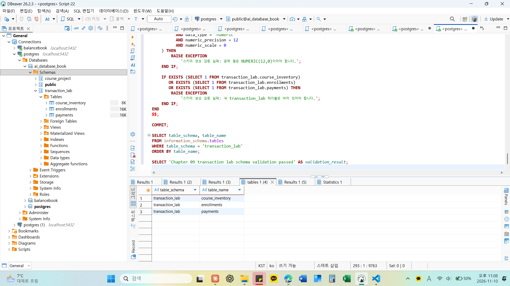
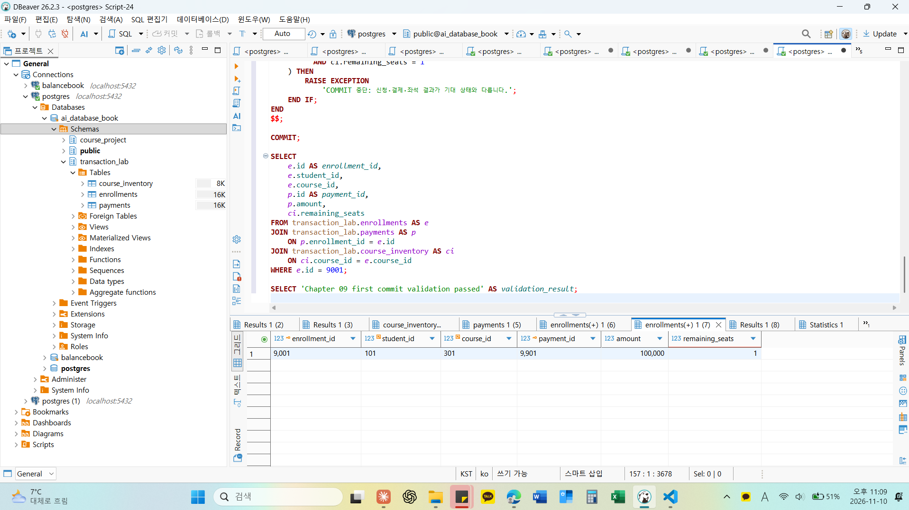
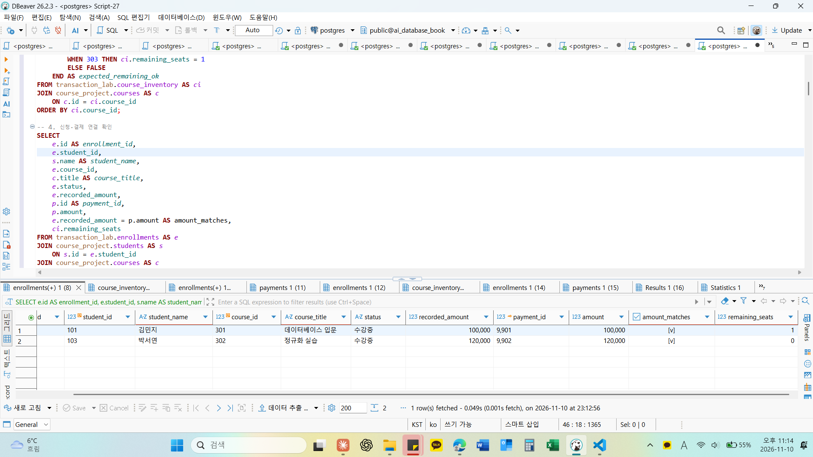
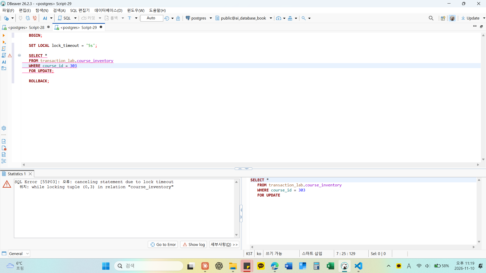

# Chapter 09 확장 실습 답안

> **과제:** 트랜잭션으로 데이터 정합성 지키기  
> **사용 방법:** 이 파일을 내려받아 본인의 GitHub 저장소에 `chapter09_answer.md`라는 이름으로 저장한 뒤 실습하면서 바로 작성합니다.  
> **제출 방법:** LMS에는 파일을 직접 업로드하지 않고, **본인 GitHub 저장소의 `chapter09_answer.md` 파일 URL**을 제출합니다.

---

## 제출 전 주의

이 파일과 캡처 화면에는 실제 비밀번호, 전체 DB 접속 URL, API Key, 개인정보를 기록하지 않습니다.

```text
GitHub 계정 또는 별칭: 유진
과제 작성일: 2026.11.10
사용한 AI 도구: Claude
```

---

# 1. 시작 환경과 Chapter 07·08 기준 상태 확인

다음을 실행하거나 Chapter 09의 `01_transaction_lab_schema.sql` 사전 검사를 확인합니다.

```sql
SELECT current_database();
SELECT current_user;
SELECT current_schema();
SHOW search_path;
SHOW transaction_read_only;
```

| 확인 항목 | 실제 결과 | 의미 |
| --- | --- | --- |
| `current_database()` | ai_database_book | 지금 연결된 데이터베이스 이름이다. Chapter 09 파일은 이 DB가 아니면 실행을 멈춘다. |
| `current_user` | postgres | 지금 SQL을 실행하는 계정이다. transaction_lab 스키마를 만들려면 이 계정에 DB의 CREATE 권한이 있어야 한다. |
| `current_schema()` | public | 스키마 이름을 생략했을 때 쓰는 기본 스키마다. 실습 SQL은 모두 course_project.와 transaction_lab.을 붙여 쓰므로 public이어도 된다. |
| `search_path` | public, "$user" | 스키마 이름을 생략했을 때 테이블을 찾는 순서다. |
| `transaction_read_only` | off | off면 데이터를 바꿀 수 있는 연결이다. |

Chapter 07·08 기준값:

```text
students = 3
instructors = 2
courses = 3
enrollments = 5
전체 recorded_amount = 590000
활성 = 3 / 340000
취소 제외 = 4 / 440000
```

### 기준 상태가 다르면 Chapter 09를 계속 진행하면 안 되는 이유

```text
Chapter 09의 실습 테이블은 course_project의 학생과 강의를 FK로 가리키고, 신청 금액과 결제 금액도 강의 301, 302, 303의 가격을 그대로 가져온다. 기준 상태가 다르면 03부터 06까지의 파일이 기대하는 좌석 수와 금액이 맞지 않아 중간에 멈추거나, 결과가 달라진 이유가 트랜잭션 때문인지 원래 데이터가 달라서인지 구분할 수 없다. 또 06 파일은 실습이 끝난 뒤 course_project가 그대로인지 같은 기준값으로 다시 검사하므로, 시작할 때부터 기준과 같아야 실습이 course_project를 건드리지 않았다는 것을 보여 줄 수 있다. 그래서 01 파일의 사전 검사가 통과한 뒤에 진행했다.
```

---

# 2. `transaction_lab` 스키마 생성

실행 파일:

```text
code/chapter09/01_transaction_lab_schema.sql
```

## 2-1. 생성 전 예상

```text
생성될 스키마: transaction_lab
생성될 테이블 3개: course_inventory, enrollments, payments

course_inventory 한 행의 의미: 강의 하나의 정원과 남은 좌석 수
enrollments 한 행의 의미: 학생 한 명이 강의 하나를 신청한 기록 한 건 (상태는 수강중 또는 취소)
payments 한 행의 의미: 신청 한 건에 대한 결제 기록 한 건 (신청 하나에 결제는 최대 한 건)
```

## 2-2. 생성 결과

```text
통과 메시지: Chapter 09 transaction lab schema validation passed
```

기대 메시지:

```text
Chapter 09 transaction lab schema validation passed
```

### Chapter 07·08의 `course_project`와 별도 `transaction_lab`을 사용하는 이유

```text
트랜잭션 실습에서는 좌석을 줄이고 신청과 결제를 넣었다가 ROLLBACK하거나 일부러 오류를 내기도 한다. 이 작업을 course_project에서 하면 Chapter 07과 08에서 맞춰 둔 3/2/3/5 행 수와 590000 같은 기준값이 바뀌어 이후 장에서 쓸 기준 데이터가 망가질 수 있다. 또 course_project에는 좌석과 결제 정보가 없다. 그래서 학생과 강의는 course_project의 것을 FK로 가리키기만 하고, 바뀌는 좌석, 신청, 결제는 transaction_lab에 따로 두었다. 문제가 생기면 transaction_lab만 지우고 다시 만들 수 있다.
```

### 증거 화면

권장 경로:

```text
assignments/chapter09/images/step02_schema.png
```



---

# 3. 초기 좌석과 기준 데이터 입력

실행 파일:

```text
code/chapter09/02_transaction_lab_seed.sql
```

## 3-1. 실행 전 예상

```text
course 301 remaining_seats 예상: 2 (정원 2)
course 302 remaining_seats 예상: 1 (정원 1)
course 303 remaining_seats 예상: 1 (정원 1)
lab enrollments 예상 행 수: 0
payments 예상 행 수: 0
```

## 3-2. 실제 결과

```text
course 301 remaining_seats: 2
course 302 remaining_seats: 1
course 303 remaining_seats: 1
lab enrollments 행 수: 0
payments 행 수: 0
통과 메시지: Chapter 09 transaction lab seed validation passed
```

기대 초기 상태:

```text
course 301 / 302 / 303 remaining_seats = 3 / 0 / 0
lab enrollments = 0
payments = 0
```

### 예상과 실제가 다른 경우 원인

```text
모두 예상과 같았다. 다만 위 기대 초기 상태에는 remaining_seats가 3 / 0 / 0으로 적혀 있는데, 02 파일은 강의 301, 302, 303의 정원과 남은 좌석을 2/2, 1/1, 1/1로 넣고 이 값을 스스로 검사한다. 3 / 0 / 0은 같은 파일이 함께 검사하는 course_inventory 3행, enrollments 0행, payments 0행과 같은 숫자다. 03부터 05까지의 파일도 시작 좌석을 301은 2, 302는 1로 검사하므로 2 / 1 / 1을 기준으로 진행했다.
```

---

# 4. 첫 번째 정상 COMMIT 추적

실행 파일:

```text
code/chapter09/03_commit_transaction.sql
```

이 실습은 학생 101이 강의 301을 신청하는 하나의 업무 단위를 추적합니다.

## 4-1. 업무 단위 정의

```text
이 트랜잭션에서 함께 성공해야 하는 변경 1: course_inventory에서 강의 301의 remaining_seats를 1 줄인다. (2에서 1)
변경 2: enrollments에 학생 101, 강의 301의 수강중 신청 9001을 넣는다. 금액은 강의 301 가격인 100000이다.
변경 3: payments에 신청 9001의 결제 9901을 100000으로 넣는다.

하나라도 실패하면 전체를 취소해야 하는 이유: 세 변경이 모두 있어야 좌석 한 개가 신청 한 건, 결제 한 건과 짝이 맞는다. 좌석만 줄고 신청이 없으면 아무도 쓰지 않는 좌석이 사라지고, 신청만 있고 결제가 없으면 돈을 내지 않은 수강생이 생기며, 결제만 있으면 무엇에 대한 결제인지 알 수 없다. 그래서 하나라도 실패하면 이미 한 변경까지 모두 취소해야 한다.
```

## 4-2. 상태 변화 기록

| 시점 | course 301 남은 좌석 | lab enrollment 9001 | payment 9901 | 설명 |
| --- | ---: | --- | --- | --- |
| BEGIN 전 | 2 | 없음 | 없음 | 02 입력 직후 상태다. |
| 트랜잭션 내부 | 1 | 있음 (수강중, 100000) | 있음 (100000) | 세 변경이 들어갔지만 COMMIT 전이라 아직 확정되지 않았고 이 세션에서만 보인다. |
| COMMIT 후 | 1 | 있음 (수강중, 100000) | 있음 (100000) | 변경이 확정되어 다른 세션에서도 보이고, 이후 ROLLBACK을 해도 되돌아가지 않는다. |

## 4-3. COMMIT 조건

```text
좌석 UPDATE 기대 영향 행 수: 1
실제 영향 행 수: 1 (마지막 RETURNING에 결제 9901 한 행이 나왔다. 결제는 좌석 차감에 성공한 행에서만 이어지므로 좌석 UPDATE도 1행이다.)
신청 생성 기대 행 수: 1
결제 생성 기대 행 수: 1
recorded_amount와 payment.amount 일치 여부: 일치 (둘 다 100000)
최종 COMMIT 판단: COMMIT. 03 파일은 COMMIT 전에 9001 수강중 100000, 9901 100000, 강의 301 남은 좌석 1을 스스로 검사하고 하나라도 다르면 멈추는데, COMMIT까지 실행되고 통과 메시지가 나왔으므로 모두 맞았다는 뜻이다.
```

기대 메시지:

```text
Chapter 09 first commit validation passed
```

### SQL 오류가 없었다는 사실만으로 COMMIT하면 안 되는 이유

```text
좌석이 0인 강의에 같은 SQL을 실행해도 오류는 나지 않고 좌석 UPDATE가 0행이 될 뿐이다. 다른 강의의 좌석을 줄이거나 금액을 잘못 가져와도 SQL은 정상 실행된다. 오류가 없다는 것은 문법과 제약조건을 어기지 않았다는 뜻이지 업무가 의도대로 처리되었다는 뜻이 아니다. 그래서 03 파일처럼 COMMIT 전에 영향 행 수, 신청과 결제의 연결, 금액 일치, 남은 좌석을 확인하고 모두 맞을 때만 COMMIT해야 한다.
```

### 증거 화면

권장 경로:

```text
assignments/chapter09/images/step04_commit.png
```



---

# 5. ROLLBACK으로 전체 원상복구 확인

실행 파일:

```text
code/chapter09/04_rollback_transaction.sql
```

## 5-1. ROLLBACK 전 예상

```text
트랜잭션 안에서 임시로 바뀔 값: 강의 302의 remaining_seats가 1에서 0이 되고, 신청 9002(학생 102, 강의 302, 120000)와 결제 9902(120000)가 생긴다.
ROLLBACK 후 다시 돌아와야 할 값: 강의 302의 remaining_seats 1, 신청 9002와 결제 9902는 없음
이미 이전 파일에서 COMMIT된 9001/9901은 유지되어야 하는가: 유지되어야 한다. 이미 COMMIT된 변경이고, ROLLBACK은 현재 트랜잭션에서 한 변경만 취소한다.
```

## 5-2. 실제 결과

```text
ROLLBACK 후 course 301 상태: remaining_seats 1 그대로다. 03에서 COMMIT한 결과가 유지되었고, 이번에 임시로 바꾼 강의 302도 remaining_seats 1로 돌아왔다.
ROLLBACK 후 lab enrollments 행 수: 1 (9001만 있고 9002는 없다)
ROLLBACK 후 payments 행 수: 1 (9901만 있고 9902는 없다)
9001 존재 여부: 있음
9901 존재 여부: 있음
통과 메시지: Chapter 09 rollback validation passed
```

기대 메시지:

```text
Chapter 09 rollback validation passed
```

## 5-3. ROLLBACK과 IDENTITY

```text
ROLLBACK이 테이블 행 변경을 되돌리는 방식:
트랜잭션 안에서 바꾼 좌석과 넣은 신청, 결제를 확정하지 않고 모두 버려 BEGIN 전 상태로 돌린다. 그래서 강의 302 좌석은 1로 돌아오고 9002와 9902는 처음부터 없던 것처럼 된다.

IDENTITY 자동 번호가 반드시 이전 값으로 되돌아가지는 않는 이유:
IDENTITY 자동 번호는 여러 세션이 동시에 받아도 겹치지 않도록, 한 번 나누어 준 번호는 트랜잭션이 취소되어도 다시 쓰지 않는다. 그래서 자동 번호로 넣었다가 ROLLBACK하면 그 번호는 건너뛰고 다음 번호부터 쓰인다. 이번 실습은 9002, 9902를 직접 넣었기 때문에 ROLLBACK 후 05에서 같은 번호를 다시 쓸 수 있었다. 대신 직접 넣은 번호는 자동 번호를 움직이지 않으므로, 05에서 RESTART WITH로 다음 자동 번호를 9003, 9903으로 맞추었다.

번호가 건너뛰었다고 데이터 손상이라고 단정할 수 없는 이유:
번호는 행을 구분하기 위한 값일 뿐 몇 건이 있는지를 세는 값이 아니다. ROLLBACK이나 실패한 INSERT 때문에 번호가 비는 것은 정상 동작이다. 데이터가 맞는지는 번호가 이어지는지가 아니라 좌석, 신청, 결제의 행 수와 연결, 금액이 서로 맞는지로 확인해야 한다.
```

---

# 6. 두 번째 COMMIT과 좌석 부족 0행 관찰

실행 파일:

```text
code/chapter09/05_commit_and_sold_out.sql
```

## 6-1. 두 번째 정상 COMMIT

```text
생성된 enrollment id: 9002
학생 id: 103
course id: 302
recorded_amount: 120000
payment id: 9902
payment amount: 120000
```

## 6-2. 좌석 부족 시도

```text
좌석 확보 UPDATE 기대 영향 행 수: 0 (강의 302의 남은 좌석이 0이다)
실제 영향 행 수: 0 (좌석 결과가 없어 마지막 RETURNING도 0행이었다)
후속 enrollment 생성 행 수: 0
후속 payment 생성 행 수: 0
```

기준상 좌석 부족 시 생성되지 않아야 하는 ID:

```text
9003
9903
```

### `UPDATE 0`이 SQL 실패가 아니라 업무상 실패일 수 있는 이유

```text
WHERE remaining_seats > 0 조건에 맞는 행이 없어 바꾼 행이 0개일 뿐, 문법이나 제약조건을 어긴 것이 아니므로 PostgreSQL은 오류를 내지 않는다. 하지만 업무로 보면 좌석을 확보하지 못해 신청에 실패한 것이다. 그래서 오류 여부만 보면 안 되고 영향 행 수나 RETURNING 결과를 보고 좌석 부족으로 처리해야 한다.
```

### 영향 행 수가 0인데 신청과 결제를 계속 생성하면 어떤 정합성 문제가 생기나요?

```text
좌석은 0 그대로인데 신청 9003과 결제 9903이 생긴다. 그러면 강의 302의 수강중 신청은 2건인데 정원은 1이라, 수강중 신청 수와 정원에서 남은 좌석을 뺀 사용 좌석 수가 맞지 않는다. 정원보다 많은 학생이 결제까지 마친 상태가 되어 누구를 취소하고 환불할지 따로 처리해야 한다. 05 파일은 좌석 결과에서만 신청과 결제가 이어지도록 WITH로 연결해서, 좌석이 0행이면 신청과 결제도 0행이 되게 했다.
```

---

# 7. 주 실습 최종 정합성 검증

실행 파일:

```text
code/chapter09/06_transaction_validation.sql
```

## 7-1. lab 최종 상태

| 항목 | 기대값 | 실제값 | 일치? |
| --- | ---: | ---: | --- |
| course_inventory 행 수 | 3 | 3 | 일치 |
| lab enrollments 행 수 | 2 | 2 | 일치 |
| payments 행 수 | 2 | 2 | 일치 |
| course 301 remaining | 1 | 1 | 일치 |
| course 302 remaining | 0 | 0 | 일치 |
| course 303 remaining | 1 | 1 | 일치 |

## 7-2. 주요 행

```text
9001 = student 101 / course 301 / amount 100000 / payment 9901
실제: student 101 김민지 / course 301 데이터베이스 입문 / amount 100000 / payment 9901 (결제 금액 100000, 금액 일치)

9002 = student 103 / course 302 / amount 120000 / payment 9902
실제: student 103 박서연 / course 302 정규화 실습 / amount 120000 / payment 9902 (결제 금액 120000, 금액 일치)

9003·9903 = 존재하지 않아야 함
실제: 신청 9003과 결제 9903 조회가 모두 0행으로 존재하지 않는다.
```

## 7-3. 보호 대상 확인

```text
course_project.enrollments 행 수: 5
전체 recorded_amount: 590000
활성 건수/금액: 3 / 340000
취소 제외 건수/금액: 4 / 440000
```

기대값:

```text
course_project.enrollments = 5
전체 = 590000
활성 = 3 / 340000
취소 제외 = 4 / 440000
```

최종 기대 메시지:

```text
Chapter 09 main transaction validation passed
```

### transaction_lab 실습 후에도 course_project 기준 상태를 다시 검사하는 이유

```text
transaction_lab의 신청은 course_project의 학생과 강의를 가리키고, 실습 SQL은 course_project.courses와 JOIN해 가격을 가져온다. 두 스키마에 같은 이름의 enrollments 테이블이 있어서 스키마 이름을 빠뜨리거나 잘못 쓰면 course_project.enrollments가 바뀔 수 있다. lab 안의 결과가 맞더라도 기준 데이터가 바뀌었다면 이후 장의 기준이 틀어지므로, 실습 전후로 같은 기준값인지 다시 확인해야 실습이 course_project를 건드리지 않았다고 말할 수 있다.
```

### 증거 화면



---

# 8. ACID를 이번 실습으로 설명

교과서 정의를 그대로 복사하지 말고 이번 좌석·신청·결제 사례로 작성합니다.

```text
Atomicity:
좌석 차감, 신청 생성, 결제 생성은 모두 되거나 모두 안 되어야 한다. 04에서 강의 302 좌석을 줄이고 9002와 9902를 넣었다가 ROLLBACK하자 세 변경이 한꺼번에 사라졌고, 좌석만 줄어든 상태 같은 일부 변경은 남지 않았다.

Consistency:
트랜잭션이 끝난 뒤에는 정해 둔 규칙이 지켜져야 한다. 남은 좌석은 0 이상 정원 이하이고, 수강중 신청 수는 정원에서 남은 좌석을 뺀 값과 같으며, 수강중 신청마다 같은 금액의 결제가 하나 있어야 한다. 좌석이 0인 강의 302에 신청하려 할 때 신청과 결제를 만들지 않아 이 규칙이 지켜졌고, 06 파일의 검증으로 최종 상태를 확인했다.

Isolation:
동시에 실행되는 트랜잭션이 서로의 중간 상태에 끼어들지 않아야 한다. 9번 실습에서 세션 A가 강의 303 좌석 행을 FOR UPDATE로 잠그자, 같은 행을 잠그려던 세션 B는 A가 끝날 때까지 기다렸다. 그래서 두 사람이 마지막 좌석 하나를 동시에 가져가는 일을 막을 수 있다.

Durability:
COMMIT된 변경은 그 뒤에도 사라지지 않아야 한다. 03에서 COMMIT한 9001과 9901은 04의 ROLLBACK, 05의 좌석 부족 처리, 06의 검증을 거친 뒤에도 그대로 남아 있었다. COMMIT이 끝났다고 알려 준 변경은 이후 서버가 다시 시작되어도 남아 있어야 한다.
```

### Atomicity와 Consistency가 같은 뜻이 아닌 이유

```text
Atomicity는 여러 변경을 전부 반영하거나 전부 취소한다는 뜻이고, Consistency는 트랜잭션이 끝난 뒤 데이터가 업무 규칙에 맞아야 한다는 뜻이다. 그래서 원자적으로 처리되어도 규칙은 틀릴 수 있다. 예를 들어 결제 금액을 강의 가격과 다르게 넣어도 좌석, 신청, 결제 세 변경은 함께 COMMIT되므로 원자성은 지켜지지만, 신청 금액과 결제 금액이 달라 일관성은 깨진다. 원자성은 DB가 지켜 주지만, 일관성은 제약조건과 COMMIT 전 검증으로 직접 지켜야 한다.
```

---

# 9. 선택 실습 — 두 세션 Lock 대기 관찰

실행 파일:

```text
code/chapter09/07_concurrency_two_sessions.sql
```

가능하면 DBeaver에서 **서로 다른 두 연결 세션**으로 수행합니다.

## 9-1. 내 환경

```text
실제 두 세션 실습 수행 / 절차 분석만 수행: 실제 두 세션 실습 수행 (DBeaver SQL 편집기 두 개, 서로 다른 연결)
transaction_isolation: read committed
lock_timeout: 세션 B의 첫 시도에서 SET LOCAL lock_timeout = '5s'로 5초를 두었다. 두 번째 시도에서는 두지 않았다.
```

## 9-2. 시간 순서 기록

| 순서 | Session A | Session B | 관찰 |
| ---: | --- | --- | --- |
| 1 | BEGIN 후 course 303을 SELECT ... FOR UPDATE | | A가 303 행의 잠금을 얻고 remaining_seats 1을 바로 조회했다. COMMIT하지 않고 두었다. |
| 2 | 잠금 유지 | BEGIN, SET LOCAL lock_timeout = '5s' 후 같은 행을 SELECT ... FOR UPDATE | B는 결과 없이 기다리다 5초 뒤 SQL Error [55P03] lock timeout 오류로 멈췄다. |
| 3 | 잠금 유지 | ROLLBACK 후 다시 BEGIN, 같은 행을 SELECT ... FOR UPDATE | B가 다시 결과 없이 기다렸다. |
| 4 | ROLLBACK | 기다리던 조회가 끝난 뒤 ROLLBACK | A가 끝나자 B가 바로 잠금을 얻고 remaining_seats 1을 조회했다. |

```text
먼저 Lock을 획득한 세션: 세션 A
대기한 세션: 세션 B
A가 COMMIT/ROLLBACK한 뒤 B에서 일어난 일: A가 ROLLBACK하자 기다리던 B의 조회가 바로 끝나 303 행의 잠금을 얻었다. A는 좌석을 바꾸지 않았으므로 B가 본 remaining_seats도 1이었고, B도 ROLLBACK으로 끝냈다.
```

### Lock 대기와 Deadlock의 차이

```text
Lock 대기는 B가 A가 가진 잠금 하나가 풀리기를 기다리는 것이라, A가 COMMIT이나 ROLLBACK하면 저절로 풀린다. Deadlock은 A는 B가 잠근 행을, B는 A가 잠근 행을 서로 기다려 어느 쪽도 먼저 끝날 수 없는 상태다. 기다리기만 해서는 풀리지 않으므로 PostgreSQL이 이런 상태를 찾아내 한쪽 트랜잭션을 오류로 끝낸다. 여러 행을 잠글 때 모든 트랜잭션이 같은 순서로 잠그면 막을 수 있다.
```

### `SELECT ... FOR UPDATE`가 모든 UPDATE 앞에 항상 필요한 것은 아닌 이유

```text
UPDATE ... WHERE remaining_seats > 0은 그 자체로 바꿀 행을 잠그고, 다른 세션이 먼저 그 행을 바꾸고 있으면 기다렸다가 COMMIT된 최신 값으로 조건을 다시 확인한 뒤 바꾼다. 그래서 좌석 하나를 줄이는 일처럼 조건부 UPDATE 한 문장으로 확인과 변경이 함께 끝나면, 앞에 FOR UPDATE가 없어도 좌석이 음수가 되거나 마지막 좌석이 두 번 팔리지 않는다. FOR UPDATE는 행을 먼저 읽고 그 값으로 여러 단계를 판단한 뒤에 바꿔야 할 때, 읽은 순간부터 다른 세션이 그 행을 바꾸지 못하게 하려고 쓴다.
```

### 증거 화면

실제 수행했다면 권장 경로:

```text
assignments/chapter09/images/step09_lock.png
```



---

# 10. 선택 실습 — 취소와 좌석 복구

실행 파일:

```text
code/chapter09/08_cancel_and_restore.sql
```

```text
9001 취소 성공 행 수: 1
course 301 좌석 변화: 1에서 2
같은 취소를 다시 시도한 행 수: 0
두 번째 좌석 복구 행 수: 0
payment 9901 유지 여부: 유지 (9901, 100000 그대로)
최종 ROLLBACK 후 원상복구 여부: 복구되었다. 9001은 수강중, 강의 301 남은 좌석은 1, 신청과 결제는 2행씩이다.
통과 메시지: Chapter 09 cancel rollback validation passed
```

기대 흐름:

```text
9001 수강중 → 취소 1행
course 301 remaining 1 → 2
같은 취소 재시도 → 0행
추가 좌석 복구 → 0행
마지막 ROLLBACK → 주 실습 기준으로 복구
```

### 같은 취소를 두 번 처리해도 좌석이 두 번 증가하지 않아야 하는 이유

```text
취소 한 건은 좌석 한 개만 돌려줘야 한다. 같은 취소가 두 번 처리되어 좌석이 두 번 늘면 실제 수강중 신청보다 남은 좌석이 많아져 정원보다 많은 신청을 받게 된다. 08 파일은 status가 수강중인 신청만 취소하고, 취소에 성공한 행이 있을 때만 좌석을 늘리도록 연결해서, 이미 취소된 9001을 다시 취소하면 취소도 좌석 복구도 0행이 된다. 사용자가 취소 버튼을 두 번 누르거나 같은 요청이 다시 들어와도 결과가 같다.
```

---

# 11. 선택 실습 — 오류 상태와 SAVEPOINT

실행 파일:

```text
code/chapter09/09_error_and_savepoint.sql
```

## 11-1. 일반 오류 후 트랜잭션 상태

```text
발생시킨 오류: 이미 수강중인 학생 101, 강의 301 신청을 9003으로 한 번 더 넣어 SQL Error [23505], 중복된 키 값이 "uq_transaction_enrollments_active" 고유 제약 조건을 위반한다는 오류를 냈다.
오류 이후 다음 SQL 실행 결과: 강의 301 좌석을 조회하는 SELECT도 SQL Error [25P02]로 실행되지 않았다. 현재 트랜잭션은 중지되어 있고, 이 트랜잭션을 종료하기 전까지는 모든 명령이 무시된다는 오류였다.
전체 ROLLBACK이 필요한 이유: 오류가 난 트랜잭션은 그 뒤의 SQL을 모두 거부하고, COMMIT을 실행해도 반영되지 않고 ROLLBACK으로 끝난다. SAVEPOINT가 없으면 오류 전에 한 좌석 차감까지 함께 버리는 전체 ROLLBACK으로 트랜잭션을 끝내고 처음부터 다시 해야 한다.
```

## 11-2. SAVEPOINT 사용

```text
SAVEPOINT 이름: before_duplicate_enrollment
오류 발생 위치: SAVEPOINT를 만들고 강의 301 좌석을 1에서 0으로 줄인 다음, 중복 신청 9003을 INSERT할 때
ROLLBACK TO SAVEPOINT 후 상태: 강의 301 남은 좌석이 1로 돌아왔고 신청 9003은 0행이었다. SAVEPOINT 뒤에 한 좌석 차감까지 함께 취소되었다.
이후 계속 실행할 수 있었는가: 있었다. 오류 상태가 풀려 SELECT가 정상 실행되었고, RELEASE SAVEPOINT 후 ROLLBACK으로 트랜잭션을 끝내 주 실습 최종 상태를 유지했다.
```

### SAVEPOINT가 전체 ROLLBACK과 다른 점

```text
전체 ROLLBACK은 BEGIN 이후의 모든 변경을 버리고 트랜잭션을 끝낸다. ROLLBACK TO SAVEPOINT는 SAVEPOINT 이후의 변경만 버리고, 그 전의 변경은 남긴 채 같은 트랜잭션을 계속 쓸 수 있다. 그래서 실패할 수 있는 단계 앞에 SAVEPOINT를 두면 그 단계만 되돌리고 다른 방법으로 다시 시도할 수 있다. 다만 SAVEPOINT로 되돌린 뒤에도 마지막에 COMMIT이나 ROLLBACK을 해야 트랜잭션이 끝난다.
```

---

# 12. 개인 프로젝트 트랜잭션 시나리오 설계

Chapter 07에서 시작한 개인 프로젝트를 사용합니다.

둘 이상의 변경이 함께 성공해야 하는 업무를 **하나** 선택합니다.

예:

```text
예약 생성 + 좌석 차감
주문 생성 + 재고 차감
대여 생성 + 대여 가능 상태 변경
답변 등록 + 질문 상태 변경
```

## 12-1. 업무 정의

```text
시나리오 ID: P09-T01
업무 이름: 전표 저장 (BalanceBook에서 전표, 분개, 생성 기록을 한 번에 저장)
사용자 행동: 가나카페 대표 김가나가 11월 5일 가나로스터리에서 원두를 외상으로 산 거래를 전표 한 장으로 입력하고 저장 버튼을 누른다. 분개는 원재료 차변 300,000, 부가세대급금 차변 30,000, 외상매입금 대변 330,000이다.
왜 하나의 트랜잭션이어야 하는가: 전표만 있고 분개가 없거나, 분개 일부만 들어가 차변과 대변이 맞지 않거나, 생성 기록이 빠진 전표가 남으면 장부를 믿을 수 없다. 저장하는 사이에 그 달이 마감되면 마감한 숫자가 바뀌는 문제도 있다. 차대 합계, 마감 여부, 생성 기록은 여러 행과 테이블에 걸친 규칙이라 CHECK나 FK로 막을 수 없다. 그래서 Chapter 07 결정 P07-MD03대로 한 트랜잭션에서 확인하고 모두 맞을 때만 COMMIT한다. Chapter 07에서 트리거 대신 트랜잭션으로 지키기로 하고 미뤄 둔 규칙을 이번에 설계한 것이다.
```

## 12-2. 트랜잭션 설계표

| 항목 | 내 설계 |
| --- | --- |
| BEGIN 전 확인 상태 | 가나카페의 2026-11 마감 기간이 있고 열려 있다. 원재료, 부가세대급금, 외상매입금 계정과 거래처 가나로스터리가 있다. Seed 기준 전표 4장, 분개 10줄, 생성 기록 4건이다. |
| 잠금/경쟁 가능 데이터 | 가나카페 2026-11 fiscal_periods 행. 전표를 넣는 동안 검토자 이세무가 같은 달을 마감할 수 있으므로 BEGIN 직후 is_closed = false 조건으로 FOR UPDATE 잠근다. |
| 변경 1 | journal_entries에 2026-11-05 원두 외상 매입 전표 1장을 넣는다. 열린 마감 기간이 있을 때만 들어가게 한다. |
| 기대 영향 행 수 | 1 |
| 변경 2 | journal_lines에 새 전표의 분개 3줄을 넣는다. 원재료 차변 300,000, 부가세대급금 차변 30,000, 외상매입금 대변 330,000 (거래처 가나로스터리) |
| 기대 영향 행 수 | 3 |
| 추가 변경 | entry_change_logs에 새 전표의 생성 기록 1건을 넣는다 (작성자 김가나). 기대 영향 행 수 1 |
| COMMIT 전 검증 | 전표 5장, 분개 13줄, 생성 기록 5건인지 본다. 가나카페의 모든 전표가 분개 2줄 이상이고 차변 합계와 대변 합계가 같은지(새 전표 330,000 / 330,000), 생성 기록이 없는 전표가 0건인지 본다. |
| COMMIT 조건 | 마감 기간 잠금 조회가 1행이고, 세 INSERT가 1, 3, 1행이며, COMMIT 전 검증을 모두 통과할 때 |
| ROLLBACK 조건 | 마감 기간 잠금 조회가 0행일 때(마감되었거나 기간이 없음), INSERT 중 오류가 날 때(한쪽 금액 CHECK, FK 위반 등), 영향 행 수가 기대와 다를 때, 차변과 대변 합계가 다르거나 분개가 2줄 미만이거나 생성 기록이 없을 때 |

## 12-3. 실패 시나리오

최소 두 개 작성합니다.

```text
실패 1: 외상매입금 대변을 300,000으로 잘못 입력해 차변 합계 330,000과 대변 합계 300,000이 다르다.
어느 단계에서 발생: 분개 3줄은 오류 없이 들어가고, COMMIT 전 차대 검증에서 걸린다.
남으면 안 되는 부분 상태: 차대가 맞지 않는 전표 1장, 분개 3줄, 그 전표의 생성 기록 1건
ROLLBACK 후 기대 상태: 전표 4장, 분개 10줄, 생성 기록 4건 그대로이고 11월은 열린 상태다.

실패 2: 김가나가 저장하기 직전에 이세무가 11월을 먼저 마감했다.
어느 단계에서 발생: BEGIN 직후 마감 기간 잠금 조회가 0행이다. 반대로 김가나의 잠금이 먼저였다면 이세무의 마감 UPDATE가 전표 저장이 끝날 때까지 기다린다.
남으면 안 되는 부분 상태: 마감된 11월에 들어간 전표, 분개, 생성 기록
ROLLBACK 후 기대 상태: 전표 4장, 분개 10줄, 생성 기록 4건 그대로이고 11월은 이세무가 마감한 상태다.
```

## 12-4. SQL 초안

```sql
-- P09-T01 가나카페 2026-11-05 원두 외상 매입 전표 저장 (balancebook, 스키마 acct)
BEGIN;

-- 1. 11월이 열려 있는지 확인하고, 저장하는 동안 마감되지 않도록 그 마감 기간 행을 잠근다.
--    0행이면 마감되었거나 기간이 없으므로 아래를 실행하지 않고 ROLLBACK한다.
SELECT period_id, year_month, is_closed
FROM acct.fiscal_periods
WHERE company_id = 1
  AND year_month = '2026-11'
  AND is_closed = false
FOR UPDATE;

-- 2. 전표 1장, 분개 3줄, 생성 기록 1건
--    전표는 열린 마감 기간이 있을 때만 들어가고, 분개와 생성 기록은 방금 만든 전표 번호에만 연결한다.
WITH new_entry AS (
    INSERT INTO acct.journal_entries (company_id, created_by, entry_date, description)
    SELECT company_id, 1, DATE '2026-11-05', '원두 외상 매입'
    FROM acct.fiscal_periods
    WHERE company_id = 1
      AND year_month = '2026-11'
      AND is_closed = false
    RETURNING entry_id
),
new_lines AS (
    INSERT INTO acct.journal_lines (entry_id, account_id, partner_id, debit_amount, credit_amount)
    SELECT entry_id, 4, NULL::INTEGER, 300000, 0 FROM new_entry  -- 원재료 차변
    UNION ALL
    SELECT entry_id, 3, NULL, 30000, 0 FROM new_entry            -- 부가세대급금 차변
    UNION ALL
    SELECT entry_id, 5, 1, 0, 330000 FROM new_entry              -- 외상매입금 대변, 가나로스터리
    RETURNING line_id
)
INSERT INTO acct.entry_change_logs (entry_id, user_id, action, changed_at)
SELECT entry_id, 1, '생성', CURRENT_TIMESTAMP
FROM new_entry
RETURNING log_id, entry_id;

-- 3. COMMIT 전 검증: 하나라도 어긋나면 오류를 내고 ROLLBACK한다.
DO $$
BEGIN
    -- 기대 영향 행 수: Seed 기준 전표 4, 분개 10, 생성 기록 4에서 1, 3, 1씩 늘어야 한다.
    IF (SELECT COUNT(*) FROM acct.journal_entries) <> 5
       OR (SELECT COUNT(*) FROM acct.journal_lines) <> 13
       OR (SELECT COUNT(*) FROM acct.entry_change_logs) <> 5 THEN
        RAISE EXCEPTION 'COMMIT 중단: 전표, 분개, 생성 기록의 행 수가 기대와 다릅니다.';
    END IF;

    -- 분개가 0줄인 전표도 걸러지도록 LEFT JOIN으로 센다.
    IF EXISTS (
        SELECT 1
        FROM acct.journal_entries AS je
        LEFT JOIN acct.journal_lines AS jl
            ON jl.entry_id = je.entry_id
        WHERE je.company_id = 1
        GROUP BY je.entry_id
        HAVING COUNT(jl.line_id) < 2
            OR SUM(jl.debit_amount) <> SUM(jl.credit_amount)
    ) THEN
        RAISE EXCEPTION 'COMMIT 중단: 분개가 2줄 미만이거나 차변과 대변 합계가 다른 전표가 있습니다.';
    END IF;

    IF EXISTS (
        SELECT 1
        FROM acct.journal_entries AS je
        LEFT JOIN acct.entry_change_logs AS l
            ON l.entry_id = je.entry_id
           AND l.action = '생성'
        WHERE je.company_id = 1
        GROUP BY je.entry_id
        HAVING COUNT(l.log_id) = 0
    ) THEN
        RAISE EXCEPTION 'COMMIT 중단: 생성 기록이 없는 전표가 있습니다.';
    END IF;
END
$$;

COMMIT;
```

---

# 13. AI를 트랜잭션 리뷰어로 활용

AI에게 완성 SQL부터 요구하지 않습니다.

## 13-1. 사용한 프롬프트

```text
나는 데이터베이스 입문 수업에서 소규모 사업자용 복식부기 장부 서비스(BalanceBook)를 PostgreSQL로 만들고 있습니다.
아래 업무를 하나의 트랜잭션으로 처리하려고 합니다. 완성 SQL을 바로 주지 말고, 먼저 아래 8가지를 검토한 뒤 PostgreSQL 초안을 제안해 주세요.

업무: 가나카페(company_id 1)의 대표 김가나(user_id 1)가 2026년 11월 5일 원두 외상 매입 전표를 저장한다.
분개: 원재료 차변 300,000, 부가세대급금 차변 30,000, 외상매입금 대변 330,000 (거래처 가나로스터리)

테이블 (스키마 acct)
- fiscal_periods(period_id PK, company_id FK, year_month, is_closed, closed_by) 같은 사업자의 같은 달은 하나뿐
- journal_entries(entry_id PK, company_id FK, created_by FK, reversal_of_entry_id, entry_date, description)
- journal_lines(line_id PK, entry_id FK, account_id FK, partner_id FK 비어 있어도 됨, debit_amount, credit_amount) 한쪽에만 0보다 큰 금액이 있어야 하는 CHECK
- entry_change_logs(log_id PK, entry_id FK, user_id FK, action, changed_at) action은 생성, 수정, 역분개 중 하나

규칙
- 마감된 달에는 전표를 넣을 수 없다.
- 전표 한 장은 분개가 2줄 이상이고 차변 합계와 대변 합계가 같아야 한다.
- 전표를 만들면 생성 기록을 반드시 남긴다.

검토할 것
1. 하나의 업무 단위가 어디까지인지
2. BEGIN 전 확인할 상태
3. 경쟁 가능 데이터와 잠금 필요성
4. 각 변경의 기대 영향 행 수
5. 여러 테이블 최종 정합성 검증
6. COMMIT 조건
7. ROLLBACK 조건
8. 동시 실행 위험
```

권장 질문 요소:

```text
1. 하나의 업무 단위가 어디까지인지
2. BEGIN 전 확인할 상태
3. 경쟁 가능 데이터와 잠금 필요성
4. 각 변경의 기대 영향 행 수
5. 여러 테이블 최종 정합성 검증
6. COMMIT 조건
7. ROLLBACK 조건
8. 동시 실행 위험
을 먼저 검토한 뒤 PostgreSQL 초안을 제안하도록 요청
```

## 13-2. AI 제안 검토

| AI 제안 | 수용 / 수정 / 보류 / 거절 | 실제 또는 논리 검증 | 판단 이유 |
| --- | --- | --- | --- |
| BEGIN 직후 가나카페 11월 마감 기간 행을 is_closed = false 조건으로 FOR UPDATE 잠그고, 0행이면 전표를 넣지 말고 ROLLBACK하라. | 수용 | 실제 검증: 9번 실습에서 FOR UPDATE로 잠근 행에 다른 세션이 잠금을 걸면 앞 세션이 끝날 때까지 기다리는 것을 확인했다. | 잠그지 않고 조회만 하면 조회와 전표 입력 사이에 이세무가 11월을 마감할 수 있다. 잠가 두면 마감 UPDATE가 전표 저장이 끝날 때까지 기다린다. |
| 전표는 열린 마감 기간이 있을 때만 INSERT ... SELECT로 넣고, 분개와 생성 기록은 RETURNING으로 받은 전표 번호에만 연결하라. | 수용 | 논리 검증: 6번 좌석 부족 실습처럼 앞 단계가 0행이면 뒤 단계도 0행이 된다. | 마감되었거나 기간이 없으면 전표, 분개, 생성 기록이 모두 0행이라 일부만 남지 않는다. 같은 때에 다른 사용자가 넣은 전표에 분개가 잘못 붙을 일도 없다. |
| 전표 저장끼리는 서로 기다릴 필요가 없으니 FOR UPDATE 대신 FOR SHARE로 잠그는 것이 어떤가? | 보류 | 논리 검증: FOR SHARE로 잠가도 마감 UPDATE는 기다리므로 마감 경쟁은 똑같이 막힌다. | FOR SHARE는 아직 배우지 않았다. 소규모 사업자는 같은 달 전표를 동시에 저장하는 일이 드물어 FOR UPDATE로 기다리는 시간도 짧다. 앱 연동 후 동시 입력이 많아지면 다시 본다. |
| COMMIT 전 차대 검증은 전표와 분개를 JOIN해 전표별 차변 합계와 대변 합계가 다른 전표를 찾는다. (AI 초안 SQL) | 수정 | 논리 검증: 분개가 0줄인 전표는 JOIN 결과에 행이 없어 검사에서 빠진다. Chapter 08에서 신청이 없는 강의 303을 남기려고 LEFT JOIN을 쓴 것과 같은 이유다. | LEFT JOIN으로 바꾸고, Chapter 07 완료 기준 4대로 분개가 2줄 미만인 전표도 막도록 COUNT(jl.line_id) 조건을 더했다. |
| 기대 영향 행 수는 전표, 분개, 생성 기록의 전체 행 수가 4, 10, 4에서 5, 13, 5로 늘었는지로 확인한다. (AI 초안 SQL) | 수정 | 논리 검증: 다른 사업자의 전표가 같은 때에 들어오면 전체 행 수가 달라져, 맞게 들어간 전표도 ROLLBACK된다. | Seed로 확인하는 이번 초안에서는 숫자로 바로 볼 수 있어 그대로 두고, 앱에 연결할 때는 RETURNING으로 받은 새 전표 번호의 분개 줄 수와 생성 기록 수를 세는 방식으로 바꾸기로 했다. |
| 분개 한 줄이 CHECK 오류로 실패하면 SAVEPOINT로 그 줄만 되돌리고 고쳐서 다시 넣어라. | 거절 | 논리 검증: 11번 실습처럼 SAVEPOINT로 되돌리면 그 앞에서 넣은 전표와 다른 분개는 그대로 남는다. | 회계 전표는 한 줄이 틀리면 거래 전체를 다시 확인해야 한다. 일부만 고쳐 저장하지 않고 전체를 ROLLBACK한 뒤 다시 입력한다. |

### AI SQL에서 확인한 가장 중요한 위험

```text
AI 초안은 12-2에 적은 흐름과 거의 같았다. 마감 기간 행을 먼저 잠그고, 전표가 들어간 경우에만 분개와 생성 기록이 이어지도록 RETURNING으로 연결했다. 다만 COMMIT 전 검증 SQL에 빠진 부분이 있었다. 전표와 분개를 JOIN해서 차변 합계와 대변 합계가 다른 전표만 찾았는데, JOIN은 분개가 하나도 없는 전표를 결과에서 빼 버린다. 그래서 분개 INSERT가 0행이면 전표와 생성 기록만 있는 빈 전표가 검사를 통과하고 COMMIT된다. 화면에서 분개 줄 없이 저장 버튼을 누르는 경우가 그렇다. Chapter 07 완료 기준 4에서 전표는 분개가 2줄 이상이어야 한다고 정해 두었는데, 이 조건이 검증에서 빠져 있었던 것이다. Chapter 08에서 신청이 없는 강의를 남기려고 LEFT JOIN과 COUNT(e.id)를 쓴 것처럼, LEFT JOIN으로 바꾸고 분개 줄 수 조건을 더했다.
```

### “오류가 없으면 COMMIT”만으로 부족한 이유

```text
오류는 문법이 틀리거나 한 행 단위의 제약조건을 어겼을 때만 난다. 차변과 대변 합계가 다른 전표, 분개가 없는 전표, 마감 기간 조회가 0행이라 아무것도 들어가지 않은 경우는 모두 오류 없이 실행된다. 이 상태에서 COMMIT하면 맞지 않는 장부가 그대로 확정되거나, 저장되지 않은 전표를 저장되었다고 알리게 된다. 그래서 각 변경의 영향 행 수와 여러 테이블에 걸친 규칙을 COMMIT 전에 직접 확인하고, 하나라도 맞지 않으면 오류가 없어도 ROLLBACK해야 한다.
```

---

# 14. 최종 성찰

아래 문장은 본인의 말로 작성합니다.

```text
1. 트랜잭션은 여러 SQL을 단순히 묶는 것이 아니라
   함께 성공해야 하는 변경을 하나의 업무로 묶고, COMMIT 전에 결과를 확인해 모두 맞을 때만 확정하고 아니면 전부 되돌리는 업무 단위이다.

2. ROLLBACK이 필요한 대표 상황은
   중간 단계에서 오류가 났거나, 오류는 없어도 영향 행 수나 금액, 좌석 같은 확인 결과가 기대와 달라 일부 변경만 남게 되는 상황이다.

3. 조건부 UPDATE의 영향 행 수가 중요한 이유는
   조건에 맞는 행이 없으면 오류 없이 0행으로 끝나므로, 그 숫자를 보아야 좌석 부족 같은 업무상 실패를 알고 뒤의 변경을 멈출 수 있기 때문이다.

4. 제약조건이 있어도 트랜잭션이 필요한 이유는
   제약조건은 한 행이나 두 테이블의 연결만 검사해서, 좌석과 신청과 결제가 함께 맞아야 하는 규칙이나 중간에 실패했을 때 앞의 변경을 되돌리는 일은 해 주지 못하기 때문이다.

5. Lock이 필요한 이유는
   여러 세션이 같은 좌석 행을 동시에 보고 바꾸면 서로의 변경을 모른 채 마지막 좌석 하나를 두 사람이 가져갈 수 있어서, 먼저 잡은 세션이 끝날 때까지 다른 세션을 기다리게 해야 하기 때문이다.

6. AI가 만든 트랜잭션 SQL을 검토할 때 가장 먼저 확인할 것은
   업무 단위가 어디까지인지, 그리고 COMMIT 전에 영향 행 수와 여러 테이블에 걸친 규칙을 확인해서 맞지 않으면 오류가 없어도 ROLLBACK하는지이다.
```

---

# 15. 제출 체크리스트

- [x] `chapter09_answer.md`를 본인 저장소에 만들었다.
- [x] Chapter 07·08 기준 상태를 확인했다.
- [x] `transaction_lab` 스키마와 초기 데이터를 만들었다.
- [x] 정상 COMMIT의 전·중·후 상태를 기록했다.
- [x] ROLLBACK 후 부분 변경이 남지 않는지 확인했다.
- [x] ROLLBACK과 IDENTITY 번호의 차이를 설명했다.
- [x] 좌석 부족 시 영향 행 수 0을 관찰했다.
- [x] 영향 행 수 0일 때 후속 행이 생성되지 않음을 확인했다.
- [x] `06_transaction_validation.sql` 최종 검증을 통과했다.
- [x] `course_project`가 변경되지 않았음을 확인했다.
- [x] ACID를 이번 실습 사례로 설명했다.
- [x] Lock 실습 또는 두 세션 절차 분석을 수행했다.
- [x] 개인 프로젝트 트랜잭션 시나리오를 작성했다.
- [x] AI 제안의 COMMIT/ROLLBACK/영향 행 수 검증을 확인했다.
- [x] 핵심 캡처는 3~4장 정도로 정리했다.
- [x] 캡처에 비밀번호·개인정보가 없다.
- [x] GitHub 웹에서 Markdown과 이미지가 정상적으로 보인다.
- [x] 최종 파일을 commit/push했다.

---

# 16. LMS 제출 URL

아래 형식의 **본인 GitHub 파일 URL**을 LMS에 제출합니다.

```text
https://github.com/<본인-GitHub-ID>/<본인-저장소>/blob/main/assignments/chapter09/chapter09_answer.md
```

내 제출 URL:

```text
https://github.com/dhdbwls777/database-course-2026-2/blob/main/assignments/chapter09/chapter09_answer.md
```

> 교수자 템플릿 URL, 저장소 메인 URL, Raw URL이 아니라 **작성 완료된 본인의 `chapter09_answer.md` 파일 화면 URL**을 제출합니다.
